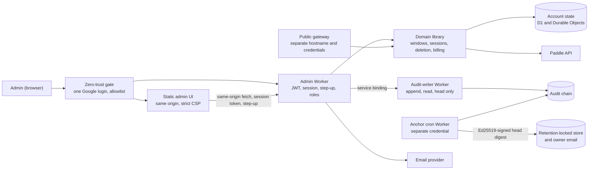

# StudentLLM Cloud admin interface

Status: planned, not implemented. This document is the design and the API contract of the admin interface of the optional cloud service. It is a draft for human review: every item marked "verify" must be checked against the platform's official documentation, and every legal point must be reviewed by a qualified lawyer before launch. No admin code exists in this repository yet, and the change that introduced this document touches only documentation and the contract validator.

Related documents:

- [cloud-admin.openapi.yaml](./cloud-admin.openapi.yaml): the machine-readable admin contract (OpenAPI 3.1), the source of truth for the admin API. [cloud-admin-fixtures/](./cloud-admin-fixtures/) holds conformance examples, including negative ones that must fail validation.
- [cloud-plan.md](./cloud-plan.md): the product and engineering plan (see its "Admin interface" section and the admin rows of its data table). [cloud-api.md](./cloud-api.md) and [cloud-api.openapi.yaml](./cloud-api.openapi.yaml): the public contract. This design does not change it; the changes it would need are listed in [Proposed amendments to the public contract](#proposed-amendments-to-the-public-contract).
- [SECURITY.md](../SECURITY.md): the credential and disclosure rules that apply here too.

## Contents

1. [Purpose, decisions and scope](#purpose-decisions-and-scope)
2. [Architecture and trust boundaries](#architecture-and-trust-boundaries)
3. [Authentication](#authentication)
4. [Roles](#roles)
5. [Request pipeline and conventions](#request-pipeline-and-conventions)
6. [Operations](#operations)
7. [Audit log](#audit-log)
8. [Safety rails and notifications](#safety-rails-and-notifications)
9. [Data tables](#data-tables)
10. [Admin UI](#admin-ui)
11. [Threat model](#threat-model)
12. [Rollout and phasing](#rollout-and-phasing)
13. [Validating the contract](#validating-the-contract)
14. [Proposed amendments to the public contract](#proposed-amendments-to-the-public-contract)
15. [Open items](#open-items)

## Purpose, decisions and scope

The owner is a solo founder. The admin interface lets the owner run the account operations that the public API deliberately does not offer: grant a free trial of a chosen length, cancel (résilier) a subscription, ban an account, delete an account, review sessions, and read an audit trail. Everything below follows decisions that are final for this design.

| Topic | Decision |
| --- | --- |
| Surface | A distinct hostname and the route prefix `/admin/v1`, its own OpenAPI file, and a small static web UI served only on the admin hostname. The desktop app never talks to it, the public contract does not list it, and the public API never accepts an admin credential. |
| Authentication | Defense in depth: (1) Cloudflare Access (or an equivalent zero-trust gate) with a single pinned Google login, an email allowlist and Google 2-step verification; (2) the admin service verifies the Access JWT itself and maps the verified email to an admin record, so a misconfigured gate fails closed; (3) every sensitive action needs an in-service WebAuthn step-up (user verification required) bound to that one action. No passwords, no shared accounts, no long-lived admin API keys. Break-glass is a manual runbook, not an endpoint. |
| Roles | `owner`, `admin`, `support` (read-only on account metadata) in the target design. **The first cut has the owner role only.** Only an owner manages admins; the last owner cannot be removed or demoted; nobody acts on their own admin record. |
| Privacy | The admin surface sees only what the service stores. There is never any course content, prompt or answer to show, no impersonation and no "login as user". Single-account reads are audit-logged with a declared purpose; search results are masked. |
| Writes | Every state change needs a reason, an idempotency key and the session token, goes through the same domain functions as the public API, runs as an operation with an outbox, and is blocked by a global freeze switch except for containment writes. No bulk operations in v1 except listing. |
| Audit | Append-only, written by a separate audit-writer Worker, double-chained (an unkeyed content chain that anyone can verify, and a keyed HMAC chain), anchored outside the database with Ed25519-signed digests, no IP address, no content, no raw token; the free-text reasons live outside the chain. No endpoint edits or deletes a row. |

**Scope: first cut and later.**

| | Operations |
| --- | --- |
| First cut (owner role only, bootstrapped by the script and runbook) | Search and read an account; grant a complimentary period, shorten it, revoke it; cancel a subscription (at period end, immediately) and resume a scheduled cancellation; suspend and unsuspend; delete an account with a cooling-off window; list and revoke devices and sessions; freeze and unfreeze; list, read, retry, withdraw and manually complete operations; WebAuthn credential management; audit list, export and verify. |
| Later (designed and in the contract, marked `x-phase: later`) | Invitations, role changes, disable and remove an admin, the `admin` and `support` roles, and the re-registration blocklist (including the blocklist options of suspension). |

The contract validator understands the flag: the later-phase routes must be exactly the invitation, admin-management and blocklist routes, and the matrix below shows the phase of every operation.

Non-goals for v1: refunds issued from the admin UI, bulk grants or bulk bans, editing a user's email, changing a user's data, any view of user content, automated provisioning of the Access allowlist, a customer-facing support portal.

## Architecture and trust boundaries



Boundaries and rules:

- **Deployments.** Three deployables, each with its own deploy credential: the admin Worker (API and static UI), the **audit-writer Worker**, and the **anchor cron Worker**. The public gateway lives on the API hostname and has no `/admin` route; a WAF rule on the public hostname also blocks `/admin/*`.
- **The admin module does not ship without the separate-Worker plan.** If the platform plan cannot host a separate audit-writer Worker with its own credential and a narrow service binding, the admin module is not deployed at all; a single-Worker fallback with a table in the same database would defeat the tamper evidence and is not an accepted fallback.
- **Audit-writer binding.** The admin Worker can call exactly three methods on the audit writer through a service binding: `append`, `read` and `head`. There is no update or delete method, and **`append` from the admin Worker cannot produce the chain-internal actions** (`audit.reconcile`, `retention.checkpoint`, `audit.key_rotate`): only the audit writer writes those. A **fourth method, `sign_anchor`, is exposed to the anchor cron Worker only** (a separate binding): the cron Worker reads the head, asks the writer to sign it, and publishes the result; it never holds a signing key. Only the audit writer holds the chain key, the anchor signing key and write access to the chain storage (verify that the platform can express this).
- **Credential separation.** The admin service accepts only the Access JWT (`Cf-Access-Jwt-Assertion`). It never accepts a StudentLLM access token or a manage token. The public gateway never accepts the Access JWT or any admin cookie; its token verifier pins its own issuer, audience and key set. Both directions are covered by tests.
- **Least secrets.** The admin Worker holds a Paddle API key restricted to the subscription operations it needs (verify that Paddle keys can be scoped), the email provider key and the keys it needs for the cursor MAC and the session token. It holds neither the inference-provider keys nor the token signing key of the gateway, and neither the chain key nor the anchor signing key (the audit writer), nor the **grant allowance key** (the keyed hash of the normalized email; it lives with the Worker that hosts the grant ledger). The blocklist key, when the blocklist ships, lives in a tiny checker component (see [Blocklist](#blocklist-later-phase)). Chain keys and anchor keys have ids (`ck1`, `ak1`, ...) so they can rotate. Separate secrets per environment (staging with Paddle sandbox, production).
- **Same domain functions.** Every state change calls the same domain library as the public API (windows, sessions, deletion, billing). Handlers in the admin Worker contain no storage writes of their own: a lint rule forbids direct storage imports there, and the invariant tests (plan windows, ledger, deletion) run against both surfaces. A function that needs an admin-only privilege takes a typed `actor` that only the admin Worker can construct.
- **No origin exposure.** The admin hostname is reachable only through the gate. The default `workers.dev` hostname **and the preview URLs** of the admin Worker are disabled (verify the setting for both), and the service refuses any request without a valid Access JWT even if the gate were bypassed.
- **No content anywhere.** The service stores none, so the admin service has none to show. Its operational logs hold request id, admin id, route, status and latency only.
- **Two switches, not one.** The admin freeze stops admin writes. The gateway kill switch of the cloud plan (per provider, per feature and global, plus the global spend cap) stops inference. They are separate: an admin compromise is answered with the freeze, a provider or cost incident with the kill switch, and neither depends on the other.

## Authentication

### Layer 1: the gate

Cloudflare Access (or an equivalent) in front of the admin hostname:

- **one identity provider**, pinned on the Access application (Google only; no other IdP and no one-time-PIN login is enabled on that application), with an explicit allowlist of email addresses;
- Google 2-step verification on the admin's Google account is required by policy. It is **defense in depth**, not the step-up: the service does not rely on the gate for the second factor of sensitive actions;
- session duration of the gate: at most 8 hours (verify the allowed values).

### Layer 2: the service verifies the JWT itself

Every request, including the requests for the static UI files, is processed as follows. Anything that fails returns `invalid_access_token` (401) and nothing else is evaluated:

1. The `Cf-Access-Jwt-Assertion` header is present. The cookie is not used as a substitute, and **`Cf-Access-Authenticated-User-Email` (or any other identity header) is never trusted.**
2. The signature is valid under a key from the Access team's JWKS, cached by `kid`. A key is refreshed on an unknown `kid` (rate limited). If the JWKS endpoint is unreachable, the **last known good set is used for at most 24 hours**; after that, or if there is no set at all, the service refuses every request. It never skips verification. The algorithm is pinned to the one the platform uses (verify); `none` and any other `alg` are rejected.
3. `iss` equals the team's issuer exactly.
4. `aud` contains the admin application's AUD tag and no other tag is accepted (a token issued for another internal tool behind the same Access team is useless here).
5. `exp` and `nbf` are honored with a small clock skew; `iat` is recorded.
6. The `email` claim is present. It is normalized (lower case) and mapped to an admin record by exact match.

Mapping outcomes: no record gives `admin_not_registered` (403); a `disabled` or `removed` record gives `admin_disabled` (403); both fail closed. The single exception is the later-phase `POST /admin/v1/invitations/accept`. There is no configuration flag, environment variable or debug mode that turns verification off.

### Layer 3: the admin session

The service keeps a **server-side session** per browser page load:

- `POST /admin/v1/session` creates it. The session is keyed by a **random 256-bit nonce** and bound to the Access identity: the JWT `sub` and the `iat` of the login that created it. The response carries the **session token** (`<nonce>.<mac>`, the MAC under a server key), returned once; the UI keeps it in memory only and sends it in `X-StudentLLM-Admin-CSRF` on every other request. A reload creates a new session; at most 3 sessions per admin exist, the oldest is ended.
- **Binding checks on every request:** the session exists and has not expired (idle 30 minutes, absolute 8 hours, never beyond the end of the Access session; otherwise `session_expired`); the presented JWT has the same `sub` as the session; its `iat` is not older than the session's login `iat`. A different `sub` ends the session.
- **When Access re-issues the JWT** (a new token with a newer `iat` and the same `sub` while the gate session continues; verify how Access does this): the session continues, the new `iat` is recorded, and **nothing about freshness changes**, because freshness is not a property of the session. When the gate session ends and the admin logs in again, the new JWT has a new login time; the old session is not extended by it and the UI creates a new one.
- A session ends at once when the admin is disabled or removed or their role changes, and on `POST /admin/v1/session/end`.
- The session record holds no JWT, no IP address and no user agent.
- **Creation is rate limited** (10 per admin per hour) and a gate identity can hold at most 3 live sessions. **When a live session is evicted by a new one, the owners are alerted** (an `admin.session_evict` row), because an unexpected eviction is the visible trace of a second holder of the same identity.

### Layer 4: step-up, per action

**Freshness is per action, never per session.** A sensitive action (the `Step-up` column of the matrix) needs an in-service **WebAuthn assertion with user verification required** that is bound to that action:

1. The UI computes the digest of the request it is about to send (method, full path, SHA-256 of the canonical body) and calls `POST /admin/v1/stepup/challenge`.
2. The service stores a **single-use challenge valid for 5 minutes** bound to that method, full path and body hash, and returns the WebAuthn request options (`userVerification: required`).
3. The browser asks the owner's security key or platform authenticator (`navigator.credentials.get`). **No navigation and no popup: the dialog and its form state stay as they are.**
4. The UI sends the action with the assertion in `X-StudentLLM-Admin-StepUp` (`<challenge_id>.<assertion>`).
5. The service checks, in this order: the challenge exists, is unused and unexpired, and its binding equals the request actually received (method, path, body hash); the credential belongs to this admin; the origin and RP id hash are right; the user-verified flag is set; the signature verifies; the signature counter increases. The challenge is **consumed in the same transaction** as the idempotency record of the action. Failures give `stepup_invalid`; a missing header gives `stepup_required`.

One step-up covers one action. A retry of the same request with the same idempotency key is answered from the idempotency record without a new step-up. A stolen session token cannot create freshness, and neither can a replayed assertion (single use, bound to the request).

**Credential rules.** A credential is accepted at registration only if all of these hold: user verification was performed; `authenticatorAttachment` is `cross-platform` (a security key) and the credential is **not backup-eligible** (the backup-eligible flag is 0, so it cannot be synced to a cloud account); the attestation format `none` is accepted (no attestation chain is required); `rpId` and the origin are pinned to the **exact admin hostname** (no parent domain, no wildcard). At every assertion the service checks that the challenge was issued **to the same admin and the same session** as the request that carries it. **Signature counter rule:** if the stored counter and the new one are both 0 the assertion passes (many keys do not implement a counter); if the new counter is greater than the stored one it passes and is stored; a counter that is equal and non-zero, or lower, fails with `stepup_invalid`, raises an owner alert, and marks the credential suspect. The lockout risk of a false positive (a key whose counter was reset) is handled by having two registered keys: the second key still works, the suspect key can be removed (a containment write) and registered again. The credential id used is recorded in the audit row of the action.

### CSRF and origin checks

The Access cookie is an ambient credential, so every request is protected:

- the session token (the CSRF token) in `X-StudentLLM-Admin-CSRF` on every route except `createAdminSession` and, in the later phase, `acceptInvitation`;
- `Origin` must equal the admin hostname and `Sec-Fetch-Site` must be `same-origin`; `Content-Type` must be `application/json` on POST; there is no CORS and no cookie set by the service;
- `acceptInvitation` is exempt from the session header because the invited identity has no session yet; the unguessable single-use code is its CSRF defence, and the origin, fetch-metadata and content-type checks still apply. The validator lists this exception explicitly, together with `createAdminSession`.

### Bootstrap, credentials, and loss

- **Bootstrap (script and runbook).** Before the first deployment the operator adds their email to the Access allowlist and runs the bootstrap script with platform credentials. It inserts the first owner (an `admin.bootstrap` audit row with `actor_kind = system`), and prints a **single-use enrollment ticket** once. The owner opens the admin UI, signs in through the gate, and registers the first WebAuthn credential with the ticket (`beginCredentialRegistration`, `completeCredentialRegistration`). No endpoint can create the first owner.
- **Two credentials.** At least two credentials are registered: a primary hardware key and a backup key kept offline. The session reports `credentials_count`; the UI warns while it is below 2. Later credentials need a step-up with an existing one, and the **enrollment ticket is accepted only while `credentials_count` is 0** and for 1 hour. The last credential cannot be removed (`state_conflict`); removing any other credential is a **containment write** (owner plus step-up, allowed while frozen), so a stolen key can be removed during an incident.
- **Lost both credentials.** The owner runs the recovery path of the bootstrap script with platform credentials: it revokes the old credentials and issues a new enrollment ticket that becomes valid only after a **24-hour waiting period**, announced on the out-of-band alert channel. **The recovery is cancelled by running the cancel step of the same platform script, authenticated by the same platform credentials that started it (owner-authenticated); the alert message tells the owner to do so if the recovery was not theirs.** There is no unauthenticated cancel link, because a link in an alert could itself be abused to prevent a legitimate recovery. This is the one situation where platform access replaces a second factor, and it is why the platform account itself must be protected (see [Threat model](#threat-model)).
- **Succession.** A sealed set of instructions and the offline backup key are held by one trusted person (and described to the lawyer): how to reach the platform account, which steps freeze the service, how to cancel the Paddle subscriptions in the dashboard, and how to wind the service down or hand it over. A second owner is a later-phase option.

### Runbooks (manual, not endpoints)

Each procedure writes an audit row with `actor_kind = system` (or is back-filled once the writer is reachable) and sends an owner alert.

- **Suspected admin compromise.** Freeze writes. Destroy the admin session (disable the admin record in the later phase; in the first cut, revoke the Access sessions of the owner in the gate and remove the suspect credential, which is a containment write and works while frozen). Review the audit rows of that admin and the platform logs. Unfreeze only after the cause is understood.
- **Freeze override (last resort).** Set the platform variable that forces the frozen state without the database or the audit writer.
- **Misconfigured gate or lost owner access.** (1) Set the override so no write and no system-driven execution can happen. (2) Repair the identity provider or the Access policy. (3) If the owner is locked out, run the bootstrap script's recovery path (24-hour wait). (4) Rotate the chain, anchor, cursor and blocklist keys if the platform credentials were exposed, run `verifyAuditChain` and the offline verifier, and record the incident.
- **Restore of a database snapshot.** After any restore, run the erasure re-application script against the **deletion ledger** (see [Delete an account](#5-delete-an-account)) before the service accepts traffic.
- **Never.** Expose the admin service without the gate, add a bypass flag, create a long-lived admin token, or edit audit rows by hand (an edit would break the chain and be detected).

## Roles

The target design has three roles ordered `support` < `admin` < `owner`; a higher role includes the lower ones except where a route is marked owner only. **In the first cut only the owner exists**, so every operation is effectively owner-only; the roles in the matrix are the minimum role of the target design and are kept in the contract so that it does not change when the other roles ship. The role-matrix test calls every route with every role.

Rules that apply regardless of role:

- **Self-action on the admin record.** An admin cannot change, disable, enable or remove their own admin record, and cannot grant themselves a role (`self_action_forbidden`). To transfer ownership (later phase), invite a new owner; that owner then removes the old record.
- **Own user account.** **All** write operations on a target account (grants, cancellations, suspension, deletion, session or device revocation, retrying or withdrawing its operations) are refused when the target account's verified email equals the acting admin's email, after the **same aggressive normalization as the blocklist**: lower case, IDNA domain, the `+tag` removed, and for `gmail.com` and `googlemail.com` the dots of the local part removed and the domain unified. This is a guard rail, not a security boundary; the founder tests with a separate test account on another domain. Reads are allowed.
- **Last owner.** The last enabled owner cannot be removed, disabled or demoted (`last_owner_protected`). Because nobody can act on their own record and only owners act on owners, the rule matters under concurrency and for scripts. All admin-registry changes go through **one serialised admin-registry object** (a single Durable Object); the count of remaining enabled owners and a re-check of the acting admin's own state are evaluated in the same transaction as the change, so two owners removing each other at the same moment cannot both succeed.
- **Roles are never taken from a request.** The role of an invitation is stored server-side.
- **Owner-only fields.** Overriding the default grant budget (`budget_percent`) and a cooling-off of 0 hours for a deletion are owner only.

## Request pipeline and conventions

Order of checks. Later checks never run if an earlier one fails, so a caller learns nothing about what lies beyond:

1. Access JWT (`invalid_access_token`).
2. Admin record and status (`admin_not_registered`, `admin_disabled`).
3. Session token, `Origin`, `Sec-Fetch-Site`, content type (`session_expired`, `csrf_invalid`).
4. Per-admin rate limit (`rate_limited`).
5. Role (`forbidden_role`, with `details.required_role`).
6. **Idempotency lookup** for state-changing routes: a finished request with the same key and digest is answered from the stored result here (`Idempotent-Replay: true`); a running one gives `idempotency_conflict`; a different digest gives `payload_mismatch`.
7. Global freeze, for writes that are not containment writes (`admin_writes_frozen`).
8. Step-up, where required (`stepup_required`, `stepup_invalid`).
9. Body validation against the schema, including the reason rules (`invalid_request`, `confirmation_mismatch`, `limit_exceeded` for configured bounds).
10. Target preconditions inside the domain transaction: target exists and the child resource belongs to the account in the path (`not_found`), self-action, state (`state_conflict`), window rules (`window_overlap`), caps (`limit_exceeded`), last owner (`last_owner_protected`), and the rule of **one non-terminal operation per (account, kind)** (`state_conflict` with `details.operation_id`).
11. The write-ahead audit intent, the domain function through an operation and its outbox, and the audit completion (see [Audit log](#audit-log)). If the intent cannot be written, nothing changes and the answer is `audit_unavailable` (503).

Denied attempts (steps 2, 5, 8 and 10) are themselves written as audit rows with `result = denied`, capped per admin per hour so that an attacker cannot flood the log; past the cap, one `audit.denied_overflow` row with the count of suppressed rows is written per window. Attempts from a verified identity that has no admin record (`actor_kind = unregistered`) are subject to a **global cap** per hour across all such identities, with the same overflow row.

**Reason.** Every state change carries a mandatory `reason` of 10 to 500 characters. It is stored outside the audit chain (see [Audit log](#audit-log)). The UI says to state the category and the facts and **not** to enter names, email addresses or other personal data (it does not suggest ticket references); the server rejects strings that look like an email address. Optional notes follow the same rule.

**Idempotency.** Every state-changing route takes `Idempotency-Key` (a UUID), scoped per admin, kept 24 hours. Unlike the public API, admin requests carry no user content, so the record stores a **SHA-256 over the method, the full path (with query) and the canonical body** (RFC 8785 JSON canonicalization):

| Situation | Result |
| --- | --- |
| Same key, same digest, first call finished | The original status and body again, with `Idempotent-Replay: true`. Nothing runs twice and no new step-up is needed. |
| Same key while the first call is still running | 409 `idempotency_conflict`, `details.state = in_progress`. |
| An `in_flight` record older than its TTL (120 seconds) | The same request can take it over; the operation id is derived from the key, so the underlying operation is not duplicated. |
| Same key, different digest | 409 `idempotency_conflict`, `details.state = payload_mismatch`. |
| A call rejected before the domain function (validation, role, freeze, step-up) | Not recorded; the same key may be reused after fixing the request. |

Operations that are naturally idempotent (revoke, withdraw) also return success when repeated against the already-changed target. The read-only POST routes (`searchAccounts`, `createStepUpChallenge`, `beginCredentialRegistration`, `endAdminSession`, `createAdminSession`) and the single-use `acceptInvitation` take no idempotency key and no reason.

**Pagination.** Cursor pagination as in the public contract: `limit` and `cursor` in, `data` and `next_cursor` out. Maximum page sizes: 25 for account search, 100 elsewhere. A cursor is an **HMAC-bound opaque value tied to the filter and the role** that produced it; replaying it with another filter or role gives `invalid_request`, so a cursor cannot be used to widen a search or cross a role boundary. Offset pagination is not used.

**Rate limits** (configuration, per admin; defaults for review):

| Class | Default |
| --- | --- |
| Session and system reads | 60 per minute |
| Admin session creation | 10 per hour, at most 3 live sessions |
| Account search | 20 per minute and 300 per day; distinct accounts surfaced: 200 per day |
| Single-account reads, lists | 120 per minute |
| State changes | 30 per minute |
| Destructive actions (delete, suspend, cancel at period end or immediately, credential removal, role change, remove, freeze) | 10 per hour |
| Step-up challenges | 30 per hour |
| User emails caused by one admin | 30 per hour |
| Invitation accept attempts (later phase) | 5 per invitation, 10 per hour per identity |
| Audit export | 5 per day |

**Auto-freeze.** If one admin performs **5 destructive actions or 25 write actions within 10 minutes** (configuration), the service freezes admin writes by itself (`system.auto_freeze` audit row) and pages the out-of-band alert channel. **Denied attempts of a registered admin count** toward these thresholds (a burst of refused destructive requests is itself a compromise signal); attempts by unregistered identities are covered by their own global cap. An owner unfreezes with a step-up.

**Errors.** One envelope, the same style as the public API (`error.code`, `error.message`, `error.request_id`, optional `retry_after_seconds` and `details`). Messages are short English and never contain content, secrets or provider text. The admin code list (`ErrorCode` in the admin contract) is separate from the public one.

| Code | HTTP | Meaning |
| --- | --- | --- |
| `invalid_request` | 400 | Malformed request, unknown field, a later-phase field in the first cut, bad reason, an email-like string in a free-text field, or a cursor used with another filter or role |
| `confirmation_mismatch` | 400 | The typed confirmation does not equal the account id |
| `invitation_invalid` | 400 | Later phase. Wrong, expired, used or over-attempted code, or an identity whose email differs from the invitation (one generic answer) |
| `invalid_access_token` | 401 | Missing or invalid Access JWT |
| `session_expired` | 401 | Unknown, expired or mismatched admin session; the UI starts a new one |
| `stepup_required` | 401 | The action needs a step-up and none was sent; `details.challenge_endpoint` |
| `stepup_invalid` | 401 | The step-up failed verification (one generic answer) |
| `admin_not_registered` | 403 | Verified identity with no admin record |
| `admin_disabled` | 403 | Admin record disabled or removed |
| `forbidden_role` | 403 | The role is too low; `details.required_role` |
| `self_action_forbidden` | 403 | Acting on one's own admin record or user account |
| `csrf_invalid` | 403 | Origin or fetch-metadata check failed, or the session token header is missing |
| `not_found` | 404 | Unknown resource, or a child resource that does not belong to the account in the path |
| `idempotency_conflict` | 409 | `details.state` is `in_progress` or `payload_mismatch` |
| `state_conflict` | 409 | The target is in a state that does not allow this, or another non-terminal operation of the same kind exists; `details.current_status` or `details.operation_id` |
| `window_overlap` | 409 | A grant would overlap or stack on another budget window |
| `last_owner_protected` | 409 | The change would leave no enabled owner |
| `limit_exceeded` | 422 | A configured cap or bound would be exceeded; `details.limit`, `max`, `current` |
| `rate_limited` | 429 | Per-admin rate limit; `Retry-After` |
| `admin_writes_frozen` | 503 | The global freeze is on |
| `audit_unavailable` | 503 | The audit intent could not be written, so nothing was done |
| `internal_error` | 500 | Unexpected failure |

## Operations

All routes are in the contract. The matrix below is generated from the contract's `x-` extensions and checked against them by the validator: a mismatch fails the build. **Step-up** is the in-service WebAuthn assertion bound to the action. **Frozen** says whether the route works while admin writes are frozen (reads always do). **Owner email** says whether the owners are emailed. The role is the minimum role of the target design; in the first cut only the owner exists. The audit action is `-` where a route is not audited.

<!-- operation-matrix:start -->
| Operation | Route | Role | Step-up | Frozen | Phase | Owner email | Audit action |
| --- | --- | --- | --- | --- | --- | --- | --- |
| `createAdminSession` | `POST /admin/v1/session` | support | no | yes | first | no | `admin.session_start` |
| `getAdminSession` | `GET /admin/v1/session` | support | no | yes | first | no | `-` |
| `endAdminSession` | `POST /admin/v1/session/end` | support | no | yes | first | no | `admin.session_end` |
| `createStepUpChallenge` | `POST /admin/v1/stepup/challenge` | support | no | yes | first | no | `-` |
| `listCredentials` | `GET /admin/v1/credentials` | owner | no | yes | first | no | `credential.list` |
| `beginCredentialRegistration` | `POST /admin/v1/credentials/registration/options` | owner | no | no | first | no | `-` |
| `completeCredentialRegistration` | `POST /admin/v1/credentials/registration/complete` | owner | yes | no | first | yes | `admin.credential_register` |
| `removeCredential` | `POST /admin/v1/credentials/{credential_id}/remove` | owner | yes | yes | first | yes | `admin.credential_remove` |
| `getSystemState` | `GET /admin/v1/system` | support | no | yes | first | no | `-` |
| `freezeAdminWrites` | `POST /admin/v1/system/freeze` | admin | no | yes | first | yes | `system.freeze` |
| `unfreezeAdminWrites` | `POST /admin/v1/system/unfreeze` | owner | yes | yes | first | yes | `system.unfreeze` |
| `searchAccounts` | `POST /admin/v1/accounts/search` | support | no | yes | first | no | `account.search` |
| `getAdminAccount` | `GET /admin/v1/accounts/{account_id}` | support | no | yes | first | no | `account.read` |
| `listAccountDevices` | `GET /admin/v1/accounts/{account_id}/devices` | support | no | yes | first | no | `account.devices_read` |
| `revokeAccountDevice` | `POST /admin/v1/accounts/{account_id}/devices/{device_id}/revoke` | owner | yes | yes | first | no | `device.revoke` |
| `revokeAllAccountSessions` | `POST /admin/v1/accounts/{account_id}/sessions/revoke-all` | owner | yes | yes | first | no | `sessions.revoke_all` |
| `listAccountGrants` | `GET /admin/v1/accounts/{account_id}/grants` | support | no | yes | first | no | `grant.list` |
| `createGrant` | `POST /admin/v1/accounts/{account_id}/grants` | admin | no | no | first | no | `grant.create` |
| `getGrant` | `GET /admin/v1/grants/{grant_id}` | support | no | yes | first | no | `grant.read` |
| `shortenGrant` | `POST /admin/v1/grants/{grant_id}/shorten` | admin | no | no | first | no | `grant.shorten` |
| `revokeGrant` | `POST /admin/v1/grants/{grant_id}/revoke` | owner | yes | yes | first | no | `grant.revoke` |
| `getGrantStats` | `GET /admin/v1/stats/grants` | admin | no | yes | first | no | `grant.stats_read` |
| `cancelAtPeriodEnd` | `POST /admin/v1/accounts/{account_id}/subscription/cancel-at-period-end` | admin | no | no | first | yes | `subscription.cancel_at_period_end` |
| `cancelImmediately` | `POST /admin/v1/accounts/{account_id}/subscription/cancel-immediately` | admin | yes | no | first | yes | `subscription.cancel_immediately` |
| `resumeSubscription` | `POST /admin/v1/accounts/{account_id}/subscription/resume` | admin | no | no | first | no | `subscription.resume` |
| `listOperations` | `GET /admin/v1/operations` | support | no | yes | first | no | `operation.list` |
| `getOperation` | `GET /admin/v1/operations/{operation_id}` | support | no | yes | first | no | `operation.read` |
| `retryOperation` | `POST /admin/v1/operations/{operation_id}/retry` | admin | yes | no | first | no | `operation.retry` |
| `withdrawOperation` | `POST /admin/v1/operations/{operation_id}/withdraw` | owner | yes | yes | first | no | `operation.withdraw` |
| `completeOperationManually` | `POST /admin/v1/operations/{operation_id}/complete-manually` | owner | yes | no | first | yes | `operation.complete_manually` |
| `suspendAccount` | `POST /admin/v1/accounts/{account_id}/suspend` | admin | yes | no | first | yes | `account.suspend` |
| `unsuspendAccount` | `POST /admin/v1/accounts/{account_id}/unsuspend` | admin | yes | no | first | yes | `account.unsuspend` |
| `listBlocklist` | `GET /admin/v1/blocklist` | admin | no | yes | later | no | `blocklist.list` |
| `removeBlocklistEntry` | `POST /admin/v1/blocklist/{entry_id}/remove` | admin | yes | no | later | yes | `blocklist.remove` |
| `requestAccountDeletion` | `POST /admin/v1/accounts/{account_id}/deletion` | admin | yes | no | first | yes | `account.delete_request` |
| `listAdmins` | `GET /admin/v1/admins` | owner | no | yes | later | no | `admin.list` |
| `listInvitations` | `GET /admin/v1/invitations` | owner | no | yes | later | no | `invitation.list` |
| `createInvitation` | `POST /admin/v1/invitations` | owner | yes | no | later | yes | `admin.invite` |
| `acceptInvitation` | `POST /admin/v1/invitations/accept` | invitee | no | no | later | yes | `admin.invitation_accept` |
| `revokeInvitation` | `POST /admin/v1/invitations/{invitation_id}/revoke` | owner | no | no | later | no | `admin.invitation_revoke` |
| `changeAdminRole` | `POST /admin/v1/admins/{admin_id}/role` | owner | yes | no | later | yes | `admin.role_change` |
| `disableAdmin` | `POST /admin/v1/admins/{admin_id}/disable` | owner | yes | yes | later | yes | `admin.disable` |
| `enableAdmin` | `POST /admin/v1/admins/{admin_id}/enable` | owner | yes | no | later | yes | `admin.enable` |
| `removeAdmin` | `POST /admin/v1/admins/{admin_id}/remove` | owner | yes | yes | later | yes | `admin.remove` |
| `listReviewItems` | `GET /admin/v1/review-items` | owner | no | yes | first | no | `review.list` |
| `resolveReviewItem` | `POST /admin/v1/review-items/{review_item_id}/resolve` | owner | no | no | first | no | `review.resolve` |
| `listAuditLog` | `GET /admin/v1/audit` | admin | no | yes | first | no | `audit.list` |
| `exportAuditLog` | `POST /admin/v1/audit/export` | owner | yes | yes | first | yes | `audit.export` |
| `verifyAuditChain` | `POST /admin/v1/audit/verify` | owner | no | yes | first | yes | `audit.verify` |
<!-- operation-matrix:end -->

**Writes allowed while frozen.** Containment writes are the actions needed to stop damage during an incident: they are owner plus a step-up. The freeze itself needs no step-up so that it is fast. Export and verify of the audit log are investigation actions and also work. Every other write is refused with `admin_writes_frozen`, and the system pauses every execution step of an admin-originated operation (see [How a write runs](#how-a-write-runs)).

<!-- frozen-list:start -->
- `removeCredential`: containment write
- `freezeAdminWrites`: freeze, no step-up so that it is fast
- `unfreezeAdminWrites`: unfreeze, owner plus step-up
- `revokeAccountDevice`: containment write
- `revokeAllAccountSessions`: containment write
- `revokeGrant`: containment write
- `withdrawOperation`: containment write
- `disableAdmin`: containment write
- `removeAdmin`: containment write
- `exportAuditLog`: investigation
- `verifyAuditChain`: investigation
<!-- frozen-list:end -->

### How a write runs

Every admin write that touches more than one store (the account object, D1, Paddle, the email provider) runs as an **operation with an outbox**, not as a sequence of inline calls:

1. The write-ahead audit **intent** row (`result = pending`, recording the credential id used for the step-up) is appended.
2. The operation is created with an **id derived from the idempotency key**, so the same request always finds the same operation. There is one non-terminal operation per account and kind. Its steps are recorded in an outbox in the same transaction as the first step.
3. **The account object is written first and fails closed** (suspension, window changes, revocations take effect on the very next inference request). D1, Paddle and email follow as retryable steps, each idempotent.
4. When the steps are done, the audit **completion** row (`success` or `failed`) is appended and the operation is `completed`.
5. A **reconciler** (a scheduled job and an on-access sweep) finds intents with no completion, **finds the operation by the key-derived id**, inspects the domain state, and appends the completion (`audit.reconcile`, a chain-internal row written by the audit writer) or finishes the outbox.

The response of a write carries the `operation_id`, so the UI can show the state. A step that cannot finish stays visible as `pending` with a retry time; a step that exhausts its retries is `failed` and alerts the owner.

**Containment writes do not depend on the audit writer being up.** Freeze, unfreeze and every containment write (revoke a device, revoke all sessions, revoke a grant, withdraw an operation, remove a credential, and in the later phase disable and remove an admin) write a **durable local journal entry in the same transaction as their effect**, take effect, and back-fill the audit rows when the writer is reachable again. They are marked `x-audit-independent` and declare no 503. If the journal itself cannot be written, the documented **platform-script fallback** (run by the owner with platform credentials) performs the containment and records it. A write that is not containment still requires the intent row and answers `audit_unavailable` without it.

**While frozen, and at execution time.** Before each system-driven execution step of an admin-originated operation (deletion execution, immediate-cancel retries and every other Paddle write; lifting an expiry and the containment steps are exempt) the system **re-validates**: the requesting admin is still enabled, the freeze is off, and the account is still in the state the operation expects. Otherwise the operation moves to `held` with a `hold_reason` (`freeze`, `requester_disabled`, `account_state_changed`), an `operation.hold` row is written and the owner is alerted. Lifting an expiry (a suspension that ends, a grant that expires) is allowed during a freeze because it only restores access.

- **Resuming a held operation needs a step-up.** `retryOperation` is a step-up route; resuming a held **deletion** through it **restarts the cooling-off clock** (a new `executes_at`), so a deletion that was held cannot execute the instant it is released.
- **Held time does not consume the retry budget.** The 14-day Paddle retry budget counts only time spent actually retrying, not time held.
- **A user's own erasure is not held by an admin freeze.** The freeze stops admin-originated operations. A deletion the user requested through `DELETE /v1/account` is a user right and runs regardless; it also supersedes a held or cooling-off admin deletion of the same account.

### 1. Search and read an account

**Search** (`searchAccounts`) is a POST with a JSON body, so an email address never appears in a URL, a log line or browser history. A **key lookup** stands alone: the exact `email` (normalized as the service does), an `email_prefix` of at least 6 characters, or an `account_id`. A `status` or `plan_id` filter is valid only together with a creation window of at most 7 days (`created_from`, `created_to`); a search by status or plan alone is refused. Results are **masked** (`jo***@gmail.com`: the first two characters of the local part, the domain); the full email is revealed only by the audited account read. A page holds at most 25 results, the route has a tight rate limit, and the **number of distinct accounts an admin may surface per day is capped** (`limit_exceeded`, `search_distinct_accounts_per_day`). The audit row records the kind of query, the number of results and a **keyed HMAC of the query value** (computed by the audit writer under the audit key from a transient field that is never stored), never the value itself; the owner can later test "did anyone search for this address" by computing the HMAC with the key.

**Read** (`getAdminAccount`) returns, for one account: id, the full verified email, login methods, status (with category, start and end of a suspension), terms version, created, last sign-in and last request times, the plan, the budget windows (past, current, scheduled, each with its source), usage totals for the current and two previous windows (credits and requests, split by feature), an optional daily series if the retained totals have that granularity, the device count, the active consent summary, the Paddle customer and subscription ids (hidden below the admin role), and pending operations. Nothing else: no content, no prompt, no answer, no IP address, no token. The request must declare a **`purpose`** (`support_request`, `abuse_review`, `billing_issue`, `legal_request`, `security_incident`, `testing`, `other`), which is recorded in the audit row. Every call writes an `account.read` row **before** the response is sent; if that write fails, the read fails (`audit_unavailable`). Responses are `Cache-Control: no-store`.

Every list and every single-record read is audited: `account.search`, `account.read`, `account.devices_read`, `grant.list`, `grant.read`, `grant.stats_read`, `operation.list`, `operation.read`, `credential.list`, `audit.list` and, in the later phase, `admin.list`, `invitation.list` and `blocklist.list` (with the result count only).

### 2. Grant a complimentary period (free trial)

`POST /admin/v1/accounts/{account_id}/grants` creates a grant and its budget windows with source `admin_grant`. No payment, no Paddle object.

Request: `days` (an explicit integer from 1 to the configured maximum, never above the contract ceiling of 90), `budget_percent` (percent of the standard window; default 100; **overriding the default is owner only**), `start_policy` (`now` or `after_current_windows`), a mandatory `reason`, a `reason_category` (trial, beta_tester, support_goodwill, compensation, partner, testing, other), an optional `note`, and `notify_user` (default true).

**Budgets are multiples of the standard window.** Let **W** be the credit limit of one standard Plus window, taken from the routing table. The plan sizes W so that a user who spends all of it costs at most about 1.50 EUR (chat, the transcription and OCR reserve and the overhead, see [Unit economics](./cloud-plan.md#unit-economics)). Every grant limit below is a multiple of W, not a number of credits, so the money ceiling follows W automatically and cannot drift from it. The credit numbers in the fixtures and the wireframes (12,500) are examples of W only.

**Windows.** A grant is cut into windows of at most 30 days; the last window is prorated and its budget rounded down. Each window has `budget_percent` of W. A 90-day grant at 100 percent is three windows, 3W, about 4.50 EUR of worst-case provider cost.

**Windows converge to the plan record.** Paid periods live in the **plan record**, the CAS-updated authority for plan state. The ledger windows **converge** to it (`syncWindows`): a paid period reaches the ledger through `ensureWindow`, which for paid windows is an **upsert with no overlap rejection**, so a renewal, a proration or a late `past_due` recovery can never fail because of a grant. **Paid periods take precedence and cut grant windows.** Grants are the only windows that are checked for overlap: a grant inserts **all of its windows in one all-or-nothing step**, with the overlap check inside the account object (the single serialised section per account). A failed grant leaves nothing behind, and two parallel grants cannot both succeed.

**Sources.** The admin contract reports three sources: `paddle_subscription`, `paddle_pass` and `admin_grant`. They map onto the stored window source `paddle` plus the plan period kind (`subscription` or `pass`) for paid windows, and onto the stored source `grant` for grants. **Plan id.** The admin view reports `plus_complimentary` for an account whose only active window is a grant. Until the public `Plan.id` enum has that value (amendment A2), the public API reports such an account as `free` and does not expose the `source` field.

**The cut instant, defined once.** When a paid period begins while a grant window is active or queued, the grant windows are cut at the **later of the purchase time and the paid period's start**, by the same step that records the paid period in the plan record and converges the ledger, so there is no instant where both are active or neither.

| Rule of the plan | How grants behave |
| --- | --- |
| One window per paid period, budgets never stack | A grant with `start_policy: now` while any paid or granted window is active is refused with `window_overlap` (the response names the conflicting source and end). A paid period never fails because of a grant: it takes precedence. |
| Queueing (semester pass windows queue after the current ones) | `after_current_windows` queues the grant after the last window whose end is known: a semester pass, a granted period, or a subscription set to cancel at period end. It is refused for an auto-renewing subscription, whose end is unknown. |
| `already_subscribed` (an active plan exists) | An active grant does not count as an active plan, so a user whose grant is running can still subscribe or buy a pass (see A3). The grant is cut at the instant defined above. The cut is a system `grant.shorten` row. Credits already used stay used. |
| Refunds and chargebacks revoke the current and future windows | They revoke only paid windows (stored source `paddle`). A **refund** that revokes the paid window within the grant's original period **restores the unused remainder of the grant**: the grant returns to `active` from the refund to its original end, each restored window limited to what was released at the cut, **and capped at the headroom that remains in the monthly cap; the excess is dropped and an owner review item is raised**. A **chargeback** does not restore automatically; it raises an owner review item (`listReviewItems`, `resolveReviewItem`). |
| `past_due` | A grant is refused while a paid window is still active. If the paid window has ended and payment is outstanding, a grant is allowed; a payment that later succeeds starts a paid window that cuts the grant. |
| A resubscribe loop cannot reset a budget | Unchanged. A grant is the only way to add a window without payment, and it is capped as below. |
| Windows are keyed by their start | A replay (the same idempotency key) never creates a second window or resets used credits. |
| Plan lapse | When the last grant window ends the account is a free account; the local app is unchanged. There is no automatic conversion and no automatic charge. |

**Cost ceiling and caps.** A grant earns no revenue, so its cost is pure cost and is capped at five levels, each a configuration value at or below its contract ceiling:

| Cap | Default for review | Error |
| --- | --- | --- |
| Per window: `budget_percent` | 100 (ceiling 200); override owner only | `limit_exceeded` (`grant_max_percent`) |
| Per grant: the sum of its window limits | at most 300 percent of W | `limit_exceeded` (`grant_max_total_percent`) |
| Per account: grant days in a rolling 12 months, **also tracked per normalized email** | 180 | `limit_exceeded` (`grant_max_days_per_account_per_year`) |
| Per admin: grants created per day | 20 | `limit_exceeded` (`grant_max_per_admin_per_day`) |
| Global: the window limits committed to grants starting in a calendar month, in multiples of W | `[PLACEHOLDER: set from the monthly budget; for example 50 W, about 75 EUR at the ceiling]` | `limit_exceeded` (`grant_monthly_cap_windows`) |

**Contract ceilings** (the schema maxima; configuration can lower them, raising one needs a new contract version; the validator checks this table against the schema):

<!-- ceilings:start -->
| Field | Ceiling |
| --- | --- |
| `days` | 90 |
| `budget_percent` | 200 |
| `grant_max_total_percent` | 600 |
| `grant_max_days_per_account_per_year` | 365 |
| `grant_max_per_admin_per_day` | 100 |
| `suspension_max_days` | 365 |
| `deletion_max_cooling_off_hours` | 72 |
<!-- ceilings:end -->

- **Atomicity: reserve, insert, confirm.** The caps are enforced by **one atomic counter object** (a single Durable Object, the grant ledger). A grant first **reserves** its commitment there (the monthly commitment, the per-email allowance and the per-admin count are one atomic step that commits all of them or none), then inserts its windows in the account object, then **confirms** the reservation. An **orphan reservation** (a crash between the steps) expires after a TTL of 10 minutes and is released by the ledger, and the reconciler finishes or cancels the grant. A check followed by a write in another store, without the reservation, is not acceptable; a test with parallel grant requests, and one that crashes between reserve and insert, must never exceed a cap or leak a commitment. D1 is a mirror.
- **Every affected month.** A window counts in the calendar month (UTC) in which it starts. A grant spanning several months is checked and committed for each of them in the same atomic step.
- **The yearly cap follows the person, not the account.** The allowance counter is keyed by a keyed hash of the normalized email (same normalization as the blocklist) and survives account deletion for its window, so deleting and re-registering does not reset it. It stores no raw email (see the data tables and the lawyer items).
- **Accounting on shorten and revoke.** Each affected window keeps `max(used, committed share of the retained days)` committed, and the difference is released to the counters. Used credits stay used and counted. A window that is removed entirely keeps its `used`.
- **Cost monitoring.** The gateway's running spend per day and month is split into paid and granted. `GET /admin/v1/stats/grants` shows credits granted and used by month and the committed share of the monthly cap; the operator is alerted at 50%, 80% and 100% of the cap. At 100% new grants are refused; existing grants continue. The global spend cap and the kill switch of the cloud plan apply to granted usage like any other.

**Preconditions.** The account must be `active`. The target cannot be the acting admin's own user account.

**Shorten and revoke.** `shorten` moves the end earlier, never later (a longer period is a new grant, so the caps apply again); windows after the new end are removed and the window containing it is cut. `revoke` is a containment write: it ends all of the grant's windows now, the remaining credits become unusable on the next request, **and an open stream aborts at its next heartbeat** (see the amendment on the inference path). Only the grant's own windows are touched. The plan version is bumped so the app refetches the account.

**User notification.** "You received a complimentary StudentLLM Plus period until <date>" with the budget, and a plain sentence that nothing is charged and nothing renews automatically. No marketing wording.

### 3. Cancel and resume a subscription (via Paddle)

Three routes, so that each has its own step-up, flags and owner notification:

- `cancelAtPeriodEnd` calls Paddle's cancel-subscription API with the next-billing-period effect (verify). When Paddle confirms, `cancel_at_period_end` becomes true; the current window continues to its end and no further window starts. No re-subscription loop is possible because `already_subscribed` already covers a subscription set to cancel.
- `cancelImmediately` (action-bound step-up) cancels now. When Paddle confirms, the current paid window ends at that instant: the remaining credits become unusable and the plan lapses to free. **No refund is issued by this route**; the owner decides on a refund in the Paddle dashboard, and the resulting adjustment event is handled by the existing refund rule. The UI says so before the confirmation.
- `resumeSubscription` removes a cancellation scheduled for the end of the period, before it takes effect. It is refused when nothing is scheduled. Paddle's way of removing a scheduled change (an update of the subscription clearing it) is marked **verify**.

A **semester pass** is a one-time payment with no subscription, so there is nothing to cancel at Paddle: the cancel routes return `state_conflict`. Ending a pass early is a window revocation plus a refund decision, a later operation.

**Every cancel emails the owners**, and the user is always notified (there is no switch to turn the user's email off).

**Operation and the `pending` state.** The routes answer 202 with an `Operation`. Windows and plan flags change only after Paddle confirms. If the Paddle call fails or times out, the operation stays `pending` with `last_error_code` (a fixed code such as `paddle_unavailable`, never provider text), `attempts` and `next_retry_at`: the system retries with bounded exponential backoff, alerts the owner after repeated failures, and moves the operation to `failed` when the retry budget is spent. The account detail shows `cancel_pending`, `GET /admin/v1/operations?state=pending` lists what needs attention, and an admin can run `retryOperation` at any time. While writes are frozen the retries are paused (`held`).

**Paddle events and idempotency.** The cancellation is applied through the same billing domain function the webhook uses. The result of the API call is applied under a claim on the operation, then reconciled by the webhook: `subscription.updated` (a scheduled change) and `subscription.canceled` (verify the exact names). The existing webhook rules apply unchanged (raw-byte HMAC, claim of the event id before side effects, ordering by `occurred_at` or a re-fetch, mapping by the stored subscription id). Whichever arrives first wins and the other is a no-op; cancelling an already canceled or scheduled subscription counts as success after a re-fetch; a webhook for a cancellation that no operation requested (the user used the portal) is applied as today. Sandbox and live use separate keys and deployments.

### 4. Ban, suspend and unban

`POST /admin/v1/accounts/{account_id}/suspend`: a mandatory reason, a `reason_category` (abuse, chargeback_fraud, terms_violation, security, legal_request, other), an optional `duration_days` (1 to the configured maximum, never above 365; omitted means until lifted), and `cancel_subscription` (`none`, `period_end`, `immediately`). Action-bound step-up (one step-up covers the whole body, including the cancellation); the owners are emailed; the user is always notified with fixed wording per category, the end date if any, and the support route. The free-text reason is never sent. The suspend dialog offers "also cancel subscription" so that a banned account does not keep being billed.

Effects, through the shared domain functions and the operation/outbox pattern:

1. The account object is written first (status `suspended`, category, end date), then D1. The behavior is the existing `account_suspended` behavior.
2. All sessions, devices and unexpired manage tokens are revoked immediately, including the revocation of manage tokens (a new domain function).
3. The data-rights routes keep working exactly as the public contract requires. Sign-in still succeeds and yields a token usable only on those routes.
4. Budget windows keep running; time is not paused. A compensating grant is the tool if a ban is lifted early.
5. A time-limited suspension is lifted by a scheduled job at `expires_at` (a system row), **and also lazily at request time**: the gateway treats an account whose `suspended_until` has passed as active, so a late job does not extend a ban.
6. Suspending an already suspended account is `state_conflict`, unless the parameters match (then it is an idempotent success with the stored detail). A `deleting` account, or one in a deletion cooling-off, gives `state_conflict`. The target cannot be the acting admin's own user account.

`POST /admin/v1/accounts/{account_id}/unsuspend` needs an **action-bound step-up and emails the owners**, sets the status back to `active`, and notifies the user. It is **refused for an account in a deletion cooling-off**: use `withdrawOperation` for that. Sessions revoked by the suspension are not restored.

#### Blocklist (later phase)

`blocklist: true` on a suspension adds two keyed-hash entries: the normalized email and the Google subject id (if linked). The UI defaults it **on for the `chargeback_fraud` category**. In the first cut the blocklist fields are rejected with `invalid_request`.

- **Keys.** Each entry is an HMAC-SHA-256 under a server-held key (a pepper, not a bare salt) and records the **key id** (`bk1`, `bk2`, ...). A check computes the hash under **every active key id** and matches any of them; on a match under an old key, the entry is opportunistically re-hashed under the current key. Rotation therefore needs no big-bang migration.
- **Where the key lives.** The check at sign-in goes through a service binding to a **tiny checker component** that holds the key and exposes one method (`isBlocked(kind, value)`); neither the gateway nor the admin Worker holds it. The checker's latency is equalised (a fixed minimum duration, the same code path for hits and misses) so that response time does not reveal whether an address is blocked.
- **Normalization.** The same aggressive normalization as the self-action guard (lower case, `+tag` removed, Gmail dots removed), which is a proportionality point for the lawyer.
- **Behavior.** A blocked identity with no account is refused without revealing why: the email path answers the request as usual but sends no code and the verification fails with the generic `invalid_code`; the Google path redirects with `error=access_denied`. Entries expire (default `[PLACEHOLDER: for example 365 days]`, at most 730). Removal needs a step-up and an owner email.

**Flagged for the lawyer.** Legal basis and proportionality of banning and of keeping a blocklist hash after the account is gone, the grounds, notice and appeal route that the terms must state, whether the reason must be given to the user, time limits, the aggressive normalization, and what a blocked person who tries to register is told. See [Open items](#open-items).

### 5. Delete an account

**Target model.** The deletion model described here (erase at tombstone creation, a deletion ledger, a bounded Paddle retry and a manual escape) is the **target model for both the user's own deletion and the admin deletion**. The plan and the privacy-policy draft describe it. The public contract (`docs/cloud-api*`) and the auth module still describe the older model until the public-contract amendments land (the next step after the three public modules merge); see [Proposed amendments to the public contract](#proposed-amendments-to-the-public-contract).

`POST /admin/v1/accounts/{account_id}/deletion`: a mandatory reason, `confirm_account_id` (must equal the path id, otherwise `confirmation_mismatch`), `cooling_off_hours` (0 to 72, default 24) and `send_heads_up`. Action-bound step-up; the owners are emailed. **A cooling-off of 0 is owner only (`x-owner-only-values` in the contract); anyone else has a configured minimum** (default 24). The UI also requires typing the account id. The completion email is always sent; only the heads-up at the time of the request can be switched off.

1. **Cooling-off.** With `cooling_off_hours` above 0 the account moves to `suspended` (category `pending_admin_deletion`, remembering the previous status), so it cannot be used, while the data-rights routes still work: **the user can export their data or delete the account themselves** during the period. If the user deletes the account, the standard deletion starts at once, is not held by any freeze, and the admin operation becomes `superseded`. The operation is `cooling_off` with `executes_at`. An admin can `withdraw` it until then (owner plus step-up), which restores the previous status; withdrawing after the user started their own deletion is `state_conflict`. The user gets a heads-up email with the date. `unsuspendAccount` is refused on such an account.
2. **Execution** at `executes_at` (or immediately when `cooling_off_hours` is 0). The operation moves from `cooling_off` to `running` after the system re-validates the requester, the freeze and the account state. A deletion past `executes_at` that is not running shows `overdue: true` and the owner is alerted. The steps, in this order:
   1. **Write the deletion-ledger entry and the tombstone first**, in one transaction: the account becomes `deleting`, **all sessions, devices and manage tokens are revoked at that instant**, the ledger gets (account id, time, source `admin` or `user`), and the tombstone is created with the opaque account id, the Paddle customer and subscription ids and retry counters. From this moment the account is unusable and can never be resurrected: a partial erasure is only ever retried forward.
   2. **Send the final notification email**, while the address is still stored (three attempts within 15 minutes; a failure is recorded and does not block the erasure). **The address is erased last**, so the email is always attempted before it disappears.
   3. Run the **idempotent per-store erase steps** with retry: login identifiers, sessions, devices, consents, usage, plan details, grants, the per-account reason key (crypto-shredding, see [Audit log](#audit-log)), and finally the email. Each step is recorded in the outbox; **completion is recorded when all are done**.
   4. **Cancel the subscription at Paddle** immediately, retrying with backoff for a **bounded period of 14 days** of actual retrying (held time does not count), with an owner alert after repeated failures. **A Paddle webhook for a tombstoned account only drives the cancel confirmation and never recreates plan state.**
   5. When the cancel succeeds, purge the tombstone. **If the retries are exhausted** the operation is `failed`, the owner is alerted, and the **manual escape** applies: the owner cancels the subscription in the Paddle dashboard and calls `completeOperationManually` (step-up, owner emailed). The service re-fetches the subscription when Paddle is reachable and refuses a mismatch; if Paddle is unreachable it accepts the attestation and records that it did. The tombstone cannot outlive `[PLACEHOLDER: maximum, for example 60 days]` without an owner decision.
3. **After erasure.** A repeated `DELETE /v1/account` (the user, or a retry) after the erasure answers **`session_revoked`**, and the client treats that as "done". Nothing else about the account can be read.
4. **Deletion ledger and restores.** Snapshots of the database can bring erased data back. The ledger (account ids and times only, no email) is kept for at least the snapshot retention period plus a margin `[PLACEHOLDER: period]`; after any restore, the re-application script erases every ledger entry again before traffic is accepted. **Ledger replay is the mechanism that makes an erasure survive a restore** for every table; crypto-shredding the reason key additionally makes the admin-written reasons unreadable in copies that replay cannot reach.
5. **What survives deletion (the exceptions, listed explicitly).** The cloud plan and the privacy policy carry the same list:
   - **audit log rows** that reference the opaque account id (chained fields only; the reason text is unreadable once its key is destroyed);
   - **admin operation records** (account id, kind, state, timestamps);
   - **blocklist entries** (keyed hashes; no email), if the account was banned with the blocklist;
   - **deletion-ledger entries** (account id, time, source);
   - **grant allowance counters** (keyed hash of the normalized email and days used, for the allowance window) and **monthly grant totals** (no account id);
   - **the webhook ledger** entries that hold Paddle ids and event ids (retention of the plan's webhook ledger);
   - **operational logs** that hold the account id (retention of the plan's operational logs);
   - **idempotency records** (hashes only, 24 hours);
   - **the Paddle customer and subscription ids** in the tombstone, only until the cancel succeeds (bounded);
   - platform snapshots, until their retention ends; and Paddle's own records of the customer, which Paddle holds as the merchant of record (a lawyer item).
6. The execution has no user fresh-sign-in step: the admin's own step-up replaces it. This is a different variant of the domain function, available only to the admin actor.

A deletion that a user requested by email should normally use `cooling_off_hours: 0` (erasure is owed without undue delay; confirm with the lawyer).

### 6. Admin management (later phase)

Designed and in the contract, not shipped in the first cut. All of it is owner only, needs a step-up and emails the owners.

**Invitation.** `POST /admin/v1/invitations` with an email, a role and a reason. A single-use invitation that expires (72 hours by default, 168 at most). The service emails a 12-character code (an alphabet without look-alike characters, about 60 bits) to the invited address; the code is stored only as a keyed HMAC, is never returned by the API and is never shown to the inviting owner. The invitation does not grant access to the gate: the owner must also add the email to the Access allowlist (manual in v1, because automating it would give the admin Worker a platform token able to change the gate's policy, a confused-deputy risk). One pending invitation per email.

**Acceptance.** `POST /admin/v1/invitations/accept` is the only route open to a verified Access identity with no admin record. It succeeds only if the identity's verified email equals the invitation email, the code matches, the invitation is pending and unexpired, and fewer than 5 attempts were made. Anything else returns the same `invitation_invalid`. It is exempt from the session header (see [CSRF](#csrf-and-origin-checks)). The role comes from the invitation.

**Manage admins.** `listAdmins`, then `role`, `disable`, `enable` and `remove` on `/admin/v1/admins/{admin_id}`. They end the target's sessions, are refused on oneself (`self_action_forbidden`) and when the change would leave no enabled owner (`last_owner_protected`, evaluated in the serialised admin-registry object). Disable and remove are containment writes. Removing an admin erases the email; the admin id and role remain so that audit rows keep a stable actor.

### 7. Sessions and devices

- `GET /admin/v1/accounts/{account_id}/devices`: device label, platform name, created, last used, idle expiry and absolute expiry. At most 3 devices. No IP address and no token. The device label is user-editable text and is always rendered as text.
- `POST .../devices/{device_id}/revoke` (containment): the same domain function as `DELETE /v1/devices/{device_id}`. **The `device_id` must belong to the `account_id` in the path**; otherwise the answer is the same `not_found` as for an unknown device (an ownership check, with an IDOR fixture). Effective on the next inference request.
- `POST .../sessions/revoke-all` (containment): revokes every session family and device and every unexpired manage token of the account, through the shared functions. This is also what resolves the Google-only user at the device limit that the cloud plan lists as an open support case.

### 8. Operations

`GET /admin/v1/operations` lists cancellations, resumptions, deletions, grant changes, suspensions and revocations, filterable by state; `GET .../{operation_id}` reads one. States: `pending`, `cooling_off`, `running`, `held`, `completed`, `failed`, `withdrawn`, `superseded`. `retryOperation` re-runs the next step now (refused while frozen and for a `held` operation until its cause is gone), `withdrawOperation` withdraws a deletion in its cooling-off (containment), and `completeOperationManually` is the Paddle escape described above. Owner review items (`GET /admin/v1/review-items`, resolved with `POST .../resolve`) are the queue for decisions that are never automatic: a chargeback, a refund that could not fully restore a grant because the monthly cap was full, and an operation that failed for good.

## Audit log

Every admin action and every single-account read is recorded. The row has: audit id, a sequence number, a chain version, the time, the actor kind (`admin`, `system` or `unregistered`), the actor admin id and role at that moment, the action, the target account id and target admin id (where relevant), a **commitment to the reason** (see below), the request id, a **`session_ref`**, an optional coarse country, the result (`success`, `denied`, `failed`, `pending`), a result code, and a `params` object. **No IP address, no user agent, no content, no email address and no raw token or code.** The fields are the `AuditRow` schema of the contract; the validator rejects a change that adds such a field.

**`params` is a closed schema per action.** `params` is a `oneOf` of per-action schemas, every one with `additionalProperties: false`, enums, integers, patterns and maximum lengths, and the row maps each action to its schema. Free text cannot enter through `params`. The validator walks every nested and inline schema, checks that each string is bounded, and fails if an action has no schema or two.

**`session_ref` and country.** `session_ref` is an HMAC of the admin session id under the audit key. It links the rows of one browser session without any network identifier. An optional coarse **country** (two letters) can be recorded; it is **off by default** and is a lawyer item. **The sanctioned source for network investigation is the platform's own logs** (the gate's access log and the hosting provider's logs), with their own retention `[PLACEHOLDER: retention of the platform logs, to verify]`; the audit log does not duplicate them and an investigation joins the two by time and the admin identity.

### Write pattern

1. **Write-ahead intent** (`result = pending`), appended before the action, **recording the credential id** that produced the step-up. If it cannot be appended, nothing changes (`audit_unavailable`, 503). This is declared on every route that writes audit rows, except the audit-independent freeze, unfreeze and containment writes.
2. The action runs as an operation with an outbox (see [How a write runs](#how-a-write-runs)).
3. The **completion** row (`success` or `failed`) is appended.
4. The **reconciler** resolves intents without a completion by finding the operation by its key-derived id and inspecting the domain state (an `audit.reconcile` row).

Rows are never updated. Freeze, unfreeze and the containment writes use the journal path described above and are back-filled.

### Reasons live outside the chain

The free-text `reason` is stored in a separate **reason store**, encrypted under a **per-account data key** (a global key for reasons that concern no account). The chained row holds only a **commitment**: `reason_commitment = HMAC-SHA-256(per-account key, reason)`. There is no separate salt to keep: once the key is destroyed the commitment cannot be tested against guesses, and the text is unreadable. When an account is deleted, its key is destroyed, in the store and in every backup copy of it, while the chain stays verifiable (the commitment in the row is unchanged). **Ledger replay after a restore is the real mechanism for erasing other data in snapshots; crypto-shredding covers the reason texts in copies that replay cannot reach.** `reason_text` and `reason_state` (`present`, `erased`, `none`) appear in API responses but are not part of the hashed rows. The UI does not suggest ticket references; if references are ever wanted they go into this deletable store.

### Chain, signatures and anchors

- **Content chain (unkeyed).** `content_sha256 = SHA-256(canonical JSON of the row without row_hash, content_sha256, reason_text and reason_state)`. The row includes `prev_content_sha256`, so each row is self-checking and linked. Anyone with the export and no secret can verify content integrity up to each signed anchor. The anchors cover the content head.
- **HMAC chain (keyed).** `row_hash = HMAC-SHA-256(chain key, prev_hash + "\n" + canonical JSON of the row without row_hash, reason_text and reason_state)`; the row includes `content_sha256` and **`chain_key_id`**, which names the key. The keys exist only in the audit-writer Worker. Someone who can write the database but does not hold the key cannot recompute a consistent HMAC chain; and someone who recomputes the unkeyed content chain cannot make it match a signed anchor.
- **Canonicalization.** RFC 8785 (JSON Canonicalization Scheme), identified by `chain_version`. The **genesis** values are `HMAC(chain key, "studentllm-audit-genesis-v1:" + environment id)` and `SHA-256("studentllm-audit-content-genesis-v1:" + environment id)`, so chains of different environments or versions cannot be spliced.
- **Single writer.** The audit writer assigns the sequence number and the previous hashes serially, so the chain has no gaps or forks.
- **Anchors.** At least daily (and immediately after a retention checkpoint or a key rotation), the **anchor cron Worker** reads the head and calls the audit writer's **`sign_anchor`** method; it publishes the record `(seq, row_hash, content_sha256, kid, time, environment)` signed with **Ed25519** to a **retention-locked store** and by email to the owners. The signing key lives only in the audit writer; the cron Worker never holds it. The `kid` names the signing key; the public keys are published with the verifier.
- **Key rotation.** Rotating a chain key or an anchor key writes an **`audit.key_rotate`** row (chain-internal; only the audit writer can produce it) naming the new key id, and an anchor is signed straight away under the new key. Old public keys stay published so old anchors keep verifying; old chain key ids stay valid for the rows that name them.
- **Chain-internal actions.** `audit.reconcile`, `retention.checkpoint` and `audit.key_rotate` can only be written by the audit writer itself; the admin Worker's `append` rejects them.
- **Alert emails carry `seq` and `row_hash`** of the audit row of the action they report, so every owner email is itself an out-of-band witness of that row.
- **Offline verifier.** A small script, shipped with the runbooks, takes the exported JSON Lines, the anchors and the public keys. **Without any secret** it checks the anchor signatures, the continuity of the sequence and the **content chain** up to each anchor; with the chain keys (escrowed offline by the owner) it also recomputes every row MAC. `verifyAuditChain` runs the same checks online.
- **Retention.** `[PLACEHOLDER: audit retention period, for example 12 months; to be set with the lawyer]`. Beyond that period a scheduled job (not an endpoint) removes the oldest rows and the audit writer appends a `retention.checkpoint` row carrying the sequence range and the last removed hashes. **Checkpoint rows are anchored immediately**, so a removal cannot be passed off as an attack or hide one.

### Reading and exporting

`GET /admin/v1/audit` lists rows, filtered by actor, target account, action, result and time (itself audited as `audit.list`). Owners see all rows; an `admin` sees only rows where they are the actor; `support` has no access. **`exportAuditLog` and `verifyAuditChain` are POST routes** (they write an audit row and email the owners). Export needs a step-up, is limited to a few per day, and returns JSON Lines: one row per line, ordered by `seq`, with the hash fields and the reason text where it still exists. There is no endpoint that edits or deletes an audit row.

## Safety rails and notifications

**Rails** (all enforced by the service, not only by the UI):

- Per-admin rate limits and cursor pagination everywhere.
- Destructive actions (delete, suspend, cancel at period end or immediately, credential removal, role changes, admin removal and disabling, freeze, unfreeze) require a reason, an idempotency key, an action-bound step-up where the matrix says so, and email the owners, plus the out-of-band alert address.
- **Every cancel emails the owners.** The user is always notified of a suspension, a cancellation and a deletion completion: those requests have no `notify_user` switch (the validator checks it). User emails caused by one admin are capped per hour.
- A global freeze switch (and an **auto-freeze** after 5 destructive or 25 write actions by one admin in 10 minutes, which pages the out-of-band channel). Containment writes work during a freeze; every system-driven execution of an admin-originated operation is paused.
- A confirmation step in the UI for destructive actions (a typed confirmation for deletion).
- No bulk operations: no route accepts a list of account ids, search is filtered and capped, and the audit export is the only large read.
- Same domain functions as the public API; the invariants hold after any admin action (tested on both surfaces).
- No audit, no action: a failed audit intent cancels the change.

**Notification matrix.** Emails are transactional, fixed templates, with no free-text reason.

| Event | User email | Owners email |
| --- | :---: | :---: |
| Grant created, shortened, revoked | yes (switchable) | no |
| Cancellation at period end or immediately | always | always |
| Resumption of a subscription | yes | no |
| Suspend | always | yes |
| Unsuspend | yes (switchable) | yes |
| Deletion requested (heads-up with the date) | yes (switchable) | yes |
| Deletion completion | always | no |
| Manual completion of an operation | no | yes |
| Device revoked, all sessions revoked | yes (switchable) | no |
| Credential registered or removed | no | yes |
| Invitation created (code to the invitee only), accepted (later phase) | invitee only | yes |
| Role change, disable, enable, remove (later phase) | no | yes |
| Freeze, unfreeze, auto-freeze | no | yes |
| Audit export, audit verify | no | yes |
| Operation failing repeatedly, held, or overdue | no | yes |
| A live admin session evicted by a new one | no | yes |
| Audit anchor mismatch | no | yes |
| Daily digest: counts of actions per admin | no | yes |

An owner email contains the action, the acting admin id and role, the target account id, the reason category, the request id, and the **`seq` and `row_hash`** of its audit row. Because the owner and the actor are the same person in a solo setup, alerts go to a **second channel** that is not behind the same Google account: an out-of-band mailbox with separate credentials **and** a push channel (a messaging bot). The daily digest doubles as a **dead-man's switch**: an external monitor alarms on the owner's phone if no digest arrives, which also detects a suppressed alert path.

## Data tables

This section is the detailed version of the admin rows added to the data table of [cloud-plan.md](./cloud-plan.md#data-flow-and-what-is-stored). **None of these records holds course content, prompts, answers, transcripts, IP addresses, user agents, tokens or one-time codes in clear.** They hold identifiers, categories, counters, timestamps, hashes, and the admin-written reasons (outside the audit chain, deletable). The admin records hold the admins' own email addresses, which are personal data of the admins and are listed in the privacy policy.

| Record | Fields | Purpose | Retention |
| --- | --- | --- | --- |
| Admin record | admin id (random, opaque); the admin's email, lower case, in clear (needed to match the verified Access identity and to send alerts); role (`support`, `admin`, `owner`; only `owner` in the first cut); status (`active`, `disabled`, `removed`); created at, created by admin id (null for the bootstrap owner); disabled at, removed at; last seen at | Map a verified identity to a role | While the admin exists; the email is erased when the admin is removed; the id and role stay while audit rows reference them |
| Admin credential | credential id; WebAuthn public key; signature counter; label; admin id; created at, last used at. Registered only if user-verified, cross-platform and not backup-eligible | The step-up, and the second factor of sensitive actions | While the admin exists |
| Admin enrollment ticket | hash of the single-use ticket; admin id; valid from (24 hours after a recovery request); expires at; used flag | Enroll the first credential after the bootstrap or a recovery | Deleted on use or expiry |
| Admin session | session id (random nonce); admin id; Access `sub`; login `iat` and latest `iat`; created at, last seen at, expires at. No JWT, no IP, no user agent. Creation is rate limited and evictions are alerted | Bind a browser page load to an Access identity and carry the session token | 30 minutes idle, 8 hours absolute, then deleted |
| Step-up challenge | challenge id; admin id; session id; method, full path and body hash it is bound to; created at, expires at (5 minutes); used flag | One single-use step-up per action | Deleted 1 hour after expiry or use |
| Admin invitation (later phase) | invitation id; invited email; role; code hash (keyed HMAC); attempt counter; state; created by admin id; created at, expires at, resolved at | Add an admin once, after login through the gate | 30 days after it is accepted, expired or revoked; the code is never stored in clear |
| Admin idempotency record | key hash scoped to admin id; SHA-256 digest of method, full path and canonical body; state (`in_flight`, `settled`); the stored status and response body (metadata only, no content); created at | Safe retries of admin writes | 24 hours (`in_flight` TTL 120 seconds) |
| Admin operation | operation id; kind (`subscription_cancel`, `subscription_resume`, `account_deletion`, `grant_change`, `suspension_change`, `session_revocation`); account id; state; effective from; executes at; previous status; hold reason; attempts; last error code (a fixed code, never provider text); next retry at; requested by admin id; created at, updated at; audit id; the outbox steps (step, state, attempts, next retry) | Make a multi-store write or a Paddle step visible, retryable and withdrawable | 90 days after it ends `[PLACEHOLDER: confirm]`; the Paddle ids stay only in the deletion tombstone |
| Grant | grant id; account id; state (`scheduled`, `active`, `expired`, `shortened`, `revoked`); reason category; days; starts at, ends at, original ends at; budget percent; the grant's windows (start, end, limit, used; source `admin_grant`); optional admin note; created by admin id, created at; audit id | Complimentary periods and their cost caps | With the account |
| Grant ledger | the atomic counters: committed window limits per calendar month; grants per admin per day; **reservations** (reserve, insert, confirm) that expire after 10 minutes if orphaned. No account id | The monthly and per-admin caps | Current and previous 12 months |
| Grant allowance counter | keyed hash (HMAC under the grant allowance key) of the normalized email; grant days used in the rolling window; last grant at. **No raw email** | The yearly per-person cap, which delete-and-re-register must not reset | 12 months after the last grant `[PLACEHOLDER: confirm with the lawyer]`; survives account deletion |
| Grant totals | month; grants created; credits granted; credits used. No account id | Cost monitoring | `[PLACEHOLDER: period, for example the accounting period]` |
| Blocklist entry (later phase) | entry id; kind (`email` or `google_subject`); key id; keyed hash (HMAC-SHA-256) of the normalized value; state; reason category; created at, expires at; created by admin id; audit id. **The email itself is not stored** | Stop re-registration after a ban | Until `expires_at` (at most 730 days) or removal, then deleted `[PLACEHOLDER: confirm with the lawyer]` |
| Audit log row | audit id; sequence number; chain version and chain key id; time; actor kind; actor admin id and role; action; target account id and target admin id; **reason commitment** (HMAC under the per-account key); request id; **session_ref** (HMAC of the session id); the credential id used for the step-up; optional coarse country (off by default); result and result code; per-action closed `params`; previous and own **content hash** (unkeyed); previous hash and row **HMAC**. **No IP address, no content, no email, no raw token, no reason text** | Accountability and tamper evidence (append-only, double-chained) | `[PLACEHOLDER: audit retention period, for example 12 months]`, then checkpointed and removed by a scheduled job |
| Audit reason | audit id; the reason text encrypted under the account's data key (a global key if no account). No separate salt | The admin-written reason, outside the chain | With the audit row; unreadable after the account is deleted (key destroyed) |
| Audit anchor | sequence number; row hash; content hash; `kid`; time; environment; Ed25519 signature; where it was published | Detect rewriting of the whole chain | Same as the audit log |
| Review item | review item id; kind (`chargeback`, `refund_restore_capped`, `operation_failed`); account id; state; created at; resolved at, by and the resolution | Decisions that are never automatic | 90 days after it is resolved `[PLACEHOLDER: confirm]` |
| Deletion ledger | account id; erased at; source (`user` or `admin`). No email | Re-apply erasures after a database snapshot restore (the real mechanism for snapshots) | At least the snapshot retention plus a margin `[PLACEHOLDER: period]` |
| System flag and freeze journal | writes frozen (boolean); frozen at; frozen by admin id; the journal of freeze and unfreeze events pending an audit back-fill | The global freeze, independent of the audit writer | Current value; journal until back-filled |

The Cloudflare Access gate and the hosting platform necessarily see the admins' connection metadata (including IP addresses) in their own logs, outside this service. The service does not store them, they are the sanctioned investigative source, and the privacy policy for admins must say so (verify what Access logs and for how long).

## Admin UI

A small static single-page app served by the admin Worker on the admin hostname only. It calls `/admin/v1` on the same origin. It is a sibling of the cloud code (a future `cloud/admin-ui/` directory), not part of the desktop app bundle.

### Technology

- Plain ES modules, no framework, no bundler required, no runtime dependency. Rationale: about eight screens; every dependency in an admin tool with this power is a supply-chain risk; a hand-written module for DOM building and a tiny router are less code than the surface a framework adds. Type checking by JSDoc and `tsc --checkJs`, with the repository's existing tooling for tests (Vitest with a DOM, Playwright for end-to-end), as development dependencies only.
- Files: `index.html`, `app.js` (router, shell), `api.js` (fetch wrapper with the session token and the step-up), `dom.js` (element builder that sets `textContent` and attributes, never `innerHTML`), `views/*.js`, `style.css`.
- Everything is shipped from the same origin. No CDN, no web font, no analytics.

### Security requirements

1. **Content Security Policy**, sent as a header by the admin Worker: `default-src 'none'; script-src 'self'; style-src 'self'; img-src 'self'; connect-src 'self'; base-uri 'none'; form-action 'self'; frame-ancestors 'none'; require-trusted-types-for 'script'`. No inline script, no inline style, no `eval`, no `unsafe-inline`. Also `X-Content-Type-Options: nosniff`, `Referrer-Policy: no-referrer`, `Cross-Origin-Opener-Policy: same-origin`, `Cross-Origin-Resource-Policy: same-origin`, a `Permissions-Policy` that denies everything except `publickey-credentials-get` and `publickey-credentials-create` for the origin, HSTS, and `Cache-Control: no-store` on API responses.
2. **No third-party script or resource**, ever. A test fails the build if any HTML or JS names an external origin.
3. **No token in a URL or in storage.** The session token is held in a JavaScript variable only. The app writes nothing to `localStorage`, `sessionStorage`, `IndexedDB` or its own cookies. The Access cookie is HttpOnly and set by the gate. URLs carry account ids and view names, never emails, codes or tokens (search terms live in memory and are sent in POST bodies).
4. **CSRF**: every request sends the session token; the service enforces origin and fetch-metadata checks.
5. **XSS**: all data is untrusted, including emails, device labels (user editable), platform names and admin-written reasons. The DOM builder cannot create HTML from strings; a lint rule bans `innerHTML`, `outerHTML`, `insertAdjacentHTML`, `document.write` and dynamic `Function`/`eval`; Trusted Types is enforced by the CSP. Residual risk: see the confused-tap case in the threat model.
6. **Idempotency keys** are generated when a dialog opens and reused for retries of the same submit, so a double click or a lost response cannot run an action twice.
7. **No secret in the page**: the UI never displays or stores a step-up assertion, a token, a code or a hash beyond what it needs for one request.
8. Frames are refused (`frame-ancestors 'none'`), so clickjacking on the destructive dialogs is not possible.
9. The UI is never the only control. Role checks, freeze, reasons, confirmations, rate limits and caps are enforced by the service; the UI only reflects them.

### Accessibility and timing

WCAG 2.2 AA is the target: all functions work by keyboard only; native elements (`button`, `label`, `select`, `table`, `dialog`) before ARIA; visible focus; focus moves into a dialog on open and returns on close; results and errors are announced in a live region; status is never conveyed by colour alone; tables have headers and captions; contrast of at least 4.5:1; the layout reflows at 320 px wide and respects `prefers-reduced-motion` and the zoom setting. Automated checks (axe in the end-to-end suite) and a manual keyboard pass are part of the exit criteria.

**Session expiry (WCAG 2.2.1 Timing Adjustable).** The session has an idle and an absolute expiry, and the step-up has a 5-minute limit. The UI therefore: shows the remaining session time in the header; warns at least 2 minutes before the idle expiry with a **"Keep me signed in"** button that makes a request (extending the idle time, repeatable); at the absolute expiry or on `session_expired` offers **"Start a new session"** which calls `createAdminSession` again without reloading, so **the dialog state and what the user typed are kept in memory**; and, when a step-up challenge expires, lets the user request a new one with one click, again without losing the form. Nothing is lost because a limit passed.

### Layout and screens

A header bar shows the admin email, the role, the session time left, the number of registered credentials (with a warning below 2) and, when the freeze is on, a persistent banner "Admin writes are frozen". Navigation: Accounts, Operations, Grants, Audit, and (later phase) Admins. A role that cannot use an action sees it disabled with the reason in text.

**1. Account search**

```
+------------------------------------------------------------------+
| StudentLLM admin   owner@...   role: owner   session: 7h 12m left  |
| Accounts | Operations | Grants | Audit                            |
+------------------------------------------------------------------+
| Search accounts                                                   |
| Find by: (o) Email   ( ) Email starts with   ( ) Account id       |
|          ( ) Status or plan + created between (max 7 days)        |
| [ student@example.invalid                         ]  [Search]     |
| Results are masked. Searches are rate limited and logged.         |
| Emails are never in the URL.                                      |
+------------------------------------------------------------------+
| Results (1)                                                       |
| Email (masked)         Account id      Status      Plan   Created |
| st***@example.invalid  acc_01EXAMPLE   Active      Grant  2026-11 |
|                                                      [Load more]  |
+------------------------------------------------------------------+
```

**2. Account detail**

```
+------------------------------------------------------------------+
| < Accounts   acc_01EXAMPLE            Status: Active   (text chip)|
| student@example.invalid   Login: email, Google                    |
| Purpose of this read: [Support request v]   (logged: account.read)|
+------------------------------------------------------------------+
| Plan: Complimentary (admin grant)  2026-11-02 to 2026-12-02       |
| Windows                                                            |
| Start       End         Source        State   Used / Limit         |
| 2026-11-02  2026-12-02  Admin grant   Active  4377 / 12500         |
| Usage (last windows)  credits | requests | chat | transcription |ocr|
| Devices (2)  label | platform | last used | expires  [Revoke]       |
| Consents  provider set | features | recorded                        |
| Pending operations: none                                          |
+------------------------------------------------------------------+
| Actions                                                           |
| [Grant trial] [Cancel subscription...] [Suspend...] [Unsuspend]   |
| [Revoke all sessions] [Delete account...]   (disabled with a      |
|  text reason when the role or state does not allow it)            |
+------------------------------------------------------------------+
```

The Paddle ids are shown to admin and owner. There is no content panel and no "login as" button.

**3. Action dialogs** (a native `dialog`; the destructive ones use a two-step flow: form, then a summary that the admin confirms; the step-up happens inside the dialog when the admin confirms).

```
Grant a complimentary period
  Duration (days)      [ 30 ]  max 90 (configured: 90)
  Budget per window    [ 100 ] % of the standard window   (owner only)
                       standard window W = 12,500 credits (example)
  Start                (o) now   ( ) after the current windows
  Category             [ Beta tester v ]
  Reason (required)    [ ................................ ] 0/500
                       State the category and the facts. Do not enter
                       names, email addresses or other personal data.
  Note (optional)      [ ................................ ]
  [x] Email the user
  Summary: commits 1.0 W (12,500 credits, about 1.25 EUR); ends 2026-12-02;
           this month's grant commitment: 14 W of 50 W.
  [Cancel]                                            [Create grant]

Delete account (irreversible)
  Reason (required)    [ ................................ ]
  Cooling-off          ( ) none (owner)  (o) 24 h  ( ) 48 h  ( ) 72 h
  [x] Send the heads-up email (the completion email is always sent)
  What happens: the account is suspended, all personal data is erased,
                the Paddle subscription is cancelled; the user is emailed.
  Type the account id to confirm: [ acc_01EXAMPLE ]
  [Cancel]                          [Confirm with security key...]
                                    (disabled until the id matches)
  Waiting for your security key...   [Ask again]   (challenge valid 5 min)

Suspend (ban) | Cancel at period end | Cancel immediately | Resume:
same pattern. Suspend offers "also cancel the subscription" (none,
period end, immediately) and shows that the user is always emailed.
"Cancel immediately" states that no refund is issued here.
```

**4. Grants.** Monthly totals (credits granted and used), W, and the monthly cap gauge, with the committed share as text and as a bar. Grants themselves are made and listed from the account detail, because every grant belongs to one account and reads are audited per account.

**5. Operations.** A table of operations filtered by state (default: pending, held and failed): kind, account id, state, attempts, last error, next retry, executes at, overdue. Row actions: Open account, Retry (step-up), Withdraw (deletions in cooling-off), Mark done (after cancelling in the Paddle dashboard). A second tab lists the owner review items with a Resolve button.

**6. Audit.** Filters (actor, target account, action, result, time) and a table of rows: time, actor, role, action, target, result, reason (or "erased"). Buttons "Export JSON lines" (step-up) and "Verify chain" (shows ok, rows checked, head, anchor signatures and anchors match). Admins see only their own rows; support does not see the screen.

**7. Credentials.** The registered security keys with labels and dates, "Add a key" (step-up with an existing key), "Remove" (step-up; the last key cannot be removed), and a warning below 2.

**8. Admins (later phase).** Admins and invitations tables, "Invite admin" dialog with the reminder that the email must also be added to the gate's allowlist, and the accept-invitation screen for a verified identity with no admin record.

**9. States.** Frozen banner with write buttons disabled (containment buttons stay enabled); `stepup_required` opens the security-key prompt inside the dialog and resumes it; `rate_limited` shows the wait; every error shows the request id for support.

## Threat model

Assets: the ability to grant paid-equivalent usage, to cancel billing, to ban or erase accounts, and the integrity of the audit log. The service stores no content, so a breach of the admin surface cannot expose course material, but it can expose account metadata (emails, plans, device labels).

| Threat | What an attacker gets | Mitigations | Residual risk |
| --- | --- | --- | --- |
| **Compromised admin account** (Google account) | The gate and a session. Without the security key: reads, and non-sensitive writes (a grant, a cancel at period end) within rate limits and caps. | Gate allowlist and Google 2-step verification; WebAuthn step-up bound to the action for every sensitive write; per-admin rate limits and auto-freeze; no bulk; masked search capped at 25 and rate limited; owner emails and a daily digest; every action audited; the freeze. | A few non-sensitive actions and some account-metadata reads before detection. |
| **Compromised owner with the key** | Everything an owner can do, one action at a time. | Phishing-resistant hardware key with user verification; single-use action-bound assertions; out-of-band alerts on a second channel; anchors outside the database; the freeze; the runbooks. A solo founder has no second person to approve, which is accepted. | The highest-impact case; detection depends on the second alert channel being read. |
| **Phished admin / stolen session** | A stolen gate cookie plus the session token lets an attacker act in that session for non-sensitive routes until it expires. | Short sessions; the token is memory-only and obtained only by a same-origin call; origin and fetch-metadata checks; freshness is per action and a stolen session cannot produce an assertion; a replayed assertion is single use and request-bound. | Non-sensitive writes within caps. |
| **Malicious insider** (later phase, `admin` or `support`) | Misuse within the role: reading accounts, giving friends grants. | Least privilege; reads logged with a purpose; grant caps per grant, per account and email, per admin and globally; no self-service on one's own user account; audit rows the actor cannot edit; owner digest; anchors. | An insider can still read records and grant within caps; deterrence and detection, not prevention. |
| **CSRF** | A malicious page makes a logged-in admin's browser act. | Session-bound token in a header on every request, origin and fetch-metadata checks, JSON content type only, no CORS, no state-changing GET. | Low. |
| **XSS in the admin UI** | Script running with the admin's session, but unable to produce an assertion without the key. | Strict CSP without inline script, Trusted Types, no `innerHTML`, no third-party script, all fields rendered as text, `frame-ancestors 'none'`, no tokens in storage. | Low; a CSP bypass in the browser itself is out of scope. **Confused tap:** a script in the page could request a challenge for an action it chooses and the owner, prompted for a tap, authorises it; WebAuthn shows no transaction text. Mitigations are the CSP and Trusted Types, the UI showing the same summary before the tap, the owner email for every destructive action with `seq` and `row_hash`, and the rate limits; the residual risk is accepted. |
| **Confused deputy** | The admin Worker (which holds powerful credentials) is tricked into acting for someone else. | The acting admin comes only from the verified JWT; targets come from the path and are re-read from storage; child resources are checked against the account in the path; Paddle subscription ids come from the database; the Access `aud` is pinned; the admin Worker and gateway reject each other's credentials; admin-only privileges need a typed actor the public API cannot build; the Access allowlist is not automated. | Low. A bug in the shared domain library affects both surfaces, which is why the invariant tests run on both. |
| **Replay** | Re-sending a captured request or assertion. | TLS only; the Access JWT expires; the session token is bound to the session; idempotency keys with a request digest; step-up challenges are single use and request-bound; invitation codes are single use with an attempt cap. | Low. |
| **Abuse of grants to create free usage** | Free cloud usage; cost to the owner. | Five caps expressed as multiples of W, enforced in one atomic counter; per-person allowance that survives delete-and-re-register; commitment checked per affected month; no automatic renewal or conversion; the global spend cap and kill switch cover granted usage; grants only for active accounts; alerts at 50/80/100% of the monthly cap; shorten and revoke; audit. Trial farming through alias addresses on other domains remains possible, but each grant is a deliberate, capped, logged act. | Bounded by the monthly cap. |
| **Gate misconfiguration** (policy opened, or origin reachable without the gate) | Direct access to the admin service. | The Worker verifies the JWT itself and has no bypass; default and preview hostnames disabled; contract-level tests call the service without a valid JWT; the freeze override. | Low. |
| **Compromised platform (Cloudflare) account** | Can deploy code, read secrets, edit the gate, bypass the service and the audit writer. | The platform login is separate from the Gmail used at the gate and from the alert mailbox, protected by a hardware key and no SMS recovery; the audit writer and anchor cron have separate deploy credentials; API tokens are scoped and short-lived; anchors are mirrored to an email digest and a retention-locked store (ideally under another account, verify); alerts on deploys and token creation. Break-glass actions are logged by the platform. | The root of trust is the platform account; a compromise there can hide its tracks until the next anchor comparison. |
| **Email provider compromise** | Reads invitation codes (later phase), alert emails and user notifications; suppresses alerts. | An invitation code alone is useless without the gate identity; alerts do not carry secrets; a second alert channel and the dead-man's switch detect suppression; users' emails contain no reason text. | Alerts can be delayed; metadata visible to the provider. |
| **Single alert channel / owner's Gmail doubling as the alert inbox** | A compromised Gmail would receive and hide the alerts. | The alert mailbox has separate credentials and a different provider from the gate's Google account; a push channel as the second route; the daily digest and an external dead-man's switch alarm when it stops. | Both channels compromised at once. |
| **Lost second factor / owner unavailable** | Locked out, or no one can wind down billing. | Two registered keys, one offline; the recovery path with a 24-hour waiting period, an alert, and a cancel that needs the platform credentials; the succession instructions; the Paddle dashboard is independent of the admin interface. | A real delay in an incident if both keys are lost. |
| **Supply chain** (UI or service dependencies) | Code execution in the admin context. | No runtime dependency in the UI; minimal pinned dependencies in the service; dependency audit in CI like the rest of the repository. | Low. |

**Incident map.**

| Scenario | First action | Who | Tool |
| --- | --- | --- | --- |
| Suspected admin or session compromise | Freeze writes; revoke the Access sessions; remove the credential; review rows by actor | Owner | `freezeAdminWrites`, the gate, the audit log |
| Suspected audit tampering or anchor mismatch | Freeze; run the offline verifier with the anchors and the escrowed key; compare with the emailed digests | Owner | `verifyAuditChain`, offline verifier |
| A grant spike or cost anomaly | Check `getGrantStats`; revoke or shorten grants; lower the monthly cap; use the gateway kill switch if inference cost is the issue | Owner | `revokeGrant`, the kill switch |
| Paddle outage during deletions or cancellations | Check `listOperations` for pending and failed; wait for backoff; after 14 days use the manual escape | Owner | `completeOperationManually`, the Paddle dashboard |
| Lost keys | Recovery path with the waiting period; the succession instructions | Owner or successor | Bootstrap script |
| Database snapshot restore | Run the deletion-ledger re-application before traffic | Owner | Runbook script |
| A chargeback or a capped refund restore | Read the owner review items; decide; suspend or revoke a grant through the normal audited calls | Owner | `listReviewItems`, `resolveReviewItem` |
| Platform account compromise | Rotate every secret and deploy credential; verify the chain and the anchors; assume the platform logs are the evidence | Owner | Platform, runbooks |

**What the audit log proves, and what it does not.**

- It proves that, if the signed anchors match, no row was changed, removed or reordered after the anchor was published, and that every state change and every single-account read recorded here was done through the admin API under a verified identity that was mapped to an admin id at that time.
- It does not prove who the person behind an admin id was: a compromised Google account looks like the admin. It does not cover actions taken outside the API with platform credentials (the runbook procedures write rows, but a holder of platform credentials can bypass the service; this is why the platform account is the root of trust and is protected separately). It records no IP address or device of the admin, by design; the platform logs are the sanctioned source. Between two anchors, a holder of the chain key could rewrite the tail of the chain; the key lives only in the audit-writer Worker and the daily anchor and the emailed `seq`/`row_hash` bound that window. It records reasons by commitment, so after an account is deleted the text can no longer be shown.

## Rollout and phasing

The admin interface is part of the work of phase 2 of the [rollout phases](./cloud-plan.md#rollout-phases) and must exist before the private beta. A private beta without it would mean granting access by editing the database by hand, which the audit design exists to avoid. The grant operation replaces the "manual allowlist" of the beta: invited users receive a complimentary period through the admin interface.

**First cut (phase 2, owner role only).** Search and read; grant, shorten, revoke; cancel at period end, cancel immediately, resume; suspend and unsuspend; delete with a cooling-off window; sessions and devices; freeze and unfreeze; the operations and owner review-item routes; WebAuthn credentials; audit list, export and verify. The first owner and the first enrollment ticket come from the bootstrap script. Cancellation and the Paddle step of deletion run against a Paddle stub or the sandbox, since billing proper is phase 3.

**Scripts and tools delivered with the first cut** (each has a runbook and is rehearsed once): the **bootstrap script** (first owner and enrollment ticket), the **lost-key recovery script** (with its owner-authenticated cancel step), the **deletion-ledger re-apply script** (after a restore), the **offline audit verifier** (anchors, public keys, content chain, optional MAC check), the **key-rotation script** (chain keys, anchor keys, other secrets), and the **dead-man's-switch monitor** (the external check that alarms when the daily digest stops).

**Later (designed, in the contract, not shipped in the first cut).** Invitations, role changes, disable and remove, the `admin` and `support` roles, and the blocklist. Then, each designed and added to the contract first: refunds from the admin UI; early end of a semester pass; scheduled or cohort grants (bulk, with their own caps and a two-step approval); a second-person approval for deletions; automated Access provisioning with a narrowly scoped token; search by Paddle id; richer cost dashboards.

| Phase | Admin work | Exit criterion added by the admin interface |
| --- | --- | --- |
| 1. Design and legal review | This document, the admin contract and fixtures, validated by the contract validator. The platform feature checks and the audit-writer plan. The lawyer items below | Written decisions on the platform checks (in particular that a separate audit-writer Worker is available) and on the retention periods; the admin items of the privacy policy and terms drafted |
| 2. Gateway and private beta | The first cut above: admin Worker, audit-writer and anchor Workers, the domain library calls, the UI and the runbooks | The first-cut exit criteria below. No invited user receives access except through a grant created in the admin interface |
| 3. Billing | Cancel and resume against Paddle sandbox, then live: `pending` and retry behavior, webhook reconciliation, immediate cancel, deletion with the real cancel step | The sandbox end-to-end test of phase 3 also covers: admin cancel at period end and immediately, resume, a Paddle failure leaving a visible `pending` operation that a retry completes, the manual escape, a webhook arriving before and after the API response, and an admin deletion with the tombstone and the cancel retry |
| 4. Desktop UI | None. The desktop app does not know the admin surface | The zero-traffic tests still hold: no admin call from the app |
| 5. Public launch | A rollback, freeze and kill-switch drill that includes the admin Worker; a break-glass and lost-key drill; **the blocklist ships before open sign-up**, because ban evasion matters only once anyone can register | Both drills completed; owner alerts received on both channels; anchors verified in production; the blocklist tests pass (keyed hashes with key ids, rotation, equalised timing, no leak of why a request is refused) |
| Later phases | The later items above | Each is designed and added to the contract first |

**Exit criteria for the first cut** (all automated unless stated):

1. The contract validator passes, including the lint rules, the negative fixtures and the matrix cross-check; the service passes the fixtures.
2. Authentication: requests with no JWT, an expired JWT, a wrong issuer, a wrong audience, an unknown `kid`, an `alg` of `none` or a swapped algorithm, an identity header without a JWT, and a valid JWT for an email that is not an admin all fail closed; a JWKS outage uses the last known good set for at most 24 hours and then refuses. A StudentLLM access token or manage token sent to the admin service is rejected, and an Access JWT sent to the public gateway is rejected.
3. Session: a different `sub` ends the session; a re-issued JWT does not change freshness; idle and absolute expiry; at most 3 sessions.
4. Step-up: an assertion works once, only for the exact method, path and body it was issued for, within 5 minutes; a replay, another body, another path, a missing user-verified flag and a counter that does not increase all fail; a replayed request with the same idempotency key is answered without a new step-up.
5. Role matrix and freeze: every route is called with every role (the later roles are tested against the contract even though they do not ship); while frozen only the containment writes, freeze/unfreeze and the investigation reads work; system-driven executions pause and hold; re-validation at execution time holds an operation when the requester is disabled.
6. Idempotency: replay returns the stored result once; a changed method, path or body is `payload_mismatch`; two parallel calls run once; an `in_flight` record is taken over after its TTL; one non-terminal operation per account and kind.
7. Window rules: after every grant, shorten, revoke, cancel, suspension and deletion path the plan-window and ledger invariants hold (no stacking, no reset of used credits on replay); **a paid renewal, a proration and a late `past_due` recovery never fail because of a grant**; a failed grant inserts none of its windows; parallel grants cannot overlap; a purchase during a grant cuts the grant at the later of the purchase time and the period start; a refund restores the unused remainder up to the monthly headroom and raises an owner review item for the excess; every cap produces `limit_exceeded` and parallel grants never exceed one; a crash between reserve and insert leaks nothing; delete-and-re-register does not reset the yearly allowance.
8. Ban: sessions and manage tokens are revoked, the account object is written before D1, the data-rights routes still work, a time-limited ban lifts itself and is also enforced lazily, an open stream is aborted at its next heartbeat, and a second suspension is `state_conflict`.
9. Deletion: cooling-off, user supersession (not held by a freeze), withdrawal, the ledger and tombstone written first, sessions revoked at that instant, the final email attempted before the address is erased, idempotent erase steps retried to completion, a webhook for a tombstoned account that never recreates plan state, a repeated `DELETE` answering `session_revoked`, the bounded Paddle retry (held time not counted), the manual escape, the ledger re-application after a simulated restore, and the notification emails; the list of surviving records equals the list in this document.
10. Audit: every write leaves an intent and a completion, every single-account read leaves one row, a failed intent cancels the action, the reconciler resolves a crash between them by the key-derived operation id, the content chain and the HMAC chain verify, a tampered, removed or reordered row is detected, a forged HMAC chain without the key is detected, the content chain fails against a signed anchor if rewritten, `append` cannot produce chain-internal actions, key rotation writes its row, anchors are signed through `sign_anchor` and compared, freeze and containment writes work with the audit writer down and are back-filled, and a test fails if a row, a log line or an error can contain an IP address, a token, a code or a raw query.
11. Search: masked output, no status-only or plan-only search, the distinct-account cap, the HMAC of the query value in the row, and cursors that fail with another filter or role.
12. UI: the CSP is present and strict (tested), no external origin appears, nothing is written to browser storage, `innerHTML` is absent, hostile strings in emails and device labels render as text, axe finds no serious issue, the keyboard-only run of the main flows passes, and the session-expiry flow keeps the dialog state.
13. Runbooks (manual, rehearsed once): bootstrap and enrollment, lost-key recovery and its cancel, break-glass, suspected-compromise, key rotation, snapshot restore with the ledger, and the dead-man's-switch monitor.
14. Credentials: registration refuses a backup-eligible, platform-attached or non-user-verified credential; the enrollment ticket works once, for 1 hour, only at zero credentials; counters (0 and 0 pass, a decrease fails); the challenge's admin and session must equal the request's; removing a credential works while frozen and the last one cannot be removed.
15. Blocklist (before phase 5, not in the first cut): see the phase 5 criterion.

## Validating the contract

`scripts/validate-cloud-contract.py` validates both contracts without network access: the public one and the admin one. For the admin contract it checks that the file is valid OpenAPI 3.1, that `docs/cloud-admin-fixtures/index.json` and the fixture files match, and that every fixture uses a real `operationId`, a declared status, a method and path that match the operation, and request and response bodies that satisfy the JSON Schemas (2020-12, format checking on). It fails on an unknown error code or a secret-bearing key in `error.details`.

It also lints the design rules so the contract cannot drift from this document:

- every path is under `/admin/v1`, the public contract lists no admin path, and the two contracts use different servers;
- the `x-` extension flags are normalised (booleans, `x-phase` is `first` or `later`, the later-phase routes are exactly the invitation, admin-management and blocklist routes);
- every state-changing operation has the session header (only `createAdminSession` and `acceptInvitation` are exempt, and the exemption is listed explicitly), an idempotency key, a mandatory `reason`, an audit action and an explicit freeze flag; destructive implies owner email; step-up operations declare the step-up header; writes allowed while frozen are owner plus step-up; audited routes declare 503 except the audit-independent freeze and unfreeze; every read except the two session reads is audited; cancel, suspend and delete have no user-notification switch;
- the operation matrix and the frozen list in this document equal the contract's extensions (role, step-up, frozen, phase, owner email, audit action);
- a recursive walk of every schema, nested and inline, finds no property that could carry content, an IP address, a user agent or a token, the invitation code, session token and enrollment ticket exist only in their one schema, every per-action audit params schema is closed with bounded strings and each audit action maps to exactly one;
- fixtures use the Access header and never a bearer token, carry the session header and a step-up header where required, an Idempotency-Key only on state-changing routes, and only `example.invalid` addresses;
- the audit chains in the fixtures are recomputed: the unkeyed content chain, the HMAC row hashes under a fixture key (not a secret), both genesis hashes and the links; an **export fixture must be contiguous** (a gap fails);
- the contract ceilings table in this document equals the schema maxima, `x-owner-only-values` names real request fields, and no fixture string looks like an IP address or a spelled-out email address (the linter cannot detect names or other free personal data in a reason; that stays the admin's responsibility and the UI warning);
- the **negative fixtures** in `docs/cloud-admin-fixtures/negative/` (a tampered row, a forged HMAC with a content mismatch, reordered rows, a broken link, a bad genesis, an export with a gap, forbidden params, a user-notification switch on a suspension, a secret in `error.details`, an idempotency key on a GET, a status-only search, a missing step-up, a real email address, an unmasked email) must each **fail with exactly the stated message**; a negative fixture that passes, or fails differently, fails the run.

Commands:

```bash
python -m pip install -r requirements-cloud-contract.txt
python scripts/validate-cloud-contract.py
```

The same commands run in CI (the "Validate cloud API contract" step). The public contract is validated exactly as before. When the admin YAML changes, edit the fixtures and the matrix until the script passes, and update this document in the same change.

## Proposed amendments to the public contract

The admin design needs the following from the public contract and the cloud plan. **The plan and the privacy-policy draft already describe the target model** (in particular the deletion model, A8). **The public contract files (`docs/cloud-api*`) and the auth module still describe the older model**, and they are deliberately not edited here: other agents are implementing the public auth, inference and billing modules against them. The amendments are applied in a separate "public contract amendments" change, **the next step after the three public modules merge**. Items A1 to A7 are the exact contract changes; A8 to A16 are the related changes to the plan, the legal drafts and the implementation notes. **A1, A2, A3, A5, A8, A10 and A14 must land before the admin module ships.**

**A1. `status` and `suspended_until` on `Account` (`docs/cloud-api.openapi.yaml`, schema `Account`).** Add two optional properties (not in `required`; additive, clients already ignore unknown response fields):

```yaml
status:
  type: string
  enum: [active, suspended, pending_deletion]
  description: >-
    Absent means active. suspended gives account_suspended on every route except the exempt ones.
    pending_deletion means an admin deletion is in its cooling-off period (the account is suspended
    for gating and the data-rights routes still work). deleting is never visible: sessions are gone.
suspended_until:
  type: [string, "null"]
  format: date-time
  description: End of a time-limited suspension, or null.
```

The service enforces `suspended_until` at request time as well as with the scheduled job. Internally the admin status stays `active`, `suspended`, `deleting` with a category; `pending_deletion` is the public view of a `suspended` account whose category is `pending_admin_deletion`.

**A2. `plus_complimentary` and a window `source`.** In schema `Plan`: add `plus_complimentary` to the `id` enum, and add an optional `source` property with the enum `[paddle_subscription, paddle_pass, admin_grant]` (null for `free`). Add the sentence: "Clients must treat an unknown `Plan.id` or `source` as a generic Plus plan for display and must not refuse to run." In `cloud-plan.md`, record `source` on budget windows; in the stored ledger the paid sources are one `paddle` source plus the plan period kind. **Until this amendment lands, a grant-only account reports `free` in the public API and the `source` field is not exposed.**

**A3. Definition of an active plan for `already_subscribed`.** In `cloud-api.md`, `cloud-plan.md` and the description of `billing/checkout`: "An active plan is a current or queued window whose source is `paddle_subscription` or `paddle_pass`, or a Paddle subscription that has not ended (including one set to cancel at period end). A window with source `admin_grant` never counts. A purchase made while a grant is running starts its paid window as Paddle reports it, and the grant is cut at the later of the purchase time and the paid period's start."

**A4. Refunds and chargebacks.** Replace "Refunds and chargebacks revoke the current window and all future windows" by: "A refund or a chargeback revokes the current and future windows whose source is `paddle_subscription` or `paddle_pass`, and the plan according to Paddle's adjustment events. Windows with source `admin_grant` are never revoked by a billing event. A refund that revokes a paid window which had cut a grant restores the unused remainder of the grant. A chargeback raises an owner review item; it does not suspend the account automatically."

**A5. Deletion: the target model for user and admin deletion.** In the domain library: `deleteAccount(accountId, actor)` where `actor` is either the user (requires a fresh sign-in, as today) or an admin actor that only the admin Worker can construct (replaces the fresh sign-in by the admin's step-up). In `cloud-api.md` (deletion): the ledger entry and the tombstone are written first and sessions are revoked at that instant; the final notification email is attempted before the address is erased; a repeated `DELETE /v1/account` after the erasure answers `session_revoked`, which the client treats as done; a `pending_deletion` status during an admin cooling-off, and a user's own `DELETE /v1/account` during that period supersedes the admin operation. In `cloud-plan.md` and the privacy policy: "Account deletion removes every record of the data table except: audit log rows that reference the opaque account id (their reason text becomes unreadable), admin operation records, blocklist entries (keyed hashes, no email), deletion-ledger entries, the grant allowance counter (keyed hash, no email) and monthly grant totals, the webhook ledger entries and operational logs that hold the account id or Paddle ids (their own retention), 24-hour idempotency records, the Paddle ids in the tombstone until the cancel succeeds, and platform snapshots until their retention ends."

**A6. `revokeManageTokens(accountId)`** in the domain library (revokes every unexpired manage token of the account, written to the account's Durable Object). Used by suspension and "revoke all sessions". Test: a manage token minted before the call is refused after it.

**A7. Blocklisted email request.** In `POST /auth/email/request`: "For an address that is on the blocklist the response is the same generic 202 as for any other address, no code is sent, and the processing time is equalised with the normal path (a fixed minimum duration, the same code path). Verification of such an address fails with the generic `invalid_code`." The Google callback redirects with `error=access_denied`. The check goes through the blocklist checker component (later phase).

**A8. Deletion: tombstone first, idempotent erase steps, bounded retry, manual escape, ledger.** Change the "Deletion tombstone" row, the Payments item on account deletion, the security requirement on deletion and the privacy policy's retention note (the plan and the privacy draft are already edited to this model together with this document): the deletion-ledger entry and the tombstone are written first and sessions are revoked; the per-store erase steps then run, each idempotent and retried, the email last, and completion is recorded when all are done; a Paddle webhook for a tombstoned account only drives the cancel confirmation and never recreates plan state; the Paddle cancel is retried with backoff for a bounded period (14 days of actual retrying), then the operator alerts and uses the manual escape (cancel in the Paddle dashboard, then mark the operation done); the **deletion ledger** (account id, time, source) is kept so that a restore of a database snapshot re-applies the erasures; the surviving records are listed as in A5. **The plan's consent record row is aligned with erasure** (consent records are erased with the account; whether a proof of consent must survive is a lawyer item), and the sentence "What the service never stores" is scoped to user requests (the admin surface stores a digest of its own requests, which carry no user content).

**A9. Streams and revocation.** In the inference path: the stream heartbeat consults the account object and aborts the stream, settling on the tokens already emitted, when the account is suspended, a session or device is revoked, or the grant that funds the window is revoked.

**A10. Lazy expiry.** The gateway treats a suspension whose `suspended_until` has passed as ended at request time (A1).

**A11. Notification emails.** The public list of notification emails (link, unlink, deletion, manage-token revoke) gains: grant created, shortened or revoked; cancellation; resumption; suspension and lifting; deletion heads-up; sessions revoked by an admin. The privacy policy's list and the terms need them.

**A12. Usage granularity.** The admin account read needs per-window, per-feature credit totals and request counts for the last three windows, and optionally a daily series. The plan's usage retention must confirm which exist.

**A13. Webhook reconciliation.** An admin-initiated cancellation or resumption produces Paddle events with no `custom_data` context. The webhook module must reconcile them with a pending operation by subscription id (the existing mapping rule supports this) and treat them as no-ops if already applied.

**A14. Window convergence, grants and the cut.** The convergent model that the billing module implements is the model for grants too. **Paid periods live in the plan record** (the CAS-updated authority). **The ledger windows converge to it** (`syncWindows`). **Paid periods take precedence and cut grant windows.** `ensureWindow` for paid windows is an **upsert with no overlap rejection**, so renewals, proration and late `past_due` recovery never fail. **Grants use one all-or-nothing insert of all their windows**, with the overlap check inside the account object (the single serialised section per account). **The cut instant is the later of the purchase time and the period start**, defined once, applied by the step that records the paid period. The admin contract's three sources (`paddle_subscription`, `paddle_pass`, `admin_grant`) map onto the stored source `paddle` plus the plan period kind (`subscription` or `pass`) and the stored source `grant`. The grant API takes a percent of the standard window W, not credits. Reconcile with A2: the amendment adds `plus_complimentary`, and until then a grant-only account reports `free` and the `source` field is not exposed.

**A15. Legal drafts.** The terms and the privacy policy do not yet mention suspension grounds and appeal, complimentary periods, the blocklist, the audit log, admin-written reasons, the admins' own data, or the list of surviving records after deletion.

**A16. Two switches.** In the security requirements of the plan: the gateway kill switch and the global spend cap are separate from the admin freeze; each has its own runbook.

## Open items

**Lawyer questions**

- Legal basis and proportionality of suspension and banning; whether a notice, the reason and an appeal route must be offered; time limits; wording in the terms. Whether the reason category shown to the user is acceptable.
- The blocklist: lawful basis, whether a keyed hash of an email is personal data (assume yes), maximum retention, the aggressive normalization, what a blocked person is told, and the interaction with erasure rights (GDPR art. 17(3)).
- The audit log: lawful basis, retention period, pseudonymous account ids surviving deletion, free-text reasons stored outside the chain and crypto-shredded on deletion (is that enough for erasure?), and the coarse country field (off by default; may it be turned on?).
- **Export gap.** The account export (`GET /v1/account/export`) lists what the service holds about the user, but audit rows, admin operation records and the grant allowance counter concern the user too. Must they be included in an access request, and in what form (the rows hold no email; the reason texts may be erased)?
- **Grant allowance counter.** A keyed hash of the normalized email kept after deletion for 12 months to stop the yearly cap being reset: lawful basis, retention, and whether the user must be told.
- **Deletion ledger.** Account ids and times kept for at least the snapshot retention to re-apply erasures after a restore: lawful basis, retention, and the wording in the privacy policy.
- **Erasure with a delayed Paddle cancel.** Keeping the Paddle ids in the tombstone for up to the bounded period (14 days of retries, a maximum such as 60 days) after all other personal data is gone: is that acceptable, and what is the user told?
- **Customer data held by Paddle.** After our erasure, Paddle (the merchant of record) keeps the customer's data under its own obligations. What must the user be told, how is an erasure request that concerns Paddle's records routed, and is the retention of the Paddle ids in the tombstone consistent with that?
- **Consent proof after erasure.** The consent record is erased with the account in the target model. Is a surviving proof of consent (for example a keyed hash and a timestamp) required or acceptable?
- **The restore mechanism.** The deletion ledger is the mechanism that re-applies erasures after a restore of a snapshot; crypto-shredding of reasons covers only copies replay cannot reach. Is that sufficient for the erasure obligation within the snapshot retention period?
- Admin personal data (the admins' emails and actions): information notice for admins, lawful basis, and the hosting and gate providers' logs (IP addresses) as the sanctioned investigative source.
- Account deletion requested by admin: whether a cooling-off period is acceptable when the user asked for erasure (the design recommends 0 hours in that case), and the exact notification content. The completion email sent before the address is erased.
- Immediate cancellation by the operator of a prepaid period: consumer-law consequences (pro-rata refund), and the interaction with the online cancellation right for subscriptions in French consumer law (verify), since the admin route does not replace the user's self-service cancellation.
- Complimentary periods: terms (no right to continuation, revocable), absence of automatic conversion, and whether an expiry reminder email is a transactional or a marketing message.
- Whether any of the admin processing amounts to an automated decision (the design is manual by construction, apart from the auto-freeze, which only stops admin writes).
- Succession: who may hold the sealed instructions and the offline key, and what the heirs or a successor may lawfully do with the processing of personal data.
- Hosting, gate, email and anchor-storage provider terms for processing the admins' data and transfer mechanisms.

**Platform feature checks (verify against official documentation)**

- That the platform plan allows a **separate audit-writer Worker** with its own deploy credential and a service binding limited to `append`, `read` and `head`, a separate anchor cron Worker, and write access to the chain storage only for the writer. If not, the admin module does not ship.
- Disabling the default `workers.dev` hostname and the preview URLs of the admin Worker.
- Cloudflare Access: pinning a single identity provider on the application, the allowed session durations, how and when the JWT is re-issued (`iat` behavior), the JWT algorithm and claims (`email`, `aud` as a list, `iat`, `nbf`, `exp`), the JWKS location and key rotation, and what Access logs about admins and for how long (IP addresses).
- WebAuthn in the browsers in use: user verification required, security keys and platform authenticators, and the `publickey-credentials-get` Permissions-Policy.
- Setting response headers (CSP, Trusted Types) on static assets served by the Worker.
- A single-writer object and database transactions for the audit chain, the grant ledger and the admin registry; an atomic counter object for the caps.
- A retention-locked storage option for the audit anchors (ideally under a different account), or an alternative (signed email digest only); Ed25519 support in the Workers runtime.
- Paddle: scoping an API key to subscription operations; the cancel-subscription semantics for "next billing period" and "immediately"; removing a scheduled cancellation; the behavior when the subscription is already canceled or scheduled; the exact webhook event names; sandbox parity.
- The email provider: sending alerts to an out-of-band address, and delivery of the invitation code (later phase).

**Decisions to confirm**

- The audit retention period, the blocklist default expiry, the retention of operation rows, the grant allowance counter and the grant totals (placeholders in the data table).
- The configured values of the grant caps, in particular the global monthly grant cap in multiples of W, derived from the real credit value and window limit once the unit economics are recomputed.
- The auto-freeze thresholds (5 destructive or 25 write actions in 10 minutes) and the other rate limits.
- Which actions an `admin` role may start without an owner's step-up when that role ships.
- The bounded period of the Paddle retry on deletion (14 days) and of the tombstone (maximum).
- The second alert channel (an out-of-band mailbox and a push channel) and who reads it, and the external monitor for the dead-man's switch.
- Whether pausing every admin-originated Paddle retry during a freeze (the conservative choice made here) is wanted, or only deletion execution and immediate-cancel retries.
