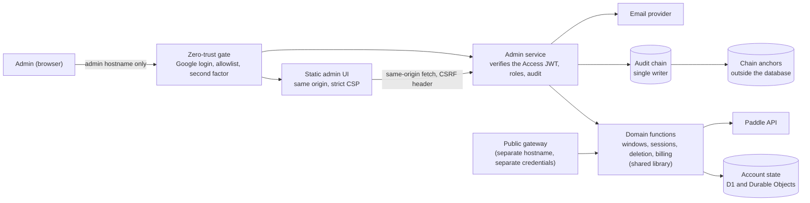

# StudentLLM Cloud admin interface

Status: planned, not implemented. This document is the design and the API contract of the admin interface of the optional cloud service. It is a draft for human review: every item marked "verify" must be checked against the platform's official documentation, and every legal point must be reviewed by a qualified lawyer before launch. No admin code exists in this repository yet, and this change touches only documentation and the contract validator.

Related documents:

- [cloud-admin.openapi.yaml](./cloud-admin.openapi.yaml): the machine-readable admin contract (OpenAPI 3.1), the source of truth for the admin API. [cloud-admin-fixtures/](./cloud-admin-fixtures/) holds conformance examples.
- [cloud-plan.md](./cloud-plan.md): the product and engineering plan (see its "Admin interface" section and the admin rows of its data table). [cloud-api.md](./cloud-api.md) and [cloud-api.openapi.yaml](./cloud-api.openapi.yaml): the public contract, which is unchanged by this design.
- [SECURITY.md](../SECURITY.md): the credential and disclosure rules that apply here too.

## Contents

1. [Purpose and decisions](#purpose-and-decisions)
2. [Architecture and trust boundaries](#architecture-and-trust-boundaries)
3. [Authentication](#authentication)
4. [Roles](#roles)
5. [Request pipeline and conventions](#request-pipeline-and-conventions)
6. [Operations](#operations)
7. [Safety rails and notifications](#safety-rails-and-notifications)
8. [Data tables](#data-tables)
9. [Admin UI](#admin-ui)
10. [Threat model](#threat-model)
11. [Rollout and phasing](#rollout-and-phasing)
12. [Validating the contract](#validating-the-contract)
13. [Interactions with the public contract](#interactions-with-the-public-contract)
14. [Open items](#open-items)

## Purpose and decisions

The owner is a solo founder. The admin interface lets the owner (and, later, a helper) run the account operations that the public API deliberately does not offer: grant a free trial of a chosen length, cancel (résilier) a subscription, ban an account, delete an account, manage other admins, look at sessions and read an audit trail. Everything below follows decisions that are final for this design.

| Topic | Decision |
| --- | --- |
| Surface | A distinct hostname and the route prefix `/admin/v1`, its own OpenAPI file, and a small static web UI served only on the admin hostname. The desktop app never talks to it, the public contract does not list it, and the public API never accepts an admin credential. |
| Authentication | Defense in depth: (1) Cloudflare Access (or an equivalent zero-trust gate) with Google login restricted to an email allowlist and a required second factor; (2) the admin service verifies the Access JWT itself and maps the verified email to an admin record, so a misconfigured gate fails closed; (3) sensitive actions need a re-authentication within 5 minutes. No passwords, no shared accounts, no long-lived admin API keys. Break-glass is a manual runbook, not an endpoint. |
| Roles | `owner`, `admin`, `support` (read-only on account metadata). Only an owner manages admins and owners. The last owner cannot be removed or demoted. Nobody acts on their own admin record. |
| Privacy | The admin surface sees only what the service stores. There is never any course content, prompt or answer to show, no impersonation and no "login as user". Single-account reads are audit-logged. |
| Writes | Every state change needs a reason, an idempotency key and a CSRF check, goes through the same domain functions as the public API, and is blocked by a global freeze switch. No bulk operations in v1 except listing. |
| Audit | Append-only, hash-chained, no IP address, no content, no raw token; exportable by owners; no endpoint edits or deletes a row. |

Non-goals for v1: refunds issued from the admin UI, bulk grants or bulk bans, editing a user's email, changing a user's data, any view of user content, automated provisioning of the Access allowlist, a customer-facing support portal.

## Architecture and trust boundaries



Boundaries and rules:

- **Two deployments, two hostnames.** The admin service is a separate deployable (a separate Worker, if the platform plan holds) on `admin.[PLACEHOLDER: domain]`. The public gateway lives on the API hostname and has no `/admin` route. A WAF rule on the public hostname also blocks `/admin/*`. The admin hostname serves nothing from the public API.
- **Credential separation.** The admin service accepts only the Access JWT (`Cf-Access-Jwt-Assertion`). It never accepts a StudentLLM access token or a manage token. The public gateway never accepts the Access JWT or any admin cookie; its token verifier pins its own issuer, audience and key set. Both directions are covered by tests (see [Rollout and phasing](#rollout-and-phasing)).
- **Least secrets.** The admin service holds a Paddle API key restricted to the subscription operations it needs (verify that Paddle API keys can be scoped), the email provider key, the audit-chain key material and the blocklist key. It does not hold provider (inference) keys or the token signing key. The gateway does not hold the blocklist key's write role or any admin secret. Separate secrets per environment (staging with Paddle sandbox, production).
- **Same domain functions.** Every state change calls the same domain library as the public API (the window, session, deletion and billing functions). Handlers in the admin service contain no storage writes of their own: a lint rule forbids direct storage imports there, and the plan-window, ledger and deletion invariant tests run against both surfaces. Functions that need an admin-only privilege (for example deleting an account without the user's fresh sign-in) take a typed `actor` that only the admin service can construct, so the public API cannot reach those paths.
- **No origin exposure.** The admin hostname is reachable only through the gate. The default platform hostname of the Worker is disabled for the admin service (verify), and the service refuses any request without a valid Access JWT even if the gate were bypassed.
- **No content anywhere.** The service stores none, so the admin service has none to show. Operational logs of the admin service hold request id, admin id, route, status and latency only.

## Authentication

### Layer 1: the gate

Cloudflare Access (or an equivalent) in front of the admin hostname:

- identity provider: Google; the policy allows only an explicit list of email addresses (the admins), and requires a second factor;
- session duration of the gate: at most 8 hours (verify the allowed values);
- a separate Access application for the step-up path (see [Re-authentication](#re-authentication)), with its own AUD tag.

Platform feature checks are listed in [Open items](#open-items). In particular, whether Access can enforce a second factor for a Google login (not only trust Google's own 2-step verification) must be verified; if it cannot, the fallback in [Re-authentication](#re-authentication) supplies the second factor inside the service.

### Layer 2: the service verifies the JWT itself

Every request, including the requests for the static UI files (the same service serves them), is processed as follows. Anything that fails returns `invalid_access_token` (401) and nothing else is evaluated:

1. The `Cf-Access-Jwt-Assertion` header is present. The cookie is not used as a substitute.
2. The signature is valid under a key from the Access team's JWKS (cached by `kid`, refreshed on an unknown `kid` with a rate limit; if no key can be obtained the service refuses, it never skips verification). The algorithm is pinned to the one the platform uses (verify); `none` and any other `alg` are rejected.
3. `iss` equals the team's issuer exactly.
4. `aud` contains the admin application's AUD tag and no other application's tag is accepted for this service (so a token issued for another internal tool behind the same Access team is useless here). The step-up application has its own tag, accepted only on the step-up completion route.
5. `exp` and `nbf` are honored with a small clock skew; `iat` is recorded.
6. The `email` claim is present. It is normalized (lower case) and mapped to an admin record by exact match.

Mapping outcomes: no record gives `admin_not_registered` (403); a `disabled` or `removed` record gives `admin_disabled` (403); both fail closed. The single exception is `POST /admin/v1/invitations/accept`, which a verified identity without an admin record may call (see [Admin management](#6-admin-management-owner-only)).

There is no configuration flag, environment variable or debug mode that turns verification off.

### Layer 3: fresh re-authentication for sensitive actions

Sensitive actions require a re-authentication within the last 300 seconds. They are marked `x-requires-fresh-auth` in the contract: delete an account, suspend an account, immediate cancellation, every admin management operation (invite, role change, disable, enable, remove), unfreeze, and audit export. A call outside the window gets `reauth_required` (401) with `details.max_age_seconds = 300`.

### Re-authentication

The service keeps a small server-side admin session (see the data table). Freshness is `reauth_at`, set only by the service from verified data, never by a client claim.

1. The UI calls `POST /admin/v1/session/reauth`. The service records `reauth_started_at` and returns `reauth_url`.
2. The browser navigates to `reauth_url`, which is protected by the dedicated Access application configured to force a new login every time (the shortest session duration the platform allows; verify), including the second factor.
3. Access redirects to `GET /admin/v1/session/reauth/complete`. The service accepts it only if a step-up was started for this session and the presented JWT was issued after `reauth_started_at` (`iat` greater than the start time). It then sets `reauth_at = now` and redirects to the UI. Any failure redirects with `?reauth=failed` and no detail.
4. `GET /admin/v1/session` reports `reauth_fresh_until = reauth_at + 5 minutes`, or `null`.

This binds freshness to a new login, so a stolen session cookie cannot create it. The completion route changes only the caller's own session freshness from verified data, so a forged navigation gives an attacker nothing.

**Fallback if the gate cannot force a fresh login or enforce a second factor:** a service-side WebAuthn step-up (a passkey or hardware key registered per admin, user verification required). Steps 1 to 3 are replaced by a WebAuthn assertion whose challenge is bound to the session. This adds one table (`admin_credentials`, see the data table) and the credential registration is itself a fresh-auth owner action. The contract's `reauth_*` routes keep their meaning; only the redirect target changes. The choice is made in phase 1 after the platform checks.

### CSRF and origin checks

The Access cookie is an ambient credential, so every POST is protected:

- the CSRF token comes from `GET /admin/v1/session`, is bound to the admin session (an HMAC of the session id under a server key) and sent in `X-StudentLLM-Admin-CSRF`; the UI keeps it in memory only;
- `Origin` must equal the admin hostname and `Sec-Fetch-Site` must be `same-origin`;
- `Content-Type` must be `application/json`;
- there is no CORS on the admin hostname and no cookie set by the service;
- any failure gives `csrf_invalid` (403) with no further detail.

### Sessions

The admin session expires after 30 minutes idle and 8 hours absolute, and ends at once when the admin is disabled, removed or has their role changed. The service stores no JWT, no IP address and no user agent.

### Bootstrap and break-glass (runbook, not endpoints)

These are documented manual procedures run by the operator with platform credentials. They are the only ways to act outside the admin API, and each writes an audit row with `actor_kind = system` and sends an owner alert.

- **Bootstrap.** Before the first deployment the operator adds their email to the Access allowlist and runs a one-off bootstrap script that inserts the first owner (`admin.bootstrap` row). No endpoint can create the first owner.
- **Lost owner access or misconfigured gate.** (1) Set the hard freeze override (a platform variable the service reads on every request, in addition to the switch in the database) so no write can happen. (2) Repair the identity provider or the Access policy. (3) If the only owner account is lost, run the bootstrap script for a new owner, then disable the old record from the UI. (4) Rotate the audit-chain and blocklist keys if the platform credentials were exposed, review the audit chain with `GET /admin/v1/audit/verify`, and record the incident.
- **Suspected admin compromise.** Freeze writes, disable the admin record, revoke the person's Access sessions in the gate, review that admin's audit rows, then unfreeze.
- **Never.** Expose the admin service without the gate, add a bypass flag, create a long-lived admin token, or edit audit rows by hand (an edit would break the chain and be detected).

## Roles

Roles are ordered `support` < `admin` < `owner`; a higher role includes the lower ones except where a route is marked owner only. The table is the rule that the role-matrix test enforces for every endpoint.

| Capability | support | admin | owner |
| --- | :---: | :---: | :---: |
| Own session, system state, freeze state | yes | yes | yes |
| Search accounts; read an account; list devices; list an account's grants; read a grant | yes | yes | yes |
| See Paddle ids on an account | no | yes | yes |
| List operations, read one operation | yes | yes | yes |
| Grant, shorten, revoke a grant; grant totals | no | yes | yes |
| Cancel a subscription; retry or withdraw an operation | no | yes | yes |
| Suspend, unsuspend; list and remove blocklist entries | no | yes | yes |
| Request an account deletion | no | yes | yes |
| Revoke a device; revoke all sessions | no | yes | yes |
| Freeze admin writes | no | yes | yes |
| Unfreeze admin writes | no | no | yes |
| List audit rows | no | own rows only | all rows |
| Export and verify the audit log | no | no | yes |
| List, invite, change role, disable, enable, remove admins; list and revoke invitations | no | no | yes |

Rules that apply regardless of role:

- **Self-action.** An admin cannot change, disable, enable or remove their own admin record, and cannot grant themselves a role (`self_action_forbidden`). To transfer ownership, invite a new owner; that owner then removes the old record.
- **Own user account.** Write operations (grant, cancel, suspend, delete, revoke sessions) are refused when the target account's verified email equals the acting admin's email (`self_action_forbidden`). This is a guard rail against self-service abuse, not a security boundary (an alias address differs, because the service does not collapse `+` tags). The founder tests with a separate test account. Reads are allowed.
- **Last owner.** The last enabled owner cannot be removed, disabled or demoted (`last_owner_protected`). Because nobody can act on their own record and only owners can act on owners, the rule is a guard that matters under concurrency and for runbook scripts: the count of remaining enabled owners is evaluated in the same transaction as the change, together with a re-check of the acting admin's own state, so two owners removing each other at the same moment cannot both succeed.
- **Roles are never taken from a request.** The role of an invitation is stored server-side; the accept request carries only the code.

## Request pipeline and conventions

Order of checks. Later checks never run if an earlier one fails, so a caller learns nothing about what lies beyond:

1. Access JWT (`invalid_access_token`).
2. Admin record and status (`admin_not_registered`, `admin_disabled`).
3. For POST: CSRF, `Origin`, `Sec-Fetch-Site`, content type (`csrf_invalid`).
4. Per-admin rate limit (`rate_limited`).
5. Role (`forbidden_role`, with `details.required_role`).
6. Global freeze, for writes (`admin_writes_frozen`).
7. Fresh re-authentication, where required (`reauth_required`).
8. Body validation against the schema, including the reason rules (`invalid_request`, `confirmation_mismatch`).
9. Idempotency lookup (`idempotency_conflict`).
10. Target preconditions inside the domain transaction: target exists (`not_found`), self-action, state (`state_conflict`), window rules (`window_overlap`), limits (`limit_exceeded`), last owner (`last_owner_protected`).
11. The domain function and the audit row, in one transaction. If the audit row cannot be written, nothing changes and the answer is `audit_unavailable` (503). No audit row, no action; the same holds for single-account reads.

Denied attempts (steps 2, 5, 7 and 10) are themselves written as audit rows with `result = denied`, capped per admin per hour so that an attacker cannot flood the log; past the cap a counter row is written instead.

**Reason.** Every state change carries a mandatory `reason` of 10 to 500 characters. It is stored in the audit row. It must not contain content or an email address; the server rejects strings that look like an email address, and the UI says to use a ticket reference. Optional notes follow the same rule.

**Idempotency.** Every state-changing route takes `Idempotency-Key` (a UUID), scoped per admin and route, kept 24 hours. Unlike the public API, admin requests carry no user content, so the record includes a SHA-256 of the canonical body:

| Situation | Result |
| --- | --- |
| Same key, same body, first call finished | The original status and body again, with `Idempotent-Replay: true`. Nothing runs twice. |
| Same key while the first call is still running | 409 `idempotency_conflict`, `details.state = in_progress`. |
| Same key, different body | 409 `idempotency_conflict`, `details.state = payload_mismatch`. |
| A call rejected before the domain function (validation, role, freeze, reauth) | Not recorded; the same key may be reused after fixing the request. |

Operations that are naturally idempotent (revoke, disable, remove) also return success when repeated with a new key against the already-changed target. The read-only POST routes (`searchAccounts`, `startReauth`) and the single-use `acceptInvitation` take no idempotency key and no reason.

**Pagination.** Cursor pagination as in the public contract: `limit` and `cursor` in, `data` and `next_cursor` out. Maximum page sizes: 25 for account search, 100 elsewhere. Offset pagination is not used.

**Rate limits** (configuration, per admin; defaults for review):

| Class | Default |
| --- | --- |
| Session and system reads | 60 per minute |
| Account search | 20 per minute and 300 per day |
| Single-account reads, lists | 120 per minute |
| State changes | 30 per minute |
| Destructive actions (delete, suspend, immediate cancel, role change, remove, freeze) | 10 per hour |
| Re-authentication starts | 10 per hour |
| Invitation accept attempts | 5 per invitation, 10 per hour per identity |
| Audit export | 5 per day |

**Errors.** One envelope, the same style as the public API (`error.code`, `error.message`, `error.request_id`, optional `retry_after_seconds` and `details`). Messages are short English and never contain content, secrets or provider text. The admin code list (`ErrorCode` in the admin contract) is separate from the public one.

| Code | HTTP | Meaning |
| --- | --- | --- |
| `invalid_request` | 400 | Malformed request, unknown field, bad reason, or an email-like string in a free-text field |
| `confirmation_mismatch` | 400 | The typed confirmation does not equal the account id |
| `invitation_invalid` | 400 | Wrong, expired, used or over-attempted invitation code, or an identity whose email differs from the invitation (one generic answer) |
| `invalid_access_token` | 401 | Missing or invalid Access JWT |
| `reauth_required` | 401 | A fresh re-authentication is needed; `details.max_age_seconds` is 300 |
| `admin_not_registered` | 403 | Verified identity with no admin record |
| `admin_disabled` | 403 | Admin record disabled or removed |
| `forbidden_role` | 403 | The role is too low; `details.required_role` |
| `self_action_forbidden` | 403 | Acting on one's own admin record or user account |
| `csrf_invalid` | 403 | CSRF token, origin or fetch-metadata check failed |
| `not_found` | 404 | Unknown resource |
| `idempotency_conflict` | 409 | `details.state` is `in_progress` or `payload_mismatch` |
| `state_conflict` | 409 | The target is in a state that does not allow this (for example suspending a deleting account); `details.current_status` |
| `window_overlap` | 409 | A grant would overlap or stack on another budget window |
| `last_owner_protected` | 409 | The change would leave no enabled owner |
| `limit_exceeded` | 422 | A configured cap would be exceeded; `details.limit`, `max`, `current` |
| `rate_limited` | 429 | Per-admin rate limit; `Retry-After` |
| `admin_writes_frozen` | 503 | The global freeze is on |
| `audit_unavailable` | 503 | The audit row could not be written, so nothing was done |
| `internal_error` | 500 | Unexpected failure |

## Operations

All routes are in the contract. Roles are the minimum role. "Fresh" means a re-authentication within 5 minutes. Every state change writes an audit row in the same transaction.

| # | Operation | Route | Role | Fresh | Audit action |
| --- | --- | --- | --- | :---: | --- |
| 1 | Search accounts | `POST /admin/v1/accounts/search` | support | no | `account.search` |
| 1 | Read an account | `GET /admin/v1/accounts/{account_id}` | support | no | `account.read` |
| 2 | Create a grant | `POST /admin/v1/accounts/{account_id}/grants` | admin | no | `grant.create` |
| 2 | List grants of an account | `GET /admin/v1/accounts/{account_id}/grants` | support | no | `grant.list` |
| 2 | Read a grant | `GET /admin/v1/grants/{grant_id}` | support | no | `grant.read` |
| 2 | Shorten a grant | `POST /admin/v1/grants/{grant_id}/shorten` | admin | no | `grant.shorten` |
| 2 | Revoke a grant | `POST /admin/v1/grants/{grant_id}/revoke` | admin | no | `grant.revoke` |
| 2 | Grant totals | `GET /admin/v1/stats/grants` | admin | no | none |
| 3 | Cancel a subscription | `POST /admin/v1/accounts/{account_id}/subscription/cancel` | admin | immediate only | `subscription.cancel` |
| 3, 5 | List, read, retry, withdraw operations | `GET /admin/v1/operations`, `GET .../{operation_id}`, `POST .../retry`, `POST .../withdraw` | support (reads), admin | no | `operation.retry`, `operation.withdraw` |
| 4 | Suspend (ban) | `POST /admin/v1/accounts/{account_id}/suspend` | admin | yes | `account.suspend` |
| 4 | Unsuspend | `POST /admin/v1/accounts/{account_id}/unsuspend` | admin | no | `account.unsuspend` |
| 4 | List and remove blocklist entries | `GET /admin/v1/blocklist`, `POST .../{entry_id}/remove` | admin | no | `blocklist.remove` |
| 5 | Delete an account | `POST /admin/v1/accounts/{account_id}/deletion` | admin | yes | `account.delete_request` |
| 6 | List admins | `GET /admin/v1/admins` | owner | no | none |
| 6 | Invite, list and revoke invitations | `POST/GET /admin/v1/invitations`, `POST .../{invitation_id}/revoke` | owner | invite: yes | `admin.invite`, `admin.invitation_revoke` |
| 6 | Accept an invitation | `POST /admin/v1/invitations/accept` | invitee | no | `admin.invitation_accept` |
| 6 | Change role, disable, enable, remove | `POST /admin/v1/admins/{admin_id}/role`, `/disable`, `/enable`, `/remove` | owner | yes | `admin.role_change`, `admin.disable`, `admin.enable`, `admin.remove` |
| 7 | List devices | `GET /admin/v1/accounts/{account_id}/devices` | support | no | `account.devices_read` |
| 7 | Revoke a device, revoke all sessions | `POST .../devices/{device_id}/revoke`, `POST .../sessions/revoke-all` | admin | no | `device.revoke`, `sessions.revoke_all` |
| 8 | List, export, verify the audit log | `GET /admin/v1/audit`, `/export`, `/verify` | admin (own rows), owner | export: yes | `audit.export`, `audit.verify` |
| - | Session, re-authentication, system state, freeze | `GET /admin/v1/session`, `POST .../reauth`, `GET .../reauth/complete`, `GET /admin/v1/system`, `POST .../freeze`, `POST .../unfreeze` | support; freeze admin; unfreeze owner (fresh) | unfreeze | `admin.session_start`, `system.freeze`, `system.unfreeze` |

### 1. Search and read an account

**Search** (`searchAccounts`) is a POST with a JSON body, so an email address never appears in a URL, a log line or browser history. Filters: exact `email` (the stored sign-in email, normalized the same way the service does), `email_prefix` (at least 6 characters), `account_id`, `status`, `plan_id`. It returns account summaries (id, email, status, plan, created at), at most 25 per page, with a tight rate limit. The audit row records the kind of query and the number of results, never the query value. There is no way to list all accounts without a filter.

**Read** (`getAdminAccount`) returns, for one account: id, verified email, login methods, status (with category, start and end of a suspension), terms version, created, last sign-in and last request times, the plan, the budget windows (past, current, scheduled, each with its source), usage totals for the current and two previous windows (credits and requests, split by feature), an optional daily series if the retained totals have that granularity, the device count, the active consent summary (provider set, features, time), the Paddle customer and subscription ids (hidden from `support`), and pending operations. Nothing else: no content, no prompt, no answer, no IP address, no token.

Every call writes an `account.read` row before the response is sent. If that write fails the read fails (`audit_unavailable`). The responses are `Cache-Control: no-store`.

### 2. Grant a complimentary period (free trial)

`POST /admin/v1/accounts/{account_id}/grants` creates a grant and its budget windows with source `admin_grant`. No payment, no Paddle object.

Request: `days` (an explicit integer from 1 to the configured maximum, never above the contract ceiling of 90), `credit_budget_per_window` (optional override), `start_policy` (`now` or `after_current_windows`), a mandatory `reason`, a `reason_category` (trial, beta_tester, support_goodwill, compensation, partner, testing, other), an optional `note`, and `notify_user` (default true).

**Windows.** A grant is cut into windows of at most 30 days. The last window is prorated (the budget is rounded down). Each window has a budget of `credit_budget_per_window`; the default is the standard Plus window limit, and the override is capped by configuration (and never above the contract ceiling of 25,000 credits per window). A 90-day grant is three windows.

**Composition with the plan rules.** The grant calls the same window domain function as billing, so these hold:

| Rule of the plan | How grants behave |
| --- | --- |
| One window per paid period, budgets never stack | Windows never overlap. A grant with `start_policy: now` while any paid or granted window is active is refused with `window_overlap` (the response names the conflicting source and end). |
| Queueing (semester pass windows queue after the current ones) | `after_current_windows` queues the grant after the last window whose end is known: a semester pass, a granted period, or a subscription set to cancel at period end. It is refused for an auto-renewing subscription, whose end is unknown. |
| `already_subscribed` (an active plan exists) | An active grant does not count as an active plan. A user whose grant is running can still subscribe or buy a pass (otherwise a trial would block conversion). The paid window starts at purchase, as Paddle reports it, and the grant is cut at that instant by the system (a `grant.shorten` row with `actor_kind = system`). Credits already used stay used and budgets never stack. This needs a clarification of the public rule (see [Interactions with the public contract](#interactions-with-the-public-contract)). |
| `past_due` | A grant is refused while a paid window is still active. If the paid window has ended and payment is outstanding, a grant is allowed; a payment that later succeeds starts a paid window that cuts the grant. |
| Refunds and chargebacks revoke the current and future windows | They revoke only windows with a Paddle source. Grant windows are untouched by billing events; if a chargeback looks fraudulent, an admin can revoke the grant or suspend the account. |
| Resubscribe loop cannot reset a budget | Unchanged: a grant is the only way to add a window without payment, and it is capped as below. |
| Budget on window boundary | Windows are keyed by their start; replays of the request (same idempotency key) never create a second window or reset used credits. |
| Plan lapse | When the last grant window ends the account is a free account; the local app is unchanged. There is no automatic conversion and no automatic charge. |

**Cost ceiling.** A grant earns no revenue, so its cost is pure cost and is capped at four levels, each a configuration value below its contract ceiling:

| Cap | Default for review | Error |
| --- | --- | --- |
| Per grant: sum of its window limits (`credits_cap_total`) | at most 3 windows times the per-window cap; with the standard window this is at most 3 times the 1.50 EUR ceiling of [Unit economics](./cloud-plan.md#unit-economics), about 4.50 EUR | `limit_exceeded` (`grant_max_total_credits`) |
| Per account: grant days per rolling 12 months | 180 | `limit_exceeded` (`grant_max_days_per_account_per_year`) |
| Per admin: grants created per day | 20 | `rate_limited` or `limit_exceeded` |
| Global: credits committed to grant windows starting in a calendar month | `[PLACEHOLDER: set from the monthly budget; for example 50 users at the 1.50 EUR ceiling]` | `limit_exceeded` (`grant_monthly_credit_cap`) |

Committed credits count at the full window limit when the grant is created, not at usage, so the cap holds even if every user spends everything. The grant totals feed the cost monitoring: the gateway's running spend per day and month is split into paid and granted, `GET /admin/v1/stats/grants` shows credits granted and used by month and how much of the monthly cap is committed, and the operator is alerted at 50%, 80% and 100% of the cap. At 100% new grants are refused; grants already made continue. The global spend cap and kill switch of the cloud plan apply to granted usage like any other, so a grant cannot bypass `kill_switch`.

**Preconditions.** The account must be `active` (not `suspended` or `deleting`). The target cannot be the acting admin's own user account.

**Shorten and revoke.**

- `shorten` moves the end earlier, never later. A longer period is a new grant, so every extension passes the caps again. Windows after the new end are removed and the window that contains it is cut.
- `revoke` ends all of the grant's windows now. The remaining credits become unusable on the next request (the change is written to the account's Durable Object, like a device revocation).
- In both cases used credits stay used and counted, only the grant's own windows are touched, the plan version is bumped so the app refetches the account, and the user gets a notification email unless `notify_user` is false.

**User notification.** "You received a complimentary StudentLLM Plus period until <date>" with the budget, and a plain sentence that nothing is charged and nothing renews automatically. No marketing wording (see the lawyer items for expiry reminders).

### 3. Cancel a subscription (via Paddle)

`POST /admin/v1/accounts/{account_id}/subscription/cancel` with `effective_from` of `period_end` or `immediately`, a mandatory reason, an optional note and `notify_user`.

- **At period end** calls Paddle's cancel-subscription API with the "next billing period" effect. When Paddle confirms, `cancel_at_period_end` becomes true; the current window continues to its end and no further window starts. No re-subscription loop is possible because `already_subscribed` already covers a subscription set to cancel.
- **Immediately** (fresh re-authentication, owners notified) cancels now. When Paddle confirms, the current paid window ends at that instant: the remaining credits become unusable and the plan lapses to free. No refund is issued by this route; if the user paid for a period they cannot use, the owner decides on a refund in the Paddle dashboard, and the resulting adjustment event is handled by the existing refund rule. The UI says so before the confirmation.
- A **semester pass** is a one-time payment with no subscription, so there is nothing to cancel at Paddle: the route returns `state_conflict`. Ending a pass early is a window revocation plus a refund decision, which is a later operation (see [Rollout and phasing](#rollout-and-phasing)).

**Operation and the `pending` state.** The route answers 202 with an `Operation` of kind `subscription_cancel`. Windows and plan flags change only after Paddle confirms. If the Paddle call fails or times out, the operation stays `pending` with `last_error_code` (a fixed code such as `paddle_unavailable`, never provider text), `attempts` and `next_retry_at`:

- the gateway retries with bounded exponential backoff; after repeated failures it sends an owner alert, and the operation moves to `failed` when the retry budget is spent;
- the account detail shows `cancel_pending`, and `GET /admin/v1/operations?state=pending` lists what needs attention;
- an admin can run `POST /admin/v1/operations/{id}/retry` at any time.

**Paddle events and idempotency.** The cancellation is applied through the same billing domain function the webhook uses.

- The result of the API call is applied under a claim on the operation, then reconciled by the Paddle webhook: `subscription.updated` (a scheduled change) and `subscription.canceled` (verify the exact event names against Paddle's current documentation). The existing webhook rules apply unchanged: raw-byte HMAC, claim of the event id before side effects, ordering by `occurred_at` or a re-fetch, mapping by the stored subscription id.
- Whichever arrives first wins and the other is a no-op. A webhook for a cancellation the operation already applied does not change windows twice (windows are keyed by start date, and the plan version moves only on a real change).
- Cancelling an already canceled or already scheduled subscription is treated as success after a re-fetch of the subscription from Paddle.
- If a webhook reports a cancellation that no operation requested (the user used the portal), it is applied as today and no operation exists.
- Sandbox and live use separate keys and separate deployments.

**User notification.** An email says what changed and when it takes effect (end of period, or now), and that billing questions go through the customer portal or support.

### 4. Ban, suspend and unban

`POST /admin/v1/accounts/{account_id}/suspend`: a mandatory reason, a `reason_category` (abuse, chargeback_fraud, terms_violation, security, legal_request, other), an optional `duration_days` (1 to the configured maximum, never above 365; omitted means until lifted), `blocklist` (default false) and `notify_user`. Fresh re-authentication; the owners are notified.

Effects, through the shared domain functions:

1. The account status becomes `suspended` (the status that already exists, with the public behavior of `account_suspended`).
2. All sessions, devices and unexpired manage tokens are revoked immediately (written to the account's Durable Object).
3. The data-rights routes keep working exactly as the public contract requires: `GET /v1/account`, the export, deletion, token refresh, logout, the device routes, the billing portal link and the terms acceptance. Sign-in still succeeds and yields a token that is usable only on those routes.
4. Budget windows keep running; time is not paused. If a ban is lifted early, a compensating grant is the tool.
5. A time-limited suspension is lifted by a scheduled job at `expires_at`, which writes an `account.suspension_expire` system row.
6. With `blocklist: true`, two keyed-hash entries are added: the normalized email and the Google subject id (if linked). Each is an HMAC-SHA-256 under a server-held key (a pepper, not just a salt), so the table cannot be reversed without the key and cannot be matched against a leaked list. For blocking, the email is normalized more aggressively than for accounts (lower case, `+` tag removed), which is a proportionality point for the lawyer. Entries expire (default `[PLACEHOLDER: for example 365 days]`, at most 730) and an admin can remove one with `POST /admin/v1/blocklist/{entry_id}/remove`.
7. At sign-in, a blocked identity that has no account is refused without revealing why: the email path answers the request as usual but sends no code and fails verification with the generic `invalid_code`; the Google path redirects with `error=access_denied`. These are existing public behaviors, so the public contract does not change.
8. The user gets a notification email with fixed wording per category, the end date if any, and the support route. The free-text reason is never sent.

`POST /admin/v1/accounts/{account_id}/unsuspend` sets the status back to `active`, optionally removes the blocklist entries created by that suspension, and notifies the user. Sessions revoked by the suspension are not restored.

Preconditions: suspending an already suspended account is idempotent success with the stored detail; a `deleting` account gives `state_conflict`; the target cannot be the acting admin's own user account.

**Flagged for the lawyer.** Legal basis and proportionality of banning and of keeping a blocklist hash after the account is gone (GDPR art. 6(1)(f) balancing test, art. 17(3) exceptions, retention of a hash of an email, which is still personal data); the grounds, notice and appeal route that the terms must state; whether the reason must be given to the user; time limits; whether the more aggressive blocklist normalization is proportionate; what is shown to a user who attempts to register while blocked. These are in [Open items](#open-items).

### 5. Delete an account

`POST /admin/v1/accounts/{account_id}/deletion`: a mandatory reason, an optional note, `confirm_account_id` (must equal the path id, otherwise `confirmation_mismatch`), `cooling_off_hours` (0 to 72, default 24) and `notify_user`. Fresh re-authentication; the owners are notified. The UI also requires the admin to type the account id (see [Admin UI](#admin-ui)).

1. **Cooling-off.** With `cooling_off_hours` above 0 the account moves to `suspended` (category `pending_admin_deletion`, remembering the previous status), so it cannot be used, while the data-rights routes still work: the user can export their data or delete the account themselves. The operation is `cooling_off` with `executes_at`. An admin can withdraw it until then (`withdrawOperation`), which restores the previous status. The user gets a heads-up email with the date.
2. **Execution** (at `executes_at`, or immediately when `cooling_off_hours` is 0) runs the shared deletion domain function, the same one behind `DELETE /v1/account`: the account becomes a `deleting` tombstone retaining only the Paddle customer and subscription ids; the subscription is cancelled at Paddle immediately, with retry and backoff and an owner alert on repeated failure; only when the cancel succeeds is the tombstone purged along with every other record of the data table (including the account's grants, sessions, consents and usage); the user gets the deletion notification email defined by the public contract. The operation shows `running`, then `completed`. A Paddle failure leaves it visible as `pending` with a retry, as for cancellation.
3. **What remains.** The audit rows that reference the account id, the operation record, the monthly grant totals (no account id) and any blocklist entry are not part of the account's records. This is an intentional exception to "deletion removes every record" and is a lawyer item (see [Interactions with the public contract](#interactions-with-the-public-contract)). The audit rows hold an opaque id, a category and an admin-written reason, but never the email, because the email is erased with the account.
4. The execution has no user fresh-sign-in step: the admin's own fresh re-authentication replaces it. This is a different variant of the domain function, available only to the admin actor.

A deletion that a user requested by email should normally use `cooling_off_hours: 0` (erasure is owed without undue delay, so confirm the delay with the lawyer).

### 6. Admin management (owner only)

**Invitation.** `POST /admin/v1/invitations` with an email, a role and a reason. Fresh re-authentication; the owners are notified.

- The service creates a single-use invitation that expires (72 hours by default, 168 at most) and emails a 12-character code (an alphabet without look-alike characters, about 60 bits) to the invited address. The code is stored only as a keyed HMAC, is never returned by the API and is never shown to the owner who invited.
- The invitation does not grant access to the gate. The owner must also add the email to the Access allowlist. This stays manual in v1, because automating it would give the admin service a platform token able to change the gate's policy, a confused-deputy risk (see [Threat model](#threat-model)).
- One pending invitation per email. The owner can revoke it.

**Acceptance.** `POST /admin/v1/invitations/accept` with the code is the only route open to a verified Access identity that has no admin record. It succeeds only if the identity's verified email equals the invitation email, the code matches, the invitation is pending and unexpired, and fewer than 5 attempts were made. Anything else returns the same `invitation_invalid`. The role comes from the invitation. On success the invitation is marked accepted, the admin record is created and the owners are notified. The token is single-use and expires, and it is accepted only after the invited person logged in through the gate with the invited email, as required.

**Manage admins.** `GET /admin/v1/admins`, then `role`, `disable`, `enable` and `remove` on `/admin/v1/admins/{admin_id}`. All need a fresh re-authentication, a reason and an idempotency key, and notify the owners. They end the target's admin sessions. They are refused on oneself (`self_action_forbidden`) and when the change would leave no enabled owner (`last_owner_protected`). Removing an admin marks the record removed and erases the email; the admin id and role remain so that audit rows keep a stable actor.

### 7. Sessions and devices

- `GET /admin/v1/accounts/{account_id}/devices` (support): device label, platform name, created, last used, idle expiry and absolute expiry. At most 3 devices. No IP address and no token. Audited as `account.devices_read`. The device label is user-editable text and is always rendered as text in the UI.
- `POST .../devices/{device_id}/revoke` (admin): the same domain function as `DELETE /v1/devices/{device_id}`; effective on the next inference request. The user is notified unless `notify_user` is false.
- `POST .../sessions/revoke-all` (admin): revokes every session family and device and every unexpired manage token of the account, through the shared functions. The account itself is unchanged. This is also what an admin uses to resolve the Google-only user at the device limit that the cloud plan lists as an open support case.

### 8. Audit log

Every admin action and every single-account read writes one row. The row has: audit id, a sequence number, time, actor kind (`admin` or `system`), actor admin id and role at that moment, action, target account id and target admin id (where relevant), the reason, the request id, the result (`success`, `denied`, `failed`, `pending`), a result code (from the error list) and a small map of allowlisted, non-personal parameters (for example days, role, effective_from, grant id). **No IP address, no user agent, no content, no email address and no raw token or code.** The row fields are the AuditRow schema of the contract, and the validator rejects a schema change that adds such a field.

**Append-only.** There is no endpoint that edits or deletes a row. Rows are never updated: a long operation writes a first row with `result = pending` and later `operation.step` rows with `actor_kind = system`. The service's database role used by the admin service has insert and select on the audit table only (verify that the platform can express this; otherwise the single-writer object is the only code path that touches the table).

**Hash chain.** `row_hash = SHA-256( prev_hash + "\n" + canonical_json(row without row_hash) )`, where `canonical_json` sorts keys, has no whitespace and is UTF-8. The first row has a `prev_hash` of 64 zeros. A single writer (a Durable Object) assigns the sequence number and the previous hash, so the chain has no gaps or forks. The conformance fixtures include a two-row chain and the validator recomputes it.

**Anchors.** A chain stored only next to the data it protects can be rewritten by whoever can write the database. So the chain head (sequence number and hash) is published at least daily to places the admin service cannot rewrite: an email digest to the owners and an entry in a write-once store (for example an object store with a retention lock; verify the platform feature). `GET /admin/v1/audit/verify` recomputes the chain and compares it with every anchor; the owner is alerted on a mismatch.

**Reading.** `GET /admin/v1/audit` lists rows, filtered by actor, target account, action, result and time. Owners see all rows; an `admin` sees only rows where they are the actor; `support` has no access. `GET /admin/v1/audit/export` (owner, fresh re-authentication, a few per day) returns JSON Lines, one row per line with the hash fields, and writes an `audit.export` row.

**Retention.** `[PLACEHOLDER: audit retention period, for example 12 months; to be set with the lawyer]`. Beyond that period a scheduled job (not an endpoint) removes the oldest rows and writes a `retention.checkpoint` row carrying the sequence range and the last removed hash, so the chain stays verifiable from the checkpoint. The rows hold pseudonymous ids that outlive an account deletion; this is a lawyer item.

**What the log proves.** See [Threat model](#threat-model).

## Safety rails and notifications

**Rails** (all enforced by the service, not only by the UI):

- Per-admin rate limits (above) and cursor pagination everywhere.
- Destructive actions (delete, suspend, immediate cancel, role changes, admin removal and disabling, freeze, unfreeze) require a reason, an idempotency key, a fresh re-authentication where the table says so, and send a notification email to every enabled owner and to the configured out-of-band alert address (see below).
- A global freeze switch: every write returns `admin_writes_frozen` until an owner unfreezes (fresh re-authentication). Any admin can freeze, so a suspected compromise can be stopped fast. The switch has a database value and a platform variable override that the runbook can set.
- A confirmation step in the UI for destructive actions (a typed confirmation for deletion).
- No bulk operations: no route accepts a list of account ids, search is filtered and capped at 25 per page, and the audit export is the only large read.
- Same domain functions as the public API; the plan-window, ledger and deletion invariants hold after any admin action (tested on both surfaces).
- No audit, no action: a failed audit write cancels the change.

**Notification matrix.** Emails are transactional, fixed templates, with no free-text reason.

| Event | User email | Owners email |
| --- | :---: | :---: |
| Grant created, shortened, revoked | yes (`notify_user`) | no |
| Cancellation at period end | yes | no |
| Cancellation immediately | yes | yes |
| Suspend, unsuspend | yes | suspend: yes |
| Deletion requested (heads-up with the date) and completed | yes | request: yes |
| Device revoked, all sessions revoked | yes | no |
| Invitation created (code to the invitee), accepted, revoked | invitee only | yes |
| Role change, disable, enable, remove | no | yes |
| Freeze, unfreeze | no | yes |
| Pending operation failing repeatedly | no | yes |
| Audit anchor mismatch, admin sign-in from a new session | no | yes |
| Daily digest: counts of actions per admin | no | yes |

An owner email contains the action, the acting admin id and role, the target account id, the reason category, the audit id and the request id. Because the owner and the actor can be the same person in a solo setup, alerts also go to an out-of-band address that is not behind the same Google account (configured at deployment).

## Data tables

This section is the detailed version of the admin rows added to the data table of [cloud-plan.md](./cloud-plan.md#data-flow-and-what-is-stored). **None of these records holds course content, prompts, answers, transcripts, IP addresses, user agents, tokens or one-time codes in clear.** They hold identifiers, categories, counters, timestamps, the admin-written reasons and hashes. The admin records hold the admins' own email addresses, which are personal data of the admins and are listed in the privacy policy.

| Record | Fields | Purpose | Retention |
| --- | --- | --- | --- |
| Admin record | admin id (random, opaque); the admin's email, lower case, in clear (needed to match the verified Access identity and to send alerts); role (`support`, `admin`, `owner`); status (`active`, `disabled`, `removed`); created at, created by admin id (null for the bootstrap owner); disabled at, removed at; last seen at | Map a verified identity to a role | While the admin exists; the email is erased when the admin is removed; the id and role stay while audit rows reference them |
| Admin invitation | invitation id; invited email; role; code hash (keyed HMAC); attempt counter; state (`pending`, `accepted`, `expired`, `revoked`); created by admin id; created at, expires at, resolved at | Add an admin once, after login through the gate | Deleted 30 days after it is accepted, expired or revoked; the code is never stored in clear |
| Admin session | session id; admin id; JWT `iat` of the latest verified token; created at, last seen at; `reauth_started_at`, `reauth_at` | Re-authentication freshness and CSRF binding. No JWT, no IP, no user agent | 30 minutes idle, 8 hours absolute, then deleted |
| Admin credential (only if the WebAuthn fallback is adopted) | credential id; public key; signature counter; label; admin id; created at, last used at | Second factor and step-up if the gate cannot provide them | While the admin exists |
| Admin idempotency record | key hash scoped to admin id and route; SHA-256 of the canonical request body; state (`in_flight`, `settled`); the stored status and response body (metadata only, no content); created at | Safe retries of admin writes | 24 hours |
| Grant | grant id; account id; state (`scheduled`, `active`, `expired`, `shortened`, `revoked`); reason category; days; starts at, ends at, original ends at; credits per window and total cap; the grant's windows (start, end, limit, used); optional admin note; created by admin id, created at; audit id | Complimentary periods and their cost caps | With the account (deleted on account deletion); the windows follow the usage retention |
| Grant totals | month; grants created; credits granted; credits used. **No account id** | Cost monitoring and the monthly grant cap | `[PLACEHOLDER: period, for example the accounting period]` |
| Blocklist entry | entry id; kind (`email` or `google_subject`); keyed hash (HMAC-SHA-256 under a server key) of the normalized value; state; reason category; created at, expires at; created by admin id; audit id. **The email itself is not stored** | Stop re-registration after a ban | Until `expires_at` (at most 730 days) or removal, then deleted `[PLACEHOLDER: confirm with the lawyer]` |
| Admin operation | operation id; kind (`subscription_cancel`, `account_deletion`); account id; state; effective from; executes at; previous status; attempts; last error code (a fixed code, never provider text); next retry at; requested by admin id; created at, updated at; audit id | Make a Paddle-dependent step or a cooling-off visible, retryable and withdrawable | 90 days after it completes or fails `[PLACEHOLDER: confirm]`; the Paddle ids stay only in the deletion tombstone |
| Audit log row | audit id; sequence number; time; actor kind; actor admin id and role; action; target account id; target admin id; reason (admin-written text); request id; result and result code; allowlisted parameters; previous hash; row hash. **No IP address, no content, no email, no raw token** | Accountability and tamper evidence | `[PLACEHOLDER: audit retention period, for example 12 months]`, then checkpointed and removed by a scheduled job |
| Audit anchor | sequence number; chain head hash; published at; where it was published | Detect rewriting of the whole chain | Same as the audit log |
| System flag | writes frozen (boolean); frozen at; frozen by admin id | The global freeze switch | Current value only |

Contents of a reason or note are the admin's responsibility: the UI warns, the server rejects email-like strings, and the privacy policy lists the admin-written reasons as data processed.

The Cloudflare Access gate and the hosting platform necessarily see the admins' connection metadata (including IP addresses) in their own logs, outside this service. The service does not store them, and the privacy policy for admins must say so (verify what Access logs and for how long).

## Admin UI

A small static single-page app served by the admin service on the admin hostname only. It calls `/admin/v1` on the same origin. It is a sibling of the cloud code (a future `cloud/admin-ui/` directory), not part of the desktop app bundle.

### Technology

- Plain ES modules, no framework, no bundler required, no runtime dependency. Rationale: about eight screens; every dependency in an admin tool with this power is a supply-chain risk; a hand-written module for DOM building and a tiny router are less code than the surface a framework adds. Type checking by JSDoc and `tsc --checkJs`, with the repository's existing tooling for tests (Vitest with a DOM, Playwright for end-to-end), as development dependencies only.
- Files: `index.html`, `app.js` (router, shell), `api.js` (fetch wrapper), `dom.js` (element builder that sets `textContent` and attributes, never `innerHTML`), `views/*.js`, `style.css`.
- Everything is shipped from the same origin. No CDN, no web font, no analytics.

### Security requirements

1. **Content Security Policy**, sent as a header by the admin service: `default-src 'none'; script-src 'self'; style-src 'self'; img-src 'self'; connect-src 'self'; base-uri 'none'; form-action 'self'; frame-ancestors 'none'; require-trusted-types-for 'script'`. No inline script, no inline style, no `eval`, no `unsafe-inline`. Also `X-Content-Type-Options: nosniff`, `Referrer-Policy: no-referrer`, `Cross-Origin-Opener-Policy: same-origin`, `Cross-Origin-Resource-Policy: same-origin`, `Permissions-Policy` denying everything, HSTS, and `Cache-Control: no-store` on API responses.
2. **No third-party script or resource**, ever. A test fails the build if any HTML or JS names an external origin.
3. **No token in a URL or in storage.** The CSRF token is held in a JavaScript variable only. The app writes nothing to `localStorage`, `sessionStorage`, `IndexedDB` or its own cookies. The Access cookie is HttpOnly and set by the gate. URLs carry account ids and view names, never emails, codes or tokens (search terms live in memory and are sent in POST bodies).
4. **CSRF**: every POST sends `X-StudentLLM-Admin-CSRF`; the service enforces origin and fetch-metadata checks.
5. **XSS**: all data is untrusted, including emails, device labels (user editable), platform names and admin-written reasons. The DOM builder cannot create HTML from strings; a lint rule bans `innerHTML`, `outerHTML`, `insertAdjacentHTML`, `document.write` and dynamic `Function`/`eval`; Trusted Types is enforced by the CSP.
6. **Idempotency keys** are generated when a dialog opens and reused for retries of the same submit, so a double click or a lost response cannot run an action twice.
7. **No secret in the page**: the UI never displays or stores an invitation code, a token or a hash.
8. Frames are refused (`frame-ancestors 'none'`), so clickjacking on the destructive dialogs is not possible.
9. The UI is never the only control. Role checks, freeze, reasons, confirmations, rate limits and caps are enforced by the service; the UI only reflects them.

### Accessibility

WCAG 2.2 AA is the target: all functions work by keyboard only; native elements (`button`, `label`, `select`, `table`, `dialog`) before ARIA; visible focus; focus moves into a dialog on open and returns on close; results and errors are announced in a live region; status is never conveyed by colour alone (each status has a text label); tables have headers and captions; contrast of at least 4.5:1; the layout reflows at 320 px wide and respects `prefers-reduced-motion` and the zoom setting. Automated checks (axe in the end-to-end suite) and a manual keyboard pass are part of the exit criteria.

### Layout and screens

A header bar shows the admin email, the role, a "Re-authenticated until 14:05" indicator (or a "Re-authenticate" button), and, when the freeze is on, a persistent banner "Admin writes are frozen". Navigation: Accounts, Operations, Grants, Admins (owner), Audit (admin and owner). A role that cannot use an action sees it disabled with the reason in text.

**1. Account search**

```
+------------------------------------------------------------------+
| StudentLLM admin   owner@...   role: owner   [Re-authenticated 4m] |
| Accounts | Operations | Grants | Admins | Audit                    |
+------------------------------------------------------------------+
| Search accounts                                                   |
| Find by: (o) Email   ( ) Email starts with   ( ) Account id       |
|          ( ) Status [active v]                                    |
| [ student@example.invalid                         ]  [Search]     |
| Searches are rate limited and logged. Emails are never in the URL.|
+------------------------------------------------------------------+
| Results (3)                                                       |
| Email                  Account id      Status      Plan   Created |
| student@example...     acc_01EXAMPLE   Active      Plus   2026-11 |
| ...                                                  [Load more]  |
+------------------------------------------------------------------+
```

**2. Account detail**

```
+------------------------------------------------------------------+
| < Accounts   acc_01EXAMPLE            Status: Active   (text chip)|
| student@example.invalid   Login: email, Google                    |
| This view was logged (account.read).                              |
+------------------------------------------------------------------+
| Plan: Complimentary (admin grant)  2026-11-02 to 2026-12-02       |
| Windows                                                            |
| Start       End         Source        State   Used / Limit         |
| 2026-11-02  2026-12-02  Admin grant   Active  4377 / 12500         |
| Usage (last windows)  credits | requests | chat | transcription |ocr|
| Devices (2)  label | platform | last used | expires  [Revoke]       |
| Consents  provider set | features | recorded                        |
| Pending operations: none                                          |
+------------------------------------------------------------------+
| Actions                                                           |
| [Grant trial] [Cancel subscription] [Suspend...] [Unsuspend]      |
| [Revoke all sessions] [Delete account...]   (disabled with a      |
|  text reason when the role or state does not allow it)            |
+------------------------------------------------------------------+
```

The Paddle ids are shown only to admin and owner. There is no content panel and no "login as" button.

**3. Action dialogs** (a native `dialog`; the destructive ones use a two-step flow: form, then a summary that the admin confirms).

```
Grant a complimentary period
  Duration (days)      [ 30 ]  max 90 (configured: 90)
  Credits per window   [ 12500 ]  default 12500, cap 12500
  Start                (o) now   ( ) after the current windows
  Category             [ Beta tester v ]
  Reason (required)    [ ................................ ] 0/500
                       Use a ticket reference. No personal data.
  Note (optional)      [ ................................ ]
  [x] Email the user
  Summary: cost cap 12,500 credits (about 1.25 EUR); ends 2026-12-02;
           counts toward this month's grant cap (3,300 of 7,500 used).
  [Cancel]                                            [Create grant]

Delete account (irreversible)
  Reason (required)    [ ................................ ]
  Cooling-off          ( ) none  (o) 24 h  ( ) 48 h  ( ) 72 h
  [x] Email the user
  What happens: the account is suspended, ... all data deleted after
                the Paddle subscription is cancelled; the user is emailed.
  Type the account id to confirm: [ acc_01EXAMPLE ]
  [Cancel]                                [Delete account] (disabled
                                           until the id matches)

Suspend (ban) | Cancel subscription: same pattern. Cancel offers
"At period end" and "Immediately" (with the note that no refund is issued here).
Sensitive dialogs start with a "Re-authenticate" step if the 5-minute
window has passed.
```

**4. Grants.** Monthly totals (credits granted and used) and the monthly cap gauge, with the committed share as text and as a bar. Grants themselves are made and listed from the account detail, because every grant belongs to one account and reads are audited per account.

**5. Operations.** A table of cancellations and deletions filtered by state (default: pending and failed): kind, account id, state, attempts, last error, next retry, executes at. Row actions: Open account, Retry, Withdraw (deletions in cooling-off only).

**6. Admins (owner).** Two tables: admins (id, email, role, status, last seen) with Change role, Disable, Enable, Remove; invitations (email, role, state, expires) with Revoke. "Invite admin" dialog: email, role, reason, expiry; text reminder that the email must also be added to the gate's allowlist. All use the destructive pattern and need a fresh re-authentication.

**7. Audit.** Filters (actor, target account, action, result, time) and a table of rows: time, actor, role, action, target, result, reason. Owners see "Export JSON lines" and "Verify chain" (shows ok, rows checked, head, and anchors match). Admins see only their own rows. Support does not see the screen.

**8. Accept invitation.** Shown when the session call returns `admin_not_registered` for a valid identity: "You were invited to administer StudentLLM. Enter the code that was emailed to <your address>." One field, one button, and the same generic failure message.

**9. States.** Frozen banner with write buttons disabled; `reauth_required` opens the re-authentication step and resumes the dialog; `rate_limited` shows the wait; every error shows the request id for support.

## Threat model

Assets: the ability to grant paid-equivalent usage, to cancel billing, to ban or erase accounts, to create admins, and the integrity of the audit log. The service stores no content, so a breach of the admin surface cannot expose course material, but it can expose account metadata (emails, plans, device labels).

| Threat | What an attacker gets | Mitigations | Residual risk |
| --- | --- | --- | --- |
| **Compromised admin account** (Google account and second factor) | The admin's role: account reads, grants, bans, cancellations, deletions one at a time. An `admin` cannot create admins. | Gate allowlist and second factor; per-admin rate limits; no bulk; search capped at 25 and rate limited; fresh re-authentication for delete, ban, immediate cancel; owner emails on destructive actions and a daily digest; the freeze switch; every action audited; disabling the admin ends sessions. Revoke the person's Access sessions too. | A few harmful actions before detection. Reading account metadata for up to the search limits. |
| **Compromised owner** | Everything, including creating admins. | Phishing-resistant factor recommended for owners; fresh re-authentication for every owner action; out-of-band alert address; audit anchors outside the database; the runbook for recovery. A solo founder has no second person to approve, which is accepted. | Highest-impact case; detection depends on the out-of-band alerts being read. |
| **Phished admin / stolen session** | A stolen gate cookie allows reads and non-sensitive writes until the gate session ends. | Short gate session (at most 8 hours); the step-up is bound to a fresh login, so a stolen cookie cannot create freshness; CSRF token and origin checks (a stolen cookie alone is not enough to script the API from elsewhere unless the attacker also obtains the in-memory CSRF token through the session endpoint, which needs the cookie, so this is reduced, not removed); sensitive actions need the factor again. | Non-sensitive writes (for example a grant) are possible with a stolen session within rate limits and caps. |
| **Malicious insider** (an `admin` or `support` abusing access) | Misuse within the role: reading accounts, giving friends grants. | Least privilege; reads logged; grants capped per grant, per account, per admin and globally; no self-service on one's own user account; audit rows the actor cannot edit; owner digest; anchors. | An insider can still read records and grant within caps; deterrence and detection, not prevention. |
| **CSRF** | A malicious page makes a logged-in admin's browser perform an action. | Per-session CSRF token in a custom header, origin and fetch-metadata checks, JSON content type only, no CORS, no state-changing GET (the re-authentication completion changes only the caller's own freshness from verified data). | Low. |
| **XSS in the admin UI** | Script running with the admin's session. | Strict CSP without inline script, Trusted Types, no `innerHTML`, no third-party script, all fields rendered as text (device labels and emails come from users), `frame-ancestors 'none'`, no tokens in storage. | Low; a CSP bypass in the browser itself is out of scope. |
| **Confused deputy** | The admin service (which holds powerful credentials) is tricked into acting for someone else. | The acting admin comes only from the verified JWT, never from a body field; targets come from the path and are re-read from storage; Paddle subscription ids come from the database, never from the request; the Access `aud` is pinned so tokens for other internal tools are rejected; the admin service and gateway reject each other's credentials; admin-only domain privileges need a typed actor the public API cannot build; the Access allowlist is not automated, so the service holds no token that can change the gate. | Low. A bug in the shared domain library affects both surfaces, which is why the invariant tests run on both. |
| **Replay** | Re-sending a captured request. | TLS only; the Access JWT expires; CSRF token bound to the session; idempotency keys with a body hash, so a replay returns the stored result without running again; a different body with the same key is refused; invitation codes are single use with an attempt cap; re-authentication proofs are bound to a started step-up. | Low. |
| **Abuse of grants to create free usage** | Free cloud usage for the attacker or friends; cost to the owner. | Four caps (per grant, per account per year, per admin per day, global monthly); credits committed at creation; no automatic renewal or conversion; the global spend cap and kill switch also cover granted usage; grants only for active accounts; cost monitoring and alerts at 50/80/100% of the monthly cap; shorten and revoke; audit. Trial farming through alias addresses is possible because sign-in does not collapse `+` tags, but grants are manual so each one is a deliberate act that is capped and logged. | Bounded by the monthly cap. |
| **Gate misconfiguration** (policy opened, or origin reachable without the gate) | Direct access to the admin service. | The service verifies the JWT itself and has no bypass; the default platform hostname is disabled; the contract-level tests call the service without a valid JWT and expect 401; the freeze override. | Low. |
| **Supply chain** (UI or service dependencies) | Code execution in the admin context. | No runtime dependency in the UI; minimal pinned dependencies in the service; audit of dependencies in CI like the rest of the repository. | Low. |

**What the audit log proves, and what it does not.**

- It proves that, if the anchors match, no row was changed, removed or reordered after the anchor was published, and that every state change and every single-account read recorded here was done through the admin API under a verified identity that was mapped to an admin id at that time.
- It does not prove who the person behind an admin id was: a compromised Google account looks like the admin. It does not cover actions taken outside the API with platform credentials (the runbook procedures write rows, but a holder of platform credentials can bypass the service; this is why platform access is held by the owner only and protected by its own second factor). It does not record the IP address or device of the admin, by design. Between two anchors, a writer of the database could rewrite the tail of the chain; the daily anchor bounds that window. It records reasons as written, which may be inaccurate.

## Rollout and phasing

The admin interface is part of the work of phase 2 of the [rollout phases](./cloud-plan.md#rollout-phases) and must exist before the private beta. A private beta without it would mean granting access by editing the database by hand, which the audit design exists to avoid. In fact the grant operation replaces the "manual allowlist" of the beta: invited users receive a complimentary period through the admin interface.

| Phase | Admin work | Exit criterion added by the admin interface |
| --- | --- | --- |
| 1. Design and legal review | This document, the admin contract and fixtures, validated by the contract validator. The platform feature checks and the choice between the gate-based step-up and the WebAuthn fallback. The lawyer items below | Written decisions on the platform checks and on the retention periods; the admin items of the privacy policy and terms drafted |
| 2. Gateway and private beta | Build the admin service, the shared domain library calls, the audit chain with anchors, the UI and the runbooks. Operations in the first cut: read (search, account, devices, sessions), grant (create, shorten, revoke, totals), ban and unban with the blocklist, cancel (against a Paddle stub or the sandbox, since billing proper is phase 3), delete (with the Paddle step against the stub), admin management, audit (list, export, verify), freeze. The first owner is created by the bootstrap script | See the list below. No invited user receives access except through a grant created in the admin interface |
| 3. Billing | Cancel against Paddle sandbox, then live: `pending` and retry behavior, webhook reconciliation, immediate cancel, deletion with the real cancel step | The sandbox end-to-end test of phase 3 also covers: admin cancel at period end and immediately, a Paddle failure leaving a visible `pending` operation that a retry completes, a webhook arriving before and after the API response, and an admin deletion with the tombstone and the cancel retry |
| 4. Desktop UI | None. The desktop app does not know the admin surface | The zero-traffic tests still hold: no admin call from the app |
| 5. Public launch | A rollback and freeze drill that includes the admin service; a break-glass drill; the anchors verified in production | Both drills completed; owner alerts received at the out-of-band address |
| Later | Refunds from the admin UI; early end of a semester pass; scheduled or cohort grants (bulk, with its own caps and a two-step approval); a second-person approval for deletions; automated Access provisioning with a narrowly scoped token; passkey step-up if not in the first cut; search by Paddle id; richer cost dashboards; a user-facing "request status" channel | Each is designed and added to the contract first |

**Exit criteria for the admin interface in phase 2** (all automated unless stated):

1. The contract validator passes, including the lint rules and fixtures; the service passes the fixtures.
2. Authentication: requests with no JWT, an expired JWT, a wrong issuer, a wrong audience, an unknown `kid`, an `alg` of `none` or a swapped algorithm, and a valid JWT for an email that is not an admin or is disabled all fail closed. A StudentLLM access token or manage token sent to the admin service is rejected, and an Access JWT sent to the public gateway is rejected.
3. Role matrix: every route is called with every role and the result matches the table in [Roles](#roles).
4. Re-authentication: an action at 299 seconds succeeds and at 301 seconds returns `reauth_required`; a stolen session without a new login cannot become fresh; the completion route rejects a JWT issued before the step-up started.
5. CSRF: a POST without the token, with a wrong origin or with a cross-site fetch metadata value is refused.
6. Idempotency: replay returns the stored result once; a changed body is `payload_mismatch`; two parallel calls run once.
7. Admin management: self-actions refused; two owners removing each other in parallel cannot both succeed (the race test); the last owner cannot be removed or demoted; the invitation is single use, expires, rejects a wrong identity and a wrong code, and is not accepted before login through the gate.
8. Window rules: after every grant, shorten, revoke, cancel, suspension and deletion path, the plan-window and ledger invariants hold (no overlap, no stacking, no reset of used credits on replay); a purchase during a grant cuts the grant; a refund event does not touch a grant; every cap in the table produces `limit_exceeded`.
9. Ban: sessions and manage tokens are revoked, the data-rights routes still work, a time-limited ban lifts itself, and a blocked email cannot register and learns nothing about why.
10. Deletion: the cooling-off period, withdrawal, execution through the shared function, the tombstone rule and the notification emails; verified by the same deletion test as the public route.
11. Audit: every write and every single-account read leaves exactly one row; a failed audit write cancels the action; the chain verifies; a tampered row, a removed row and a reordered row are each detected; a test fails if a row, a log line or an error can contain an IP address, a token or a code; the anchors are published and compared.
12. Freeze: all writes refuse, reads and unfreeze work, and the platform override works.
13. UI: the CSP is present and strict (tested), no external origin appears, nothing is written to browser storage, `innerHTML` is absent, hostile strings in emails and device labels render as text, axe finds no serious issue, and a keyboard-only run of the main flows passes.
14. Runbooks (manual, rehearsed once): bootstrap, break-glass, suspected-compromise, key rotation.

## Validating the contract

`scripts/validate-cloud-contract.py` now validates both contracts without network access: the public one and the admin one. For the admin contract it checks that the file is valid OpenAPI 3.1, that `docs/cloud-admin-fixtures/index.json` and the fixture files match, and that every fixture uses a real `operationId`, a declared status, a method and path that match the operation, and request and response bodies that satisfy the JSON Schemas (2020-12, format checking on). It fails on an unknown error code or a secret-bearing key in `error.details`.

It also lints the design rules so the contract cannot drift from this document:

- every path is under `/admin/v1`, the public contract lists no admin path, and the two contracts use different servers;
- every operation declares a minimum role; every state-changing operation has the CSRF header, an idempotency key and a mandatory `reason` and an audit action (except the single-use invitation accept and the read-only POST routes); a GET never takes an idempotency key; destructive routes are not open to `support`;
- admin management routes are owner only; single-account reads declare an audit action; every audit action exists in the `AuditAction` enum;
- no schema has a property that could carry content, an IP address, a user agent or a token, and the invitation code and the CSRF token exist only in their one schema; the audit row has no `ip`, `email`, `token` or `content` field;
- fixtures use the Access header and never a bearer token, carry the CSRF header and an idempotency key where required, and use only `example.invalid` addresses;
- the audit fixture chain is recomputed (`row_hash` and the link to the previous row).

Commands:

```bash
python -m pip install -r requirements-cloud-contract.txt
python scripts/validate-cloud-contract.py
```

The same commands run in CI (the "Validate cloud API contract" step). The public contract is validated exactly as before; its files are unchanged. When the admin YAML changes, edit the fixtures until the script passes, and update this document in the same change.

## Interactions with the public contract

The admin design needs the following from the public contract and plan. None is applied here, because this change must not alter the public semantics. Each item names where to route it.

1. **Account status is not exposed.** The public `Account` schema has no `status`; `suspended` and `deleting` exist only in the plan's data table. Admin needs a suspension category and an end date (time-limited bans) and reuses `suspended` for the deletion cooling-off. Nothing public has to change if the app keeps relying on the `account_suspended` error, but the plan's table should record the extra fields (done in the admin rows) and the support route text should cover them.
2. **The plan identifier and the window source.** The public `Plan.id` enum is `free`, `plus_monthly`, `plus_semester`. A grant window needs a source and the app needs to show it. The admin contract uses `plus_complimentary` internally. Decide whether to add `plus_complimentary` to the public enum (an additive change, clients must tolerate unknown enum values) or to report a grant as an existing id. The plan's description of budget windows should also record the `source` field.
3. **`already_subscribed` and an active grant.** The public rule says an active plan makes checkout return `already_subscribed`. If a grant counts as an active plan, a trial blocks conversion. The admin design says a grant does not count and that the paid window cuts the grant. The plan and the API text need that clarification.
4. **Refunds and chargebacks "revoke the current window and all future windows".** The admin design limits this to windows with a Paddle source, so a grant is not revoked by a billing event. The wording should say so. Separately, the public contract is silent on whether a chargeback also sets the account to `suspended`; admin ban does so explicitly.
5. **Deletion.** `DELETE /v1/account` needs the user's fresh sign-in and answers with the `deleting` state. Admin deletion needs a variant of the domain function without the user's fresh sign-in (replaced by the admin's re-authentication), plus a cooling-off state that the public `DeletionResponse` (`state: deleting`) does not have. The plan states that deletion removes every record of the data table, but audit rows, the operation record, monthly grant totals and blocklist entries survive; the plan and the privacy policy need the exception.
6. **Manage tokens.** The public contract has no operation that revokes manage tokens; suspension and "revoke all sessions" need a domain function that does.
7. **Sign-in refusal for a blocked identity.** The design reuses existing behaviors (the email path sends no code and fails with `invalid_code`; the Google path redirects with `error=access_denied`). The email-request route would then silently not send a code for a blocked address, which the public text ("always answers the same way") allows but does not state.
8. **Notification emails.** The public contract lists the notification emails (link, unlink, deletion, manage-token revoke). Admin adds grant, cancellation, suspension, deletion heads-up and session revocation emails; the privacy policy's list of emails and the terms need them.
9. **Usage granularity.** Admin shows usage per feature for the last windows and optionally per day. The plan's usage retention (totals for a placeholder period) must confirm that per-window, per-feature totals exist, and whether a daily series is kept.
10. **Webhook reconciliation.** An admin-initiated cancellation produces Paddle events with no `custom_data` context. The webhook module must reconcile them with a pending operation by subscription id (the existing mapping rule already supports this).
11. **Support route for the Google-only user at the device limit.** The plan lists this as an open item; `sessions/revoke-all` and the device revoke route resolve it from the admin side.
12. **Legal drafts.** The terms and the privacy policy do not yet mention suspension grounds, complimentary periods, the blocklist, the audit log or admin-written reasons.

## Open items

**Lawyer questions**

- Legal basis and proportionality of suspension and banning; whether a notice, the reason and an appeal route must be offered; time limits; wording in the terms.
- The blocklist: lawful basis, whether a keyed hash of an email is personal data (assume yes), maximum retention, the more aggressive normalization, what a blocked person is told, and interaction with erasure rights (GDPR art. 17(3)).
- The audit log: lawful basis, retention period, pseudonymous account ids surviving deletion, whether audit rows must be included in an access request, and whether free-text reasons are acceptable.
- Admin personal data (the admins' emails and actions): information notice for admins, lawful basis, and the hosting provider's logs.
- Account deletion requested by admin: whether a cooling-off period is acceptable when the user asked for erasure (the design recommends 0 hours in that case), and the exact notification content.
- Immediate cancellation by the operator of a prepaid period: consumer-law consequences (pro-rata refund), and the interaction with the online cancellation right for subscriptions in French consumer law (verify), since the admin route does not replace the user's self-service cancellation.
- Complimentary periods: terms (no right to continuation, revocable), absence of automatic conversion, and whether an expiry reminder email is a transactional or a marketing message.
- Whether any of the admin processing amounts to an automated decision (the design is manual by construction).
- Hosting and Access provider terms for processing the admins' data and transfer mechanisms.

**Platform feature checks (verify against official documentation)**

- Whether Cloudflare Access can require a second factor for a Google login, or only rely on Google's own 2-step verification; if not, adopt the WebAuthn fallback.
- Allowed Access session durations, the minimum, and whether a separate Access application per path can force a new login each time (the step-up design).
- The JWT: signature algorithm, the claim names (`email`, `aud` as a list, `iat`, `nbf`, `exp`), the JWKS location and its key rotation, and how to validate several AUD tags.
- What Access logs about admins, for how long, and whether it includes IP addresses.
- Disabling the default platform hostname of the Worker and keeping the origin reachable only through the gate; the plan limits of Access for the number of admins.
- Setting response headers (CSP, Trusted Types) on static assets served by the Worker.
- A single-writer object and database transactions for the audit chain and for the last-owner check; expressing an insert-only role for the audit table.
- A write-once storage option with a retention lock for the audit anchors, or an alternative (signed email digest only).
- Paddle: scoping an API key to subscription operations; the cancel-subscription semantics for "next billing period" and "immediately", the behavior when the subscription is already canceled or scheduled, the exact webhook event names, and sandbox parity.
- The email provider: sending alerts to an out-of-band address, and delivery of the invitation code.

**Decisions to confirm**

- The audit retention period, the blocklist default expiry, the retention of operation rows and of the grant totals (placeholders in the data table).
- The configured values of the grant caps, in particular the global monthly grant cap, derived from the real credit value and the real window limit once the unit economics are recomputed.
- Whether to forbid the owner from granting to their own user account (the design forbids it and uses a separate test account) or to allow the owner only.
- Whether the first cut should adopt the WebAuthn step-up from the start.
- The out-of-band alert address and who reads it.
