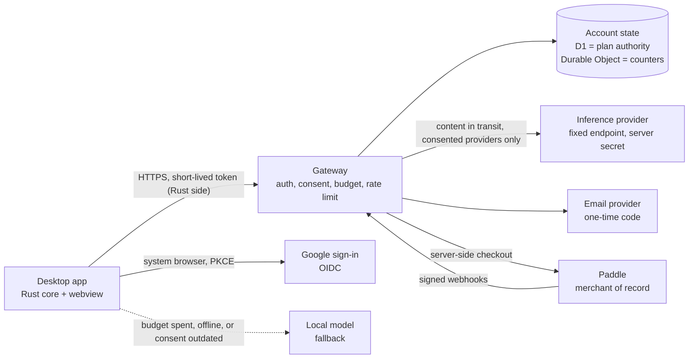

# StudentLLM Cloud plan

Status: planned, not implemented. This document is a decided product and engineering plan for an optional paid cloud tier. It is a draft for human review: every price, provider term and legal point marked "verify" must be rechecked against official sources before launch. No cloud code exists in this repository yet.

Related documents:

- [cloud-api.md](./cloud-api.md): the HTTP contract the implementers code against.
- [terms-of-service.draft.md](./legal/terms-of-service.draft.md) and [privacy-policy.draft.md](./legal/privacy-policy.draft.md): legal drafts that need review by a qualified lawyer before any use.

## Principles

1. The local app is the product. Everything that works today keeps working offline, forever, for free.
2. Cloud is a separate, optional mode. It is off by default and never required.
3. Course content leaves the machine only after an explicit consent, only for the feature the user is using, and only to providers the user consented to.
4. The service keeps as little as possible: no content, no prompts, no answers. Only what is needed to run an account and a quota, listed completely in [Data flow and what is stored](#data-flow-and-what-is-stored).
5. The service never makes the free app worse. No feature is removed from the free tier to sell it back.

This is consistent with [SECURITY.md](../SECURITY.md): local mode makes no implicit network request, and course data is private by default. See [Zero ambient traffic](#zero-ambient-traffic) for the rules that make this testable.

## Product tiers

| | Free | Plus |
| --- | --- | --- |
| Price | 0 | 6 EUR per month (VAT included), or a semester pass of about 25 EUR for 5 months |
| Local app (recording, import, notes, search, chat, study, export) | Full | Full |
| Local models, local ASR sidecar, local document sidecar | Yes | Yes |
| Bring your own provider key (a key the user owns) | Yes, free | Yes |
| Larger cloud models | No | Yes |
| Monthly credit budget | Not applicable | Yes, with a visible meter |
| Cloud transcription and OCR | No | Yes |
| Encrypted backup and sync across devices | No | Planned for after the first cloud launch (phase 6), included in Plus when it ships |
| Ads | Never | Never |
| Overage charges | Not applicable | Never |

Decided points:

- The free tier is the full local app, with no ads and no feature removal. Bring-your-own-key stays free because the key and the cost belong to the user.
- There is no 2 EUR tier and there are no ads. The unit economics below explain why a tier that low does not work with a hard cost cap.
- A student discount is planned. Its price floor comes from the break-even computed in [Unit economics](#unit-economics); the verification method is an open item.
- The semester pass is a one-time payment for a fixed 5-month period that does not renew by itself (to confirm with the lawyer). Buying a second pass while one is active extends the end date by 5 months; it does not stack budgets.
- Backup ships after the first cloud launch because it is the least specified part. The launch scope is cloud models, cloud transcription and OCR, accounts, quota and billing. See [Backup design (later)](#backup-design-later).
- Budgets are monthly and do not roll over. When the budget is spent, the app falls back to the local model (see [Quota design](#quota-design)). Nothing is billed beyond the plan price.

## Architecture

A small separate service, the **gateway**, sits between the desktop app and one or more inference providers. It lives outside the app bundle. It will be documented first under a new top-level `cloud/` directory (design notes only, no code) and implemented from phase 2. Cloudflare Workers is the suggested host because it fits a small service with per-user counters, but the design is provider-agnostic: the app speaks an OpenAI-compatible API to the gateway and the gateway speaks OpenAI-compatible APIs upstream. The HTTP contract is in [cloud-api.md](./cloud-api.md).

Components:

- **Desktop app.** Keeps its local-first behavior. A new "cloud" provider is one more OpenAI-compatible provider, but all gateway calls and all token handling happen in the Rust side of the Tauri app (see [Desktop client requirements](#desktop-client-requirements)). The webview never sees a token. Cloud is desktop-only in the first release; the browser build does not offer it, because it has no safe place to hold a refresh token.
- **Gateway.** Verifies the access token, checks consent, plan and budget, applies rate limits, validates and rewrites the request, forwards it to the routed model, streams the answer back, and settles usage. It has no endpoint that returns stored content, because it stores none.
- **Account state.** D1 (or an equivalent SQL store) is the authority for accounts, plans, consent and the webhook ledger. One Durable Object per account holds the live credit counters and reservations and is reconciled with D1 periodically. The final storage choice is an open item.
- **Auth module.** Part of the gateway. Verifies Google ID tokens, issues and verifies one-time email codes, and mints session tokens.
- **Billing.** The gateway creates Paddle checkouts server-side and receives Paddle webhooks. The app never decides its own plan.
- **Model routing table.** A configuration file mapping a logical model name to a provider, upstream model id, required provider set, credit weights and limits. Changing a model or provider inside a consented provider set is a config change and a deploy, not an app release.

## Data flow and what is stored

Chat or note-formatting request with Plus enabled:

1. The app checks that consent exists for this feature and provider set and that the user is signed in. If not, it does nothing and uses the local model.
2. The Rust side refreshes the access token if needed (lazily, just before the request), then sends the minimal context it would send to a local model (retrieved passages and the question) to the gateway over HTTPS with the access token, the consent version and an idempotency key.
3. The gateway verifies the token, checks that the account's recorded consent covers the provider set of the routed model, applies the rate limit, validates the body against the allowlist, reserves credits, and forwards the request to the fixed upstream endpoint with the server-held provider key. It sends a per-account pseudonym as the upstream `user` field, never the email or the account id.
4. The answer streams back through the gateway to the app. The gateway settles the usage reported by the provider.
5. The request and answer exist only in memory for the duration of the call.

**The complete list of what the service stores.** This table is the single source for the privacy policy; anything not in it is not stored.

| Record | Fields | Purpose | Retention |
| --- | --- | --- | --- |
| Account | internal account id (random, opaque, the key for everything), sign-in email (normalized to lower case, stored in clear because the service must send mail to it), email verified flag, Google subject id if linked, status, created at, last sign-in at, last request at | Run the account | Until closure, plus platform snapshot retention |
| Pending sign-in | hash of the OAuth state, `code_challenge`, redirect type, optional link ticket id, one-time code hash (keyed HMAC), attempt and resend counters, created at, expires at | Complete one sign-in | Deleted on use or expiry (10 minutes) |
| Sign-in counters | failed-attempt and request counters keyed by a salted hash of the email and of the connection address; the salt rotates, entries expire after 24 hours | Brute-force and abuse limits | 24 hours; no raw IP address is stored |
| Sessions | refresh family id, hash of the current refresh token, device id, device label (platform name, editable by the user), created at, last used at, revoked at | Refresh, revocation, device list | Until expiry or revocation, then deleted |
| Consent | consent id, provider set, features, consent text version, granted or withdrawn, time | Prove and enforce consent | Account lifetime plus a proof period |
| Plan | plan id, status, period start and end, budget anchor date, cancel-at-period-end flag, Paddle customer id and subscription id, time of the last applied event | Entitlement | Until closure plus accounting obligations |
| Webhook ledger | Paddle event id, event type, `occurred_at`, processing state, and an allowlist of fields (ids, status, period, price id); events for an unknown account id are kept in quarantine without creating an account | Idempotency, audit | [PLACEHOLDER: period, for example 90 days] |
| Usage | credits used and reserved per budget window and per feature, request counts, reservations (request id, credits, state, expiry), settled request ledger (request id, feature, logical model id, credits, time) | Enforce the budget; show the meter; idempotent settlement | Ledger rows 24 hours for idempotency, then folded into window totals; totals for [PLACEHOLDER: period] |
| Operational logs | request id, account id, route, status code, credits charged, latency, time | Operate and debug | [PLACEHOLDER: period, for example 30 days] |
| Backup ciphertext | not stored at launch; see the later phase | | |

What the service never stores: course content, transcripts, documents, audio, images, prompts, model answers, IP addresses, geolocation, request or response bodies, access tokens, plaintext refresh tokens or one-time codes, card data, billing addresses. Provider keys and signing keys are server secrets, not account data.

Two honest notes. The sign-in email is stored in clear, because sending a code requires it. The network and hosting provider necessarily see IP addresses and connection metadata while delivering requests; the service itself does not store them and the privacy policy says so.

## Zero ambient traffic

SECURITY.md says local mode does not make an implicit network request. The cloud mode keeps that promise for everyone who has not triggered a cloud action:

- The app makes no gateway request unless the user triggers a cloud action (sign in, a cloud request, a billing action) or opens the cloud panel. Being signed in does not change this.
- Token refresh is lazy: it happens just before a cloud request, never on a timer or at launch.
- There is no polling. The usage meter is updated from the credit headers on every response and from one fetch when the cloud panel opens.
- The app has no updater, and cloud adds none. Version compatibility is handled by the minimum-client-version handshake: `GET /v1/status` is called when the cloud panel opens, and every response carries a `min client` header. No version check runs for users who never touch cloud.
- No telemetry or analytics is sent to the service, with cloud on or off.
- Required test: with the user signed in and every cloud feature off, an app session (launch, recording, import, chat with a local model, idle time) produces zero requests to the gateway host. The test runs in CI against a request-recording network stub, and also asserts zero requests for a user who never signed in.

## Authentication

Sign-in methods: Sign in with Google (OpenID Connect) and a typed one-time code sent by email. No passwords are created or stored. There is no clickable login link, so link scanners and cross-site request tricks cannot complete or consume a sign-in.

The account key is the internal account id. An email address or a Google subject id is a login identifier attached to an account, never the key.

**Google path** (system browser, PKCE, no embedded web view):

1. The user clicks **Sign in with Google**. The Rust side generates a PKCE `code_verifier` and `code_challenge`, a random `state`, and starts a loopback listener on `127.0.0.1` on an ephemeral port (a deep link is the fallback where loopback is not possible).
2. The app opens the system browser on the gateway's `/auth/start` with the `code_challenge`, `state` and redirect URI. The gateway runs the OIDC authorization code flow with Google, requesting only the `openid` and `email` scopes and no offline access, so Google issues no refresh token.
3. The gateway verifies the ID token (signature, issuer, audience, expiry, nonce) and requires `email_verified=true`. Any other value is a failed sign-in. After verification the gateway discards every Google token; nothing from Google is kept except the subject id and the verified email.
4. The gateway redirects to the loopback or deep-link URI with a short-lived, single-use authorization code (about 60 seconds) and the app's `state`. The app checks `state` and exchanges the code plus the `code_verifier` at `/auth/token`.

**Email path** (no browser, no loopback):

1. The user types an email address. The Rust side generates a PKCE pair and calls `/auth/email/request` with the email and the `code_challenge`. The response is identical whether or not the address is known.
2. The email carries an 8-character one-time code (an alphabet without look-alike characters, about 40 bits). The code is valid for 10 minutes, single use, stored only as a keyed HMAC, and bound to the `code_challenge` of the request that asked for it.
3. The user types the code in the app. The Rust side calls `/auth/email/verify` with the email, the code and the `code_verifier`. Only the device that requested the code can complete the sign-in.
4. Attempt limits: at most 5 wrong attempts per code, after which the code is invalidated; a cap on code requests per address and per connection hash per hour; a minimum interval between resends; generic error messages. A dictionary of disposable domains may be added later.

**Email normalization.** Addresses are lower-cased (and the domain converted to its ASCII form). The `+` tag and dots are not collapsed: `a.b@x.com` and `ab+c@x.com` are different addresses.

**Account linking.** A Google identity and an email address are linked to the same account only after a fresh proof of control of both: the signed-in session must have authenticated within the last 5 minutes (or re-authenticate), the gateway issues a single-use link ticket, and the second method must then complete its own sign-in carrying that ticket. Matching email alone never links or merges accounts, including a Google email equal to an existing email account.

**Sessions and tokens.**

- Access token: a signed JWT valid for about 15 minutes, algorithm pinned (EdDSA; `alg` from the token is never trusted), fixed `iss` and `aud`, `kid` resolved from a published JWKS. Claims are listed in [cloud-api.md](./cloud-api.md#access-token). The plan is not in the token; it is read from account state.
- Refresh token: opaque, rotated on every refresh, hashed at rest, bound to a device record. Reuse of a rotated token outside a short grace window revokes the whole session family. The grace window (about 30 seconds) lets a client retry a refresh whose response was lost.
- Revocation: effective at the next request (the session state is checked where the credit counter is checked), with a target of about 60 seconds and a hard bound of the access-token lifetime. Sign-out and device revocation are available from the account screen.
- Refresh tokens live in the operating system credential store, held by the Rust side. Access tokens are held in memory only.

**Loopback redirect rules.** The gateway matches the redirect URI by scheme, host `127.0.0.1` and exact path, and ignores the port, as RFC 8252 prescribes for loopback clients. A listener accepts one request and closes. Deep-link redirects are a fallback only: on Windows and Linux, any local application can register the same custom scheme, so the OS gives no ownership guarantee. The mitigations are the PKCE verifier (an intercepted code is useless without it), `state` checking, a 60-second single-use code, and preferring loopback.

## Quota design

- **Credits.** The budget is a single pool of credits normalized to provider cost: one credit equals a fixed small amount of money (for example 0.0001 EUR) at the routing-table price of the model, with a safety margin. Chat, note formatting, transcription and OCR all draw from the same pool, and a pricier model draws more credits per token. The cost ceiling in [Unit economics](#unit-economics) is real only because credits are cost-normalized: if the budget were counted in raw tokens, a switch to a pricier model or a heavy use of audio would break the ceiling.
- **Budget window.** Each Plus account has a monthly budget window anchored on the day Plus first became active for it (clamped to the month length). Windows are computed from the stored anchor and period dates, never from the arrival of a webhook. Resubscribing after a lapse does not reset the budget: the used credits of the current window stay. A semester pass covers five consecutive windows. A second pass bought while one is active extends the end date and does not add budget.
- **Reserve then settle.** Before forwarding, the gateway reserves an estimate: input tokens counted server-side plus the clamped maximum output tokens. After the response it settles real usage and releases the difference.
  - A reservation has a time-to-live of 2 minutes. A reconciler (a scheduled job and an on-access sweep) handles expired reservations: one that never reached the provider is released; one that was forwarded and never settled is settled at the full reservation, so a crash cannot create free usage.
  - A stream that ends without a usage chunk is settled at the full reservation. The gateway forces the provider to include usage in streamed responses.
  - Reasoning tokens count as output tokens.
  - Audio and image sizes are estimated on the server from the bytes received (container duration, pixel dimensions), never from client-declared values.
  - Settlement is idempotent per request id. A retry with the same idempotency key reuses the reservation or is refused with the earlier outcome; it never charges twice.
- **Requests that would exceed the remaining budget** are refused before forwarding with `budget_exhausted`.
- **Limits per request.** Maximum input size, clamped output tokens, maximum request duration, image count and size, and audio duration and size, all from the routing table.
- **Rate limit.** A short sliding window per account (for example 20 requests per minute and 2 concurrent requests) plus limits on the unauthenticated endpoints keyed by a hashed connection identifier. Values are config.
- **Where state lives.** D1 is the authority for plan state (plan, period, anchor). The per-account Durable Object holds the live counters and reservations, so parallel requests cannot overspend, and writes window totals back to D1 periodically. If an object is lost, the counters are rebuilt from the last D1 snapshot with open reservations counted at their full amount.
- **Meter.** Credit headers on every response and `GET /v1/usage` return the remaining credits. The app shows a usage meter whenever cloud is on and warns at 80% and 100%.
- **Fallback.** When the budget is spent, the consent is outdated, a kill switch is active, or the gateway is unreachable, the app switches automatically to the configured local model and tells the user plainly, once per episode. If no local model is available it says so and does not retry against the cloud. There is no overage charge and no way to buy extra credits in the first version.
- **Plan lapse.** If the plan ends the account becomes a free account: the cloud features stop and the local app is unchanged.

## Provider strategy

Rule: production traffic must use an inference provider whose contract allows commercial use. Prices and model availability change often; they must be rechecked on each provider's official pricing, models and terms pages before launch and again at every routing change. Anything below about prices or model status is unverified (as of 2026-10-31, verify).

- **NVIDIA NIM.** The free API catalog at `integrate.api.nvidia.com` is a trial offer and is not for production use. Several keys must not be combined or rotated to multiply rate limits; doing so would circumvent the terms and is excluded explicitly. NIM stays limited to development (the opt-in dev provider described in [providers.md](./providers.md)) and to users who bring their own key. It is never put behind the paid gateway.
- **First production model: `gpt-oss-120b` on Groq**, listed there as a production model (as of 2026-10-31, verify at launch). Third-party trackers list gpt-oss-120b at around $0.15 per million input tokens and $0.60 per million output tokens on several providers; this is unverified and used only for sizing.
- **Qwen.** Qwen is the preferred model family, but the only Qwen model listed on Groq is a preview model (reported as Qwen 3.8 27B, verify the exact name and status). Preview models can be discontinued at short notice, so it cannot be the production base. Plan: add a Qwen option on a provider that lists a Qwen model as a production model, after reading that provider's current commercial terms, retention and training policy. Until then Qwen stays available through local models.
- **Provider checklist** before a provider enters the routing table: commercial use allowed; no training on customer data; documented retention (zero or minimal) for API requests; data processing agreement available; processing region and transfer mechanism known; OpenAI-compatible API; stable production model status; published rate limits compatible with the expected load; acceptable uptime history.
- **Provider sets and consent.** Consent is recorded per provider set: a named, versioned list of providers (for example `ps1 = {Groq}`) shown to the user by name. Each logical model in the routing table belongs to exactly one provider set.
- **Routing is configuration.** A table maps logical model names (for example `studentllm-large`, `studentllm-fast`) to provider, upstream model id, provider set, credit weights, limits and an ordered fallback list.
- **Failover only inside the consented set.** The app sends its consent version with each request. The gateway routes only to providers inside the provider set the account has consented to. If the model needs a provider set that is not consented, the gateway returns `consent_outdated` and the app asks for consent again or falls back to the local model. There is no silent cross-provider failover outside the consented set: adding a provider to the routing table for failover means adding it to a new provider set version and obtaining consent again. If every provider inside the set fails, the gateway returns `provider_unavailable` and the app falls back to the local model.
- **Upstream pseudonym.** The gateway sends `user` upstream as an HMAC of the account id under a server-held key, so a provider can rate limit or investigate abuse per user without receiving the account id or email. The privacy policy lists this.
- **Cloud transcription and OCR.** Same rules. The provider and model are chosen in phase 2; audio and images are forwarded in transit only. Candidate models and prices are not decided here.

## Payments

**Paddle as merchant of record.** Paddle is the seller of record toward the customer: it collects payment, computes and remits EU VAT and other sales tax, issues invoices, and handles refunds as the seller. This is the main reason it was chosen for a solo founder. Paddle's fee is reported as about 5% plus $0.50 per transaction (as of 2026-10-31, verify the current schedule and what the percentage applies to).

Why not the alternatives: Lemon Squeezy is moving under Stripe, which makes its future terms and product shape uncertain, and Polar's pricing is unclear. The choice is revisited if the fees hurt (see [Risks](#risks)).

Flow:

1. The signed-in user chooses a plan in the app. The app calls `POST /v1/billing/checkout`; the gateway creates the Paddle transaction server-side with the opaque account id in `custom_data` and returns the checkout URL, which the app opens in the system browser. The client never supplies price ids or custom data. No payment details pass through the app or the gateway.
2. Paddle sends signed webhooks. The gateway handles them as specified below and updates the plan in D1. Webhook handling is idempotent and order-safe.
3. The app learns the plan from the gateway on demand (the cloud panel, or a response header after the plan changes).
4. Cancellation and invoices are handled through Paddle's customer portal (`GET /v1/billing/portal`). A cancellation takes effect at the end of the paid period.
5. On account deletion the gateway cancels the subscription at Paddle before deleting the account, and tells the user what refund rules apply.
6. The service starts in Paddle's sandbox; live mode is switched on only after the end-to-end test in phase 3. Sandbox and live use separate secrets and separate deployments.

**Webhook specification.**

- Verify the HMAC over the raw request bytes (never a re-serialized body), using the timestamp in Paddle's signature header, with a short timestamp tolerance and a constant-time comparison. A request that fails verification is rejected before any parsing.
- Two webhook secrets are accepted at once during rotation. Sandbox and live secrets are never mixed.
- Claim the event id atomically (a unique-key insert in D1) before any side effect. A duplicate returns 2xx without effects. A claim left in `processing` for too long can be taken over; a failed processing releases the claim so Paddle's retry works.
- Apply events by `occurred_at`: an event older than the last applied event for the same subscription is recorded and ignored. For state-changing subscription events the gateway may instead re-fetch the subscription from Paddle's API and apply that state, which is the safer default.
- Respond 2xx fast. Do the signature check and the claim, then process quickly; slow work (emails, cleanups) runs after the response.
- Unknown account id in `custom_data`: respond 2xx, quarantine the event with its allowlisted fields, alert the operator, and never create an account from a webhook.
- Persist and log only an allowlist of fields (ids, status, period, price id, currency). No customer name, address, tax id or card detail is persisted or logged.
- Refunds and chargebacks revoke the plan according to Paddle's adjustment events (event names to verify against Paddle's current documentation).
- Budgets are not touched by webhooks except through the plan period; receiving a webhook never resets credits.

## Security requirements

These are release criteria for the gateway.

**Secrets**
- Provider keys, the Paddle API key and webhook secrets, the email provider key, the Google client secret, the upstream pseudonym key, the code HMAC key and the token signing key exist only as server secrets (for example Workers secrets). They are never in the repository, the app bundle, a log, or a checked-in environment file.
- Separate secrets per environment (staging, production, Paddle sandbox and live). A rotation procedure is documented and rehearsed. The signing key supports rotation through `kid` and a JWKS with overlap.
- No secret is returned by any endpoint. Secret-bearing headers are stripped from logs.

**No content in logs**
- A logging-policy test in CI fails if a log call can receive request bodies, response bodies, prompts or transcripts. Provider error messages are mapped to fixed error codes before they are logged or returned.
- Platform features that persist request payloads (full request logging, replay, body tail sampling) stay off, and this is checked at each deploy.

**Upstream safety (SSRF) and body allowlist**
- The gateway forwards only to a fixed allowlist of upstream endpoints from the routing table. The client never supplies a URL, host, path, header or provider name that reaches the upstream. Redirects from upstream are not followed.
- Request bodies are validated against an allowlist of fields; unknown fields are rejected. Specifically:
  - images are accepted only as `data:` URLs of an allowed image type; `http(s)` URLs are refused;
  - `tools`, `tool_choice`, `functions`, `n` greater than 1 and `logit_bias` are rejected;
  - `max_tokens` is clamped to the routing-table limit; `model` is a logical name that the gateway rewrites to the upstream id; `user` and `stream_options` are set by the gateway;
  - size limits are enforced while the body streams in, so an oversized body is cut off without being buffered whole;
  - audio has explicit duration and size caps computed on the server.

**Abuse, fraud and spend limits**
- Per-account credit budget (hard), short-window rate limit, concurrency limit, per-request caps.
- Sign-in endpoints: limits keyed by hashed email and hashed connection identifier, generic responses, code attempt limits, cooldowns.
- Limits on the number of devices and active sessions per account. Anomaly detection uses the device count and session patterns (many new sessions, repeated refresh reuse, budget exhaustion at the start of every window). It does not use geography or stored IP addresses.
- A **global spend cap**: the gateway keeps a running total of estimated provider cost per day and per month across all accounts; when a configured threshold is crossed it alerts the operator, and at the hard cap it refuses new cloud requests with `kill_switch` (the app falls back to local) until raised.
- A **kill switch** per provider, per feature and global, in config, usable without a deploy and effective within seconds.
- Chargeback and refund events revoke the plan automatically. Account sharing is addressed in the terms and by the device limit.

**Token handling**
- Short-lived access tokens, rotating refresh tokens with reuse detection and a short grace window, revocation checked on every request, device-bound sessions.
- All endpoints require TLS; HSTS on the gateway domain; no cookies for the API; CORS is not enabled for the API, since the only first-party client is the native Rust side.

**Other**
- Dependencies pinned and scanned; minimal third-party code in the gateway.
- A vulnerability disclosure route consistent with [SECURITY.md](../SECURITY.md) applies to the cloud service. SECURITY.md will be updated in phase 4 to describe the optional cloud mode without weakening the local-mode statements.
- Account deletion removes every record in the data table (except what the law requires) and is verified by a test; deleted data may persist in platform snapshots for a documented period.

## Desktop client requirements

- All gateway calls and all token handling happen in the Rust side of the Tauri app. The webview calls Tauri commands and receives streamed text through events. The webview never sees the refresh token or the access token.
- The refresh token is held in the operating system credential store; the access token in memory only.
- **Prerequisite for the desktop cloud phase:** the Tauri configuration currently sets `"csp": null` (see `src-tauri/tauri.conf.json`). That gap must be closed with a restrictive Content Security Policy before any cloud code ships, because untrusted content (imported documents, model output rendered as rich text) reaches the webview and the webview must not be able to reach the gateway or exfiltrate through arbitrary hosts. The allowed `connect-src` is the local sidecars only; gateway traffic is not made from the webview at all.
- The user-set base URL for the gateway is ignored in release builds (mirroring the pinned dev NVIDIA route in [providers.md](./providers.md)).
- Cloud is off by default, with a persistent indicator and the usage meter when on.

## Privacy and consent UX

Cloud is off by default. The first time a user turns it on, or tries a cloud feature, a consent screen appears before any request leaves the machine. It is not a cookie-banner pattern and has no pre-ticked box.

**Legal basis and consent, stated consistently.** The processing the user asks for (sending the content of a request to a provider to get the answer) is performed under the contract (GDPR art. 6(1)(b)). The explicit consent screen is a separate, stricter safeguard that StudentLLM adds on top: no cloud request is sent without it, it is per feature and per provider set, and the user can withdraw it at any time. Withdrawal stops cloud processing immediately and returns the app to local behavior; it does not change what has already been delivered. The privacy policy and the screen use the same wording. Whether consent should also be the legal basis is a question for the lawyer ([LAWYER] note in the privacy policy).

The screen states in plain language:

- what is sent for each feature: chat (the question and the retrieved passages from the course), note formatting (the transcript or document text being formatted), study material (the same), cloud transcription (the audio), OCR (the page or image);
- who receives it: the StudentLLM gateway, then the named providers of the provider set, with their region once known;
- what the service keeps (account, plan, usage counters, timestamps; the full list is linked) and what it does not keep (the content, the prompts and the answers);
- that the provider receives the content in transit to produce the answer, and under which retention terms;
- that cloud use is optional, can be turned off at any time, and that the app then goes back to purely local behavior;
- links to the terms and the privacy policy.

Controls and behavior:

- Consent is recorded per provider set and per feature (chat and notes, transcription and OCR), with the consent text version. A course can be marked "never cloud" at any time; such a course is excluded from every cloud request.
- The app sends the consent version with each request. If the routed model needs a provider set that is not consented, the gateway answers `consent_outdated`, the app does not send, and it asks for consent or uses the local model. A new provider, a new category of data or a material policy change requires consent again.
- A **What will be sent** preview shows the exact payload (the passages and the question) before the first request, and an inspector is available later for each answer.
- While cloud is in use the interface shows a persistent cloud indicator and the usage meter. Each answer states whether it came from a cloud or a local model, and generated content is labeled as AI-generated.
- Consent is stored locally (never part of a backup) and recorded with the account through `POST /v1/consent`.
- Turning cloud off, signing out, or deleting the account is available from the account screen. Withdrawal is as easy as consent.
- Fallback notices are explicit: "Your monthly cloud budget is used up. Using your local model until <date>." The app never silently switches a free user's content to a cloud model.
- A user who never clicks Sign in, and a signed-in user with all features off, make no request to the service.

## Unit economics

All figures are rough, rounded, and based on unverified numbers, each tagged here as of 2026-10-31 and to be verified: the Paddle fee (about 5% + $0.50 per transaction), the gpt-oss-120b prices (about $0.15 / $0.60 per million input / output tokens on third-party trackers), the dollar-euro rate (taken as $1 = 0.90 EUR), and the 20% French VAT rate (Paddle applies the rate of the buyer's country, so the net varies a little). They size a conservative budget; they do not replace a real model with real prices at launch. Not included: fixed costs, the company's own taxes and social charges, support time, currency effects, refunds, and the fee on refunds.

**Monthly subscription, 6 EUR VAT included**

| Line | Amount |
| --- | --- |
| Price paid by the customer | 6.00 EUR |
| VAT at 20% (6.00 / 6) | 1.00 EUR |
| Price excluding VAT | 5.00 EUR |
| Paddle fee: 5% of 6.00 EUR (0.30) + $0.50 (about 0.45) | about 0.75 EUR |
| Net revenue after VAT and payment fee | about 4.25 EUR |

The fee takes about 12.5% of the gross price, a meaningful share because the fixed $0.50 weighs more on a small price.

**Worst-case variable cost per Plus user per month (budget fully used)**

| Line | Amount |
| --- | --- |
| Chat and notes: 3M input + 0.6M output tokens at $0.15 / $0.60 per million (about $0.81) | about 0.75 EUR |
| Cloud transcription and OCR reserve (to be priced in phase 2) | about 0.50 EUR |
| Gateway, state, email (assumed) | about 0.25 EUR |
| Total ceiling | about 1.50 EUR |

The monthly credit pool is sized so that a user who spends all of it costs the company at most about this ceiling. The ceiling is real only because credits are cost-normalized and shared across features: the pool is a money-equivalent budget, not a token count, and the budget is a hard cap with no overage. A typical student will use much less.

**Contribution at the ceiling:** about 4.25 - 1.50 = 2.75 EUR per user per month, before fixed costs and the company's taxes.

**Semester pass, 25 EUR for 5 months:** fee about 1.25 + 0.45 = 1.70 EUR once; VAT about 4.17 EUR; net about 19.1 EUR, or about 3.8 EUR per month. At the 1.50 EUR ceiling the contribution is about 2.3 EUR per month.

**Price floor.** With a fixed $0.50 fee, net revenue for a gross monthly price P is about 0.783 x P - 0.45 EUR. Covering the 1.50 EUR ceiling needs P of about 2.5 EUR, with no margin and no fixed costs. That is why a 2 EUR tier is not offered, and why the student discount must stay above a floor (about 4 EUR gross keeps roughly 1.2 EUR of contribution at the ceiling). The discount level is an open item.

**Break-even by user count** depends on fixed costs not yet known (domain, email, legal, accounting, monitoring, support) and is computed in phase 3 once real costs exist.

## Backup design (later)

Encrypted backup and sync is not part of the first cloud launch. It is the only feature that stores user-derived data on the service, so it gets its own phase (phase 6) and its own consent. It does not change the guarantee that the inference path stores nothing. The design points settled so far:

- **Keys.** The data key lives in the operating system credential store on each device. A recovery phrase is shown once at setup and the user must re-enter it to confirm it was saved. The key is derived and wrapped with Argon2id and an authenticated encryption scheme (an AEAD such as XChaCha20-Poly1305 or AES-256-GCM). There is no server-side key escrow: losing the key and the phrase means losing the backup.
- **Authenticated metadata.** The object id, version, owner and type are bound to each ciphertext as authenticated additional data, so the server cannot swap or replay objects across objects, versions or accounts undetected.
- **Scope in v1.** Opt-in per course, default off. Text artifacts only (notes, transcripts, study material); no audio, images or original source files. A storage cap of 100 MB per account.
- **Consent is device-local.** The cloud consent state and the "never cloud" flags are device-local settings and are never part of a backup payload as consent. On restore, the app starts with cloud off, and "never cloud" flags carried by the backup are restored fail-closed (a flag present in the backup is applied, and a course with an unknown state is treated as never cloud until the user decides).
- **Tenancy.** The account scope comes only from the access token. No endpoint accepts an account id or a path prefix from the client.
- **Metadata that leaks.** Even with strong encryption the service sees object counts, sizes, timestamps, the number of courses synced, and access patterns. Object ids are opaque and random, sizes may be padded to buckets, and the policy lists these as processed data.
- **Lifecycle.** Backup data is deleted on account deletion and on the user's request; a plan lapse leaves a grace period to download it. The endpoints will be added to [cloud-api.md](./cloud-api.md) when the design is finalized.

## Risks

| Risk | Impact | Mitigation |
| --- | --- | --- |
| Provider terms change or forbid the intended use | Service interruption, rework | Provider checklist, contract review before launch, several providers inside consented sets, local fallback |
| Preview model churn (a preview model is withdrawn at short notice) | Broken model option | Only production models in the default routing; previews are never the base; model swap by config inside the consented set |
| NIM trial misuse | Terms violation, account ban | NIM kept to development and bring-your-own-key only; no key pooling or rotation to multiply limits |
| Abuse and account farming | Cost spike | Hard cost-normalized budget, rate and concurrency limits, device limits, anomaly alerts, kill switch, global spend cap |
| Provider price increase | Margin loss | Credit weights tied to the routing table; re-weight or change model by config; spend alarm |
| Payment fees too high for a 6 EUR price | Thin margin | Semester pass reduces per-transaction fees; revisit the provider choice if fees hurt |
| Lemon Squeezy and Polar uncertainty | Limited alternatives | Billing isolated behind one webhook module and the checkout endpoint; plan data portable |
| Webhook forgery, replay or reordering | Free or lost entitlements | Raw-byte HMAC, claim before effects, occurred-at ordering or re-fetch, server-side checkout |
| GDPR: content in transit to a provider and transfers outside the EU | Regulatory exposure | Consent screen per provider set, DPAs with all processors, transfer mechanism per processor, no storage, lawyer review, DPIA decision |
| Webview compromise (the CSP gap) | Token theft | Rust-side tokens, CSP closed before cloud code ships |
| Backup stores ciphertext of student data | Treated as personal data | Later phase, client-side encryption, separate consent, no escrow, deletion on request |
| Minors using the service | Consent and capacity rules | Minimum age in the terms, parental consent path to decide |
| Academic integrity concerns | Reputation | Terms place responsibility on the user; the app keeps source citations |
| Outage of the gateway or provider | Degraded experience | Automatic local fallback; no hard dependency on cloud |
| Solo founder load (support, security, incidents) | Quality risk | Narrow scope, staging, runbook, private beta before launch |
| Consumer law mistakes (withdrawal right, renewal information, mediation) | Fines, refunds | Lawyer review; Paddle handles invoicing, VAT and refunds as the seller, but the consumer information duties need review |

## Rollout phases

Each phase has an exit criterion. A phase does not start the next one until its criterion is met.

| Phase | Scope | Exit criterion |
| --- | --- | --- |
| 0. Local 0.1.0 | Ship the local, free app (in progress; see [status.md](./status.md)) | `v0.1.0` tagged with the draft release published and the local app verified; no cloud code in the app |
| 1. Design and legal review | This plan and [cloud-api.md](./cloud-api.md) finalized; terms and privacy policy reviewed by a lawyer; provider contracts read; company details filled; DPIA decision made | Reviewed legal documents with all placeholders resolved; provider checklist passed for the first production model; written decision on the blocking open items |
| 2. Gateway and private beta | Build the gateway with auth (Google and email code), consent enforcement, credit quotas, rate limits, the body allowlist, the routing table, a staging environment and a minimal non-shipped test client; no billing; a few invited users on a manual allowlist | Security requirements met and tested (logging test, SSRF and allowlist tests, token refresh and reuse tests, reservation and reconciler tests); cost per user measured against the ceiling for four weeks; budget fallback verified; no content in any log confirmed by audit |
| 3. Billing | Paddle in sandbox, then live: server-side checkout, webhooks per the specification, plan changes, cancellation, refunds | Sandbox end-to-end passes (purchase, renewal, cancel, refund, chargeback, failed payment, out-of-order and duplicate webhooks, unknown account id, account deletion with cancellation); first live transaction processed and reconciled; unit economics recomputed with real fees and costs |
| 4. Desktop UI | Prerequisite: the `csp: null` gap closed. Then: Rust-side cloud client, account screen, consent screen, usage meter, local fallback, "never cloud" per course; README, SECURITY.md and provider docs updated | A user can sign in, consent, use a cloud answer, see the meter, hit the budget, and fall back to the local model; the "signed in, all features off, zero requests" test and the "never signed in, zero requests" test pass; the webview cannot read a token; accessibility checks pass |
| 5. Public launch | Open sign-up, public pricing page, support route, status page | Phase 4 criteria hold in production; terms and privacy policy published and linked in the app; monitoring and spend alarms active; a rollback and kill-switch drill completed |
| 6. Encrypted backup (after launch) | Backup design finalized and reviewed; endpoints added to the API contract; client and server implementation; separate consent | Restore tested on a clean device with cloud off after restore; a key-loss test behaves as documented; the 100 MB cap and per-account tenancy are tested; the privacy policy and terms updated and re-consented |

## Open items

Blocking before phase 2:
- Choose the legal entity details, hosting region and email provider; fill every placeholder in the legal drafts.
- Lawyer review of the terms and the privacy policy, including the right of withdrawal, the semester pass renewal, tacit renewal and cancellation, the minimum age, the DPIA question, the legal basis for content in transit, and the AI Act transparency wording.
- Confirm the first production provider's commercial terms, retention, training policy, DPA and processing region; confirm `gpt-oss-120b` is still listed as a production model.
- Decide the account state store and the platform snapshot retention (and its effect on deletion).
- Complete Google OAuth client configuration and check its verification and data-use requirements.

Before phase 3:
- Verify Paddle's fee schedule, what the percentage applies to, payout currency, refund and chargeback costs, its seller-of-record terms for digital services to consumers, the exact webhook event names, and how the withdrawal-waiver acknowledgement is collected at its checkout.
- Decide the student discount level and verification method.
- Confirm whether the semester pass renews automatically (current plan: it does not).

Before phase 4:
- Choose cloud transcription and OCR providers and price them in credits.
- Choose a Qwen production option and its provider after reading current terms.
- Decide retention periods for logs, ledgers and usage totals.
- Decide how bring-your-own-key keys are stored in the packaged app (the OS credential store) and which providers are offered in the packaged build.
- Close the `csp: null` gap and add the zero-traffic tests.
- Update README, SECURITY.md and [providers.md](./providers.md) to describe the cloud mode.

Ongoing:
- Recheck prices and model availability on providers' official pages before launch and at each change.
- Decide the support channel and response commitments.
- Decide whether to publish the gateway design or source (the app stays MIT regardless).
