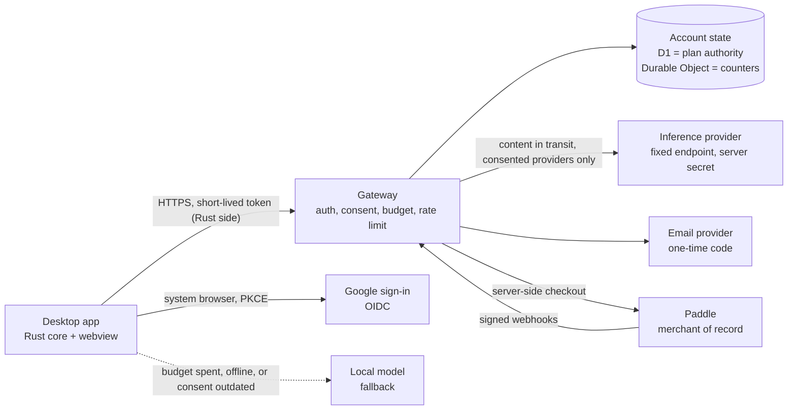

# StudentLLM Cloud plan

Status: planned, not implemented. This document is a decided product and engineering plan for an optional paid cloud tier. It is a draft for human review: every price, provider term and legal point marked "verify" must be rechecked against official sources before launch. The app contains no cloud code; the gateway scaffold lives in [cloud/](../cloud/README.md) (see [Rollout status](#rollout-status)).

Related documents:

- [cloud-api.openapi.yaml](./cloud-api.openapi.yaml): the machine-readable HTTP contract (OpenAPI 3.1), the source of truth for the API.
- [cloud-api.md](./cloud-api.md): explains the contract and its behaviors; [cloud-api-fixtures/](./cloud-api-fixtures/) holds shared conformance examples.
- [terms-of-service.draft.md](./legal/terms-of-service.draft.md) and [privacy-policy.draft.md](./legal/privacy-policy.draft.md): legal drafts that need review by a qualified lawyer before any use.

## Principles

1. The local app is the product. Everything that works today keeps working offline, forever, for free.
2. Cloud is a separate, optional mode. It is off by default and never required.
3. Course content leaves the machine only after an explicit consent, only for the feature the user is using, and only to providers the user consented to.
4. The service keeps as little as possible: no content, no prompts, no answers. Only what is needed to run an account and a quota, listed completely in [Data flow and what is stored](#data-flow-and-what-is-stored).
5. The service never makes the free app worse. No feature is removed from the free tier to sell it back.

This is consistent with [SECURITY.md](../SECURITY.md): local mode makes no implicit network request, and course data is private by default. See [Zero ambient traffic](#zero-ambient-traffic) for the rules that make this testable.

## Product tiers

| | Free | Plus |
| --- | --- | --- |
| Price | 0 | 6 EUR per month (VAT included), or a semester pass of about 25 EUR for 5 months |
| Local app (recording, import, notes, search, chat, study, export) | Full | Full |
| Local models, local ASR sidecar, local document sidecar | Yes | Yes |
| Bring your own provider key (a key the user owns) | Yes, free | Yes |
| Larger cloud models | No | Yes |
| Monthly credit budget | Not applicable | Yes, with a visible meter |
| Cloud transcription and OCR | No | Yes |
| Encrypted backup and sync across devices | No | Planned for after the first cloud launch (phase 6), included in Plus when it ships |
| Ads | Never | Never |
| Overage charges | Not applicable | Never |

Decided points:

- The free tier is the full local app, with no ads and no feature removal. Bring-your-own-key stays free because the key and the cost belong to the user.
- There is no 2 EUR tier and there are no ads. The unit economics below explain why a tier that low does not work with a hard cost cap.
- A student discount is planned. Its price floor comes from the break-even computed in [Unit economics](#unit-economics); the verification method is an open item.
- The semester pass is a one-time payment for a fixed 5-month period that does not renew by itself (to confirm with the lawyer). Buying a second pass while one is active queues its windows after the current ones; budgets never stack. A pass bought while a pass is active queues after it. A subscription cannot be bought while any plan is active, and a pass cannot be bought while a subscription is active (`already_subscribed`).
- Backup ships after the first cloud launch because it is the least specified part. The launch scope is cloud models, cloud transcription and OCR, accounts, quota and billing. See [Backup design (later)](#backup-design-later).
- Budgets are per paid period (one window per billing period, five windows for a semester pass) and do not roll over. When the budget is spent, the app falls back to the local model (see [Quota design](#quota-design)). Nothing is billed beyond the plan price.

## Architecture

A small separate service, the **gateway**, sits between the desktop app and one or more inference providers. It lives outside the app bundle. It lives in the top-level `cloud/` directory, a separate npm project that is implemented from phase 2 (see [Rollout status](#rollout-status)). Cloudflare Workers is the suggested host because it fits a small service with per-user counters, but the design is provider-agnostic: the app speaks an OpenAI-compatible API to the gateway and the gateway speaks OpenAI-compatible APIs upstream. The HTTP contract is in [cloud-api.md](./cloud-api.md).

Components:

- **Desktop app.** Keeps its local-first behavior. A new "cloud" provider is one more OpenAI-compatible provider, but all gateway calls and all token handling happen in the Rust side of the Tauri app (see [Desktop client requirements](#desktop-client-requirements)). The webview never sees a token. Cloud is desktop-only in the first release; the browser build does not offer it, because it has no safe place to hold a refresh token.
- **Gateway.** Verifies the access token, checks consent, plan and budget, applies rate limits, validates and rewrites the request, forwards it to the routed model, streams the answer back, and settles usage. It has no endpoint that returns stored content, because it stores none.
- **Account state.** D1 (or an equivalent SQL store) is the authority for accounts, plans, consent and the webhook ledger. One Durable Object per account holds the live credit counters and reservations and is reconciled with D1 periodically. Durable Objects and storage are pinned to an EU region (see [Data flow and what is stored](#data-flow-and-what-is-stored)). The final storage choice is an open item.
- **Auth module.** Part of the gateway. Verifies Google ID tokens, issues and verifies one-time email codes, and mints session tokens.
- **Billing.** The gateway creates Paddle checkouts server-side and receives Paddle webhooks. The app never decides its own plan.
- **Model routing table.** A configuration file mapping a logical model name to a provider, upstream model id, required provider set, credit weights and limits. Changing a model or provider inside a consented provider set is a config change and a deploy, not an app release.

## Data flow and what is stored

Chat or note-formatting request with Plus enabled:

1. The app checks that consent exists for this feature and provider set and that the user is signed in. If not, it does nothing and uses the local model.
2. The Rust side refreshes the access token if needed (lazily, just before the request), then sends the minimal context it would send to a local model (retrieved passages and the question) to the gateway over HTTPS with the access token. On the POST content routes only, it adds the active consent record id and an idempotency key.
3. The gateway checks, in this order: client version, token and session, terms acceptance and account status (`terms_required`, `account_suspended`), plan, consent, and the rate-limit window. These need only headers and run before the body is read. Then the idempotency lookup (a conflict never consumes a concurrency slot), the concurrency slot, the body validation against the allowlist (size limits are enforced while the body streams in), and last the budget reservation. It forwards the request to the fixed upstream endpoint with the server-held provider key. It sends a per-account pseudonym as the upstream `user` field, never the email or the account id.
4. The answer streams back through the gateway to the app. The gateway settles the usage reported by the provider.
5. The request and answer exist only in memory for the duration of the call.

**The complete list of what the service stores.** This table is the single source for the privacy policy; anything not in it is not stored.

| Record | Fields | Purpose | Retention |
| --- | --- | --- | --- |
| Account | internal account id (random, opaque, the key for everything); the single verified sign-in email, normalized to lower case and stored in clear because the service must send mail to it; Google subject id if linked; the allowed login methods (`google`, `email`); status (`active`, `suspended`; a deleted account has no row, only the tombstone); `terms_version` and time of acceptance; plan version counter; created at, last sign-in at, last request day (day granularity, not every request) | Run the account | Until closure, plus platform snapshot retention |
| Pending sign-in | hash of the OAuth state, `code_challenge`, redirect type, the app's redirect URI and its own `state` (echoed back on the redirect; neither is secret), the device label from the request, accepted `terms_version`, optional link ticket id, one-time code hash (keyed HMAC), for an email sign-in a keyed hash of the normalized address under the non-rotating code key (the lookup key; the address itself is not stored here), the account id once the Google callback resolved the account (for a new user, the verified Google subject id and email instead, for the 60 seconds of the authorization code, because the account is created at `/auth/token` after the PKCE proof), attempt and resend counters, created at, expires at. A new code request replaces earlier codes | Complete one sign-in | Deleted on use or expiry (10 minutes) |
| Link ticket | ticket hash, account id, method, created at, expires at, used flag | Link a second login method after a fresh sign-in | Deleted on use or expiry (5 minutes) |
| Sign-in counters | request and failed-attempt counters keyed separately by a salted hash of the email and by a salted hash of the connection address (an IPv6 address counts as its /64 prefix; a request without a readable address shares one bucket with much stricter limits); the salt rotates, entries expire after 24 hours | Brute-force and abuse limits | 24 hours; no raw IP address is stored |
| Device counters | the device registry (device id, account id, label as a platform name that the user can edit, created at, last used at), number of active devices and sessions per account, and new-session counts per day | Enforce the limit of 3 devices; anomaly detection | While the sessions exist; daily counts 30 days |
| Sessions | refresh family id; hash of the current refresh token; `prev_hash` and `rotated_at` of the previous token; during the grace window only, the successor token encrypted under a key derived from the previous token; `auth_time`; device id (the label is held in the device registry above); created at, last used at; idle expiry (30 days) and absolute expiry (180 days); revoked at | Refresh, retry grace window, revocation, device list | Until expiry or revocation, then deleted; the encrypted successor is erased after the grace window or when the new token is first used |
| Manage token | hash of an opaque random token, account id, expiry (5 minutes), the id of the sign-in code that produced it, use count. The token itself is never stored or logged | Let a user at the device limit list and revoke devices | 5 minutes, then deleted |
| Idempotency record | key hash scoped to account id and route, request id (the attempt that owns the reservation), state (`in_flight`, `failed_before_forward`, `failed_no_usage`, `settled`), credits charged, created at, the lease expiry of an attempt that owns no reservation yet (the route's maximum duration plus 60 seconds: after it a crashed attempt counts as `failed_before_forward`) and a flag saying that a reservation owns the attempt. **No content and nothing derived from content** (no body hash or fingerprint) | Safe retries without double charging | 24 hours |
| Consent | append-only records: consent id, provider set id and version, features, consent text version, granted or withdrawn, time; one active record per provider set | Prove and enforce consent | Account lifetime; erased with the account at deletion [LAWYER: whether a proof of consent must survive deletion] |
| Plan | plan id, status, paid periods (start and end), budget windows (one per paid period, with limit), cancel-at-period-end flag, Paddle customer id and subscription id, time of the last applied event, plan version counter | Entitlement | Until closure plus accounting obligations |
| Webhook ledger | Paddle event id, event type, `occurred_at`, processing state, the claim's attempt number (a fencing token, so a worker whose claim was taken over cannot complete the event), and an allowlist of fields (ids, status, period, price id). All other webhook fields are discarded. Events for an unknown subscription or account are kept in quarantine without creating an account | Idempotency, audit | [PLACEHOLDER: period, for example 90 days] |
| Deletion tombstone | written first, in the same transaction as a deletion-ledger entry and the revocation of every session; holds the opaque account id marked `deleting`, the Paddle customer and subscription ids and retry counters. The per-store erase steps (login identifiers, sessions, devices, consents, usage, plan details, grants, and the email last) then run, each idempotent and retried, and completion is recorded when all are done | Make deletion safe to retry without keeping personal data, and never resurrect a half-deleted account | Until the subscription cancellation succeeds: retried with backoff for 14 days of actual retrying, then handled by hand (the owner cancels in the Paddle dashboard and marks it done); at most [PLACEHOLDER: maximum period, for example 60 days] |
| Usage | credits used and reserved per budget window and per feature, request counts, reservations (request id, feature, logical model id, credits, state, expiry, whether it was forwarded, and the idempotency key hash and route it belongs to, so settling, releasing or sweeping it moves the idempotency record in the same step), the next due time of each account's reservation sweep, settled request ledger (request id, feature, logical model id, credits, time), double-settlement counters | Enforce the budget; show the meter; idempotent settlement | Ledger rows 24 hours, then folded into window totals; totals for [PLACEHOLDER: period] |
| Rate-limit and concurrency state | per-account sliding-window hit times and concurrency leases (lease id, account id, expiry); windows for unauthenticated routes are keyed by a salted hash of the connection address, never the address | Enforce the short-window limit and the concurrent-request limit | The window length, or the lease time to live (seconds to minutes) |
| Switches and spend counters | kill-switch flags (global, per provider, per feature) with the time they were set; running totals of estimated provider cost per day and per month, in cost-normalized credits; per-day counts of unknown upstream outcomes by kind (no account, no content) | Kill switches, the global spend cap (it stops new requests once reached and can be overshot by the reservations in flight) and the review of the full-reservation rule | A switch until it is cleared; totals [PLACEHOLDER: period] |
| Operational logs | request id, account id, route, status code, credits charged, latency, time | Operate and debug | [PLACEHOLDER: period, for example 30 days] |
| Admin record | admin id (random, opaque); the admin's email, lower case, in clear (it must match the verified gate identity and receive alerts); role (`owner` in the first cut; `admin` and `support` later); status; created at, created by; disabled at, removed at; last seen at. See [cloud-admin.md](./cloud-admin.md#data-tables) | Map a verified admin identity to a role | While the admin exists; the email is erased on removal |
| Admin credential | WebAuthn credential id and public key, signature counter, label, admin id, created at, last used at | The in-service step-up (user verification) for sensitive admin actions | While the admin exists |
| Admin enrollment ticket | hash of a single-use ticket, admin id, valid from, expires at, used flag | Enroll the first credential after bootstrap or recovery | Deleted on use or expiry |
| Admin session | session id (random nonce); admin id; gate `sub`; login and latest `iat`; created at, last seen at, expires at. No JWT, no IP address, no user agent | Bind a page load to a gate identity; carry the CSRF token | 30 minutes idle, 8 hours absolute |
| Admin step-up challenge | challenge id, admin id, session id, the method, full path and body hash it is bound to, expires at (5 minutes), used flag | One single-use step-up per action | Deleted 1 hour after expiry or use |
| Admin invitation | later phase: invitation id, invited email, role, code hash (keyed HMAC), attempt counter, state, created by, created at, expires at | Add an admin once, after login through the gate | 30 days after it is resolved |
| Admin idempotency record | key hash scoped to admin id; SHA-256 digest of method, full path and canonical body; state; stored status and response body (metadata only); created at | Safe retries of admin writes | 24 hours |
| Admin operation | operation id; kind; account id; state; effective from; executes at; previous status; hold reason; attempts; last error code (fixed code); next retry at; requested by; created at, updated at; audit id; outbox steps | Make multi-store and Paddle steps visible, retryable and withdrawable | [PLACEHOLDER: period, for example 90 days after it ends] |
| Grant | grant id; account id; state; reason category; days; starts at, ends at, original ends at; budget percent; the grant's windows (start, end, limit, used; source `admin_grant`); optional admin note; created by; audit id | Complimentary periods and their cost caps | With the account |
| Grant ledger | atomic counters: committed window limits per calendar month; grants per admin per day. No account id | The monthly and per-admin caps | Current and previous 12 months |
| Grant allowance counter | keyed hash (HMAC) of the normalized email; grant days used in the rolling window; last grant at. No raw email | The yearly per-person cap, which delete-and-re-register must not reset | 12 months after the last grant [PLACEHOLDER: confirm with the lawyer]; survives account deletion |
| Grant totals | month; grants created; credits granted; credits used. No account id | Cost monitoring | [PLACEHOLDER: period] |
| Blocklist entry | later phase: entry id; kind; key id; keyed hash (HMAC) of the normalized email or Google subject id; state; reason category; created at, expires at; created by; audit id. The email is not stored | Stop re-registration after a ban | Until its expiry (at most 730 days) or removal [PLACEHOLDER: confirm with the lawyer] |
| Admin audit log row | audit id; sequence number; chain version; time; actor kind, actor admin id and role; action; target account id and target admin id; reason commitment (salted hash); request id; session_ref (HMAC of the session id); optional coarse country (off by default); result and result code; closed per-action parameters; previous hash and row HMAC. No IP address, no content, no email, no raw token, no reason text | Accountability and tamper evidence (append-only, HMAC-chained, written by a separate audit-writer Worker) | [PLACEHOLDER: audit retention period, for example 12 months] |
| Admin audit reason | audit id; salt; the admin-written reason encrypted under a per-account key (destroyed when the account is deleted) | The reason, outside the chain | With the audit row; unreadable after account deletion |
| Admin audit anchor | sequence number, row hash, time, environment, Ed25519 signature, where published | Detect rewriting of the whole chain | Same as the audit log |
| Deletion ledger | account id; erased at; source (`user` or `admin`). No email | Re-apply erasures after a restore of a database snapshot | At least the snapshot retention plus a margin [PLACEHOLDER: period] |
| Admin system flag | writes frozen (boolean); frozen at; frozen by; journal of freeze events pending an audit back-fill | The global freeze of admin writes, independent of the audit writer | Current value; journal until back-filled |
| Backup ciphertext | not stored at launch; see the later phase | | |

What the service never stores: course content, transcripts, documents, audio, images, prompts, model answers, IP addresses, geolocation, request or response bodies, body hashes or fingerprints of user requests (the admin surface stores a digest of its own requests, which carry no user content), access tokens, plaintext refresh tokens or one-time codes, card data, billing addresses, names or tax identifiers from payment events. Provider keys and signing keys are server secrets, not account data.

Two honest notes. The sign-in email is stored in clear, because sending a code requires it. The network and hosting provider necessarily see IP addresses and connection metadata while delivering requests; the service itself does not store them and the privacy policy says so.

**Hosting region and snapshots.** Durable Objects and storage are pinned to an EU region or jurisdiction (verify the exact options the platform offers as of 2026-10-31). The gateway code itself may run at edge locations outside the EU while a request is in transit, unless the platform's regional controls are used; whether to pay for them is an open item. The D1 snapshot retention (point-in-time recovery) is platform-defined; choose the shortest the platform allows and record the real value (verify) in the privacy policy, because deleted data can persist in snapshots for that period.

## Zero ambient traffic

SECURITY.md says local mode does not make an implicit network request. The cloud mode keeps that promise for everyone who has not triggered a cloud action:

- A signed-out cloud panel is static: it explains cloud, shows the bundled terms and privacy notice and a **Sign in** button, and makes no request when it opens.
- The app makes no gateway request unless the user triggers a cloud action (sign in, a cloud request, a billing action) or opens the cloud panel while signed in. Being signed in does not change this for users who never open the panel or use a cloud feature.
- The service status (`GET /v1/status`) is fetched only after sign-in, when the signed-in panel opens, or after an explicit "check service status" click. Never from the signed-out panel and never in the background.
- Token refresh is lazy: it happens just before a cloud request, never on a timer or at launch.
- There is no polling. The usage meter is updated from the credit headers on every response and from one fetch when the signed-in panel opens. A changed `X-StudentLLM-Plan-Version` header on a response triggers one refetch of the account.
- The app has no updater, and cloud adds none. Version compatibility is handled by the minimum-client-version handshake: the status call and an `X-StudentLLM-Min-Client` header on responses. No version check runs for users who never touch cloud.
- No telemetry or analytics is sent to the service, with cloud on or off.
- Required tests, run in CI against a request-recording network stub: (1) a user who never signed in, through a full app session, produces zero requests to the gateway host; (2) the signed-out cloud panel opens with zero requests; (3) a signed-in user with every cloud feature off, through launch, recording, import, chat with a local model and idle time, produces zero requests.

## Authentication

Sign-in methods: Sign in with Google (OpenID Connect) and a typed one-time code sent by email. No passwords are created or stored. There is no clickable login link, so link scanners and cross-site request tricks cannot complete or consume a sign-in.

The account key is the internal account id. An email address or a Google subject id is a login identifier attached to an account, never the key.

**Terms before sign-in.** The app shows the bundled terms of service and privacy notice, with their version, and requires an explicit accept before it calls `/auth/start` or `/auth/email/request`. The accepted `terms_version` is sent with that call. The gateway stores `terms_version` and the time at account creation; a missing or outdated version gives `terms_required` and no account is created. For an existing account, a newer terms version gives `terms_required` on the next cloud call; the app shows the new terms and posts the acceptance to `/v1/account/terms`.

**Gating exceptions.** `terms_required` and `account_suspended` never block `GET /v1/account`, the account export, account deletion, token refresh, logout, the device routes, the billing portal link (`GET /v1/billing/portal`), `POST /v1/account/terms` and the withdrawal of consent (`POST /v1/consent` with `granted: false`; a grant is gated like any other route), so data-rights routes and the withdrawal of consent always work for a suspended account or one that has not accepted the latest terms. Sign-in routes (`/auth/start`, `/auth/callback`, `/auth/token`, `/auth/email/request`, `/auth/email/verify`) succeed for suspended accounts: the account gets an access token that is usable only on the exempt routes, and every other route returns `account_suspended`.

**Google path** (system browser, PKCE, no embedded web view):

1. After the terms accept, the user clicks **Sign in with Google**. The Rust side generates a PKCE `code_verifier` and `code_challenge`, a random `state`, and starts a loopback listener on `127.0.0.1` on an ephemeral port (a deep link is the fallback where loopback is not possible).
2. The app opens the system browser on the gateway's `/auth/start`. The gateway runs the OIDC authorization code flow with Google, requesting only the `openid` and `email` scopes and no offline access, so Google issues no refresh token.
3. The gateway verifies the ID token (signature, issuer, audience, expiry, nonce) and requires `email_verified=true`. Any other value is a failed sign-in. After verification the gateway discards every Google token; nothing from Google is kept except the subject id and the verified email.
4. The gateway redirects to the loopback or deep-link URI with a short-lived, single-use authorization code (about 60 seconds) and the app's `state`. The app checks `state` and exchanges the code plus the `code_verifier` at `/auth/token`.

**Email path** (no browser, no loopback):

1. After the terms accept, the user types an email address. The Rust side generates a PKCE pair and calls `/auth/email/request` with the email, the `code_challenge` and the `terms_version`. The response is identical whether or not the address is known.
2. The email carries an 8-character one-time code (an alphabet without look-alike characters, about 40 bits) and no link. It tells the user to enter the code only in StudentLLM, on the device where it was requested, and that nobody will ever ask for it. The code is valid for 10 minutes, single use, stored only as a keyed HMAC, and bound to the `code_challenge` of the request that asked for it. **A new request invalidates all earlier codes for the address.**
3. The user types the code in the app. The Rust side calls `/auth/email/verify` with the email, the code and the `code_verifier`. Only the device that requested the code can complete the sign-in.
4. Limits: at most 5 wrong attempts per code, after which it is invalidated; 5 code requests per hour per address; a separate, larger cap per hashed connection address (the two counters are independent); a minimum interval of 60 seconds between resends, inside which a further request changes nothing (the earlier code stays valid, no mail is sent) and is answered with the same 202; failed checks are counted per address and connection together and per connection, never per address alone; generic error messages.

**Loopback listener.** The listener stays open until a request carrying the right `state` arrives or a timeout (for example 5 minutes). A request with a missing or wrong `state` is answered with an error page and ignored; it does not close the listener, so a stray local request cannot cancel the sign-in. It then closes.

**Email normalization.** Addresses are lower-cased (and the domain converted to its ASCII form). The `+` tag and dots are not collapsed: `a.b@x.com` and `ab+c@x.com` are different addresses.

**Identity rules.**

- One verified email per account. A sign-in whose email already belongs to a different account, or a link attempt whose email differs from the account's email, returns `identity_conflict`; matching email alone never links or merges accounts. The user signs in with the existing method and links the other method from the account screen.
- **A sign-in succeeds only for a method currently in the account's `login_methods`.** Google sign-in for an account that no longer has Google (or never linked it) returns `identity_conflict`; email sign-in for an account whose email method is not in `login_methods` returns the generic `invalid_code`, so the response does not reveal that the address exists.
- Lookup order at sign-in: by Google subject id first, then by email. If the Google subject id is known, the account is that one, even if Google's email has since changed.
- **When Google's email changes:** the account is kept (it is keyed by the subject id) and the stored email is **not** updated automatically; the account screen shows the stored email. A change of the stored email is not supported in v1 (open item).
- **Linking** needs a fresh proof of control of both methods: a fresh sign-in of the signed-in account (`auth_time` within 5 minutes), a single-use link ticket, then the second method's own sign-in carrying the ticket. Failures at ticket issuance: `reauth_required`, and `identity_conflict` if the method is already linked. Failures at completion: the Google callback redirects with `error=identity_conflict`, and `/auth/email/verify` returns 409 `identity_conflict`, when the second method's email differs from the account's email or belongs to another account. **Completion returns success, not a new session**: the client passes its current `device_id` and keeps the same device and tokens.
- **Unlinking:** `DELETE /v1/account/login-methods/{method}` removes a method, never the last one (400 `invalid_request`), and needs a fresh sign-in. After unlinking, sign-in with that method fails as described above.
- A notification email is sent to the account address when a method is linked or unlinked and when the account is deleted.

**Re-authentication** means a fresh sign-in. It sets a new `auth_time` in the session; a refresh copies `auth_time` unchanged, so a stolen refresh token cannot refresh its way into a fresh-auth action (account deletion, linking, unlinking, export).

**Sessions and tokens.**

- Access token: a signed JWT valid for about 15 minutes, algorithm pinned (EdDSA; `alg` from the token is never trusted), fixed `iss` and `aud`, `kid` resolved from a published JWKS. Claims are in the OpenAPI file (`AccessTokenClaims`). The plan is not in the token; it is read from account state.
- Refresh token: opaque, rotated on every refresh, hashed at rest, bound to a device record. **Lifetime:** 30 days idle, 180 days absolute; after either, `session_revoked`.
- **Rotation and retry grace.** On rotation the gateway keeps the previous token's hash and `rotated_at`, and stores the successor token encrypted under a key derived from the previous token (there is no deterministic derivation of tokens from a server key). Presenting the previous token again within about 30 seconds, before the successor was used, decrypts and returns the same successor, so a client that lost the response can retry. The encrypted successor is erased when the grace window ends or the successor is first used. Any other reuse of a rotated token revokes the whole session family (`refresh_reuse`).
- **Residual risk (accepted):** during the grace window, anyone who holds the previous token can obtain the successor. The window is short, TLS protects the transport, the previous token lives only in the OS credential store of the same device, and the first use of the successor erases the stored copy.
- **Devices.** A client-supplied `device_id` is honored only if it belongs to the authenticated account; otherwise a new device id is created. At most 3 devices per account. The limit check and the device insert are one atomic step inside the account's Durable Object, so two parallel sign-ins cannot both take the last slot.
- **Manage token.** A sign-in on a fourth device through the email path returns 409 `device_limit_reached` with a `manage_token` in a dedicated response schema (`DeviceLimitResponse`), never in `error.details`, so the error envelope's rule of carrying no secrets stays true. The manage token is an opaque random token (not a JWT), valid 5 minutes, stored hashed, and single-purpose: it works only for `GET /v1/devices` and `DELETE /v1/devices/{device_id}`; every other route rejects it with `insufficient_scope` (403). The gateway tells a manage token from an access token on `Authorization: Bearer` by the `mt_` prefix, which is checked first. A token without that prefix is parsed as a JWT, and a malformed one gets `invalid_token`; an `mt_` token on any route other than the two device routes gets `insufficient_scope`. It must never be logged. A successful code check at the limit does not count as an attempt and leaves the code unconsumed, and at most 3 manage tokens are minted per code. Revoking a device with a manage token sends a notification email to the account address. After revoking, the client retries the sign-in with the same code.
- **The Google path issues no manage token.** A user at the limit who signs in with Google revokes a device from another signed-in device, or, if the email method is linked, uses the email path, and then retries. A Google-only user (the email method is not linked) at the limit with no other signed-in device cannot self-serve: they wait for the 30-day idle expiry of an old session or contact support. Under a manage token the device list reports `current: false` for every device.
- **Revocation** is written to the account's Durable Object, the same object that holds the credit counters, so it is immediate on the inference path. Sign-out and device revocation are available from the account screen. `auth_time` is unchanged by refresh.
- Refresh tokens live in the operating system credential store, held by the Rust side. Access tokens are held in memory only.

**Loopback redirect rules.** The gateway matches the redirect URI by scheme, host `127.0.0.1` and exact path, and ignores the port, as RFC 8252 prescribes for loopback clients. Deep-link redirects are a fallback only: on Windows and Linux, any local application can register the same custom scheme, so the OS gives no ownership guarantee. The mitigations are the PKCE verifier (an intercepted code is useless without it), `state` checking, a 60-second single-use code, and preferring loopback.

## Quota design

- **Credits.** The budget is a single pool of credits normalized to provider cost: one credit equals a fixed small amount of money (for example 0.0001 EUR) at the routing-table price of the model, with a safety margin. Chat, note formatting, study material, transcription and OCR all draw from the same pool, and a pricier model draws more credits per token. The cost per request is **rounded up to a whole credit per request**. The cost ceiling in [Unit economics](#unit-economics) is real only because credits are cost-normalized: if the budget were counted in raw tokens, a switch to a pricier model or a heavy use of audio would break the ceiling.
- **Budget windows.** There is one budget window per paid period.
  - A monthly subscription gets one window per billing period, with the dates of the paid period reported by Paddle.
  - A semester pass gets five consecutive windows of one month each, from its start.
  - A new purchase starts a new anchor: if no plan is active it starts at the purchase. A pass bought while a pass is active queues its windows after the current ones (the end date is extended and budgets are never stacked inside one window). A subscription cannot be bought while any plan is active, and a pass cannot be bought while a subscription is active; both are refused with `already_subscribed` (meaning an active plan exists).
  - `past_due`: the current window continues until its end, and no new window starts until the payment succeeds.
  - Windows are keyed by their start date. Receiving or replaying a webhook can create a missing window but never resets the used credits of an existing one. Budgets reset on the period boundary, never on webhook receipt.
  - A chargeback, and a **full** refund, withdraw the windows the refunded payment bought (when the event names no payment: the running window and all later ones), and only windows sourced from Paddle payments. A **partial** refund changes nothing and alerts the operator: a proportional refund after a withdrawal is a normal flow (terms of service, 5.2), not a revocation. A full refund of a subscription payment also cancels the subscription immediately at Paddle (a refund does not cancel it, and the renewals would start entitlement again); a partial refund does not.
  - Because a subscription cannot be bought again while active (`already_subscribed`, including one set to cancel at period end), cancelling and resubscribing cannot be used to reset a budget early.
- **Reserve then settle.** Before forwarding, the gateway reserves an estimate: input tokens counted server-side plus the clamped maximum output tokens. After the response it settles real usage and releases the difference.
  - **Reservation TTL:** the routing-table maximum duration for the route plus a 60-second margin, extended by a heartbeat while a stream is making progress. A reconciler (a scheduled job and an on-access sweep) handles expired reservations: one that never reached the provider is released; one that was forwarded with an unknown outcome (a crash, a missing usage chunk, a client abort after the first token) is settled at the full reservation, so a crash cannot create free usage.
  - **Double settlement:** the first settlement wins. Later settlements for the same request id are ignored and counted (a counter, never content).
  - A stream that ends without a usage chunk is settled at the full reservation, with one exception: a mid-stream `provider_unavailable` settles on the tokens actually emitted, falling back to the full reservation only if they cannot be counted. The gateway forces the provider to include usage in streamed responses.
  - Reasoning tokens count as output tokens.
  - Audio and image sizes are estimated on the server from the bytes received, never from client-declared values alone. **Transcription** is reserved at `max(declared duration, a bound derived from the byte size)` and settled on the duration the provider reports. Recordings longer than the per-request duration cap are chunked by the client, each chunk with its own idempotency key and timestamp offsets applied when the segments are merged.
- **Idempotency.** Keys are scoped per account and route and exist only on the POST content routes. A record is in one of four states: `in_flight`, `failed_before_forward`, `failed_no_usage`, `settled`.
  - A retry while the record is `in_flight` returns `idempotency_conflict` with `details.state = "in_progress"`; the client waits and does not resend.
  - A same-key retry is allowed from `failed_before_forward` (the reservation is reused) and from `failed_no_usage`.
  - `failed_no_usage` is the terminal state of a call that failed definitively, and is defined strictly: an explicit upstream error response (a definitive error status with no completion), or a connection failure before the request was accepted. The reservation is released and zero credits are charged. `failed_no_usage` events are counted per account per hour as an anomaly signal.
  - Every timeout, gateway abort, reset after bytes were sent, or missing response is an unknown outcome and settles at the full reservation, or on counted tokens where available; a same-key retry then returns `idempotency_conflict` with `details.state = "settled"`. Any other forwarded attempt is settled at actual usage; the full reservation also covers a crash, a missing usage chunk, and a client abort after the first token.
  - A retry after `settled` returns `idempotency_conflict` with `details.state = "settled"`, the original request id and the credits charged; since no content is stored the answer cannot be replayed, and the client uses a new key to regenerate.
  - There is **no body-fingerprint check**, because nothing derived from content is stored. A key identifies an attempt, and clients use a fresh key for each logical request.
  - The lookup runs after the token, plan, consent and rate-limit checks and before the budget reservation, and a conflict never consumes a concurrency slot.
- **Requests that would exceed the remaining budget** are refused before forwarding with `budget_exhausted`.
- **Limits per request.** Maximum input size, clamped output tokens, maximum request duration, image count and size, and audio duration and size, all from the routing table.
- **Rate limit.** A short sliding window per account (for example 20 requests per minute and 2 concurrent requests) plus limits on the unauthenticated endpoints keyed by a hashed connection identifier. Values are config.
- **Where state lives.** D1 is the authority for plan state (plan, paid periods, windows). The per-account Durable Object holds the live counters, reservations and revocations, so parallel requests cannot overspend, and writes window totals back to D1 periodically. If an object is lost, the counters are rebuilt from the last D1 snapshot with open reservations counted at their full amount.
- **Plan changes reach the client** through the `X-StudentLLM-Plan-Version` response header and the `plan_version` field of the account object. The client refetches the account only when the header differs from its cached value; there is no polling.
- **Meter.** Credit headers on every response and `GET /v1/usage` return the remaining credits. The app shows a usage meter whenever cloud is on and warns at 80% and 100%.
- **Fallback.** When the budget is spent, the consent is outdated, the account is suspended, a kill switch is active, or the gateway is unreachable, the app switches automatically to the configured local model and tells the user plainly, once per episode. If no local model is available it says so and does not retry against the cloud. There is no overage charge and no way to buy extra credits in the first version.
- **Plan lapse.** If the plan ends the account becomes a free account: the cloud features stop and the local app is unchanged.

## Provider strategy

Rule: production traffic must use an inference provider whose contract allows commercial use. Prices and model availability change often; they must be rechecked on each provider's official pricing, models and terms pages before launch and again at every routing change. Anything below about prices or model status is unverified (as of 2026-10-31, verify).

- **NVIDIA NIM.** The free API catalog at `integrate.api.nvidia.com` is a trial offer and is not for production use (per NVIDIA's API trial terms as of 2026-10-31; verify the current wording). Several keys must not be combined or rotated to multiply rate limits; doing so would circumvent the terms and is excluded explicitly. NIM stays limited to development (the opt-in dev provider described in [providers.md](./providers.md)) and to users who bring their own key. It is never put behind the paid gateway.
- **First production model: `gpt-oss-120b` on Groq**, listed there as a production model (as of 2026-10-31, verify at launch). Third-party trackers list gpt-oss-120b at around $0.15 per million input tokens and $0.60 per million output tokens on several providers; this is unverified and used only for sizing.
- **Qwen.** Qwen is the preferred model family, but the only Qwen model listed on Groq is a preview model (reported as Qwen 3.8 27B, verify the exact name and status). Preview models can be discontinued at short notice, so it cannot be the production base. Plan: add a Qwen option on a provider that lists a Qwen model as a production model, after reading that provider's current commercial terms, retention and training policy. Until then Qwen stays available through local models.
- **Provider checklist** before a provider enters the routing table: commercial use allowed; no training on customer data; documented retention (zero or minimal) for API requests; data processing agreement available; processing region and transfer mechanism known; OpenAI-compatible API; stable production model status; published rate limits compatible with the expected load; acceptable uptime history.
- **Provider sets and consent.** Consent is recorded per provider set: a named, versioned list of providers (for example `ps1 = {Groq}`) shown to the user by name. Each logical model in the routing table belongs to exactly one provider set.
- **Routing is configuration.** A table maps logical model names (for example `studentllm-large`, `studentllm-fast`) to provider, upstream model id, provider set, credit weights, limits and an ordered fallback list.
- **Failover only inside the consented set.** On the POST content routes the app sends the active consent record id for the provider set of the routed model. The gateway routes only to providers inside the provider set the account has consented to. If the model needs a provider set that is not consented, the gateway returns `consent_outdated` and the app asks for consent again or falls back to the local model. There is no silent cross-provider failover outside the consented set: adding a provider to the routing table for failover means adding it to a new provider set version and obtaining consent again. If every provider inside the set fails, the gateway returns `provider_unavailable` and the app falls back to the local model.
- **Upstream pseudonym.** The gateway sends `user` upstream as an HMAC of the account id under a server-held key, so a provider can rate limit or investigate abuse per user without receiving the account id or email. The privacy policy lists this.
- **Cloud transcription and OCR.** Same rules. The provider and model are decided before phase 4 (see [Open items](#open-items)); audio and images are forwarded in transit only. Candidate models and prices are not decided here.

## Payments

**Paddle as merchant of record.** Paddle is the seller of record toward the customer: it collects payment, computes and remits EU VAT and other sales tax, and issues invoices. Refunds are made by Paddle as the seller; we arrange a refund through Paddle on request. This is the main reason it was chosen for a solo founder. Paddle's fee is reported as about 5% plus $0.50 per transaction (as of 2026-10-31, verify the current schedule and what the percentage applies to).

Why not the alternatives (as of 2026-10-31, verify): Lemon Squeezy is reported to be moving under Stripe, which makes its future terms and product shape uncertain, and Polar's pricing was not clear. The choice is revisited if the fees hurt (see [Risks](#risks)).

Flow:

1. The signed-in user chooses a plan in the app. The app calls `POST /v1/billing/checkout`; the gateway creates the Paddle transaction server-side with the opaque account id in `custom_data` and returns the checkout URL, which the app opens in the system browser. The client never supplies price ids or custom data. If an active plan exists (a subscription, including one set to cancel at the end of its period, or a pass; a pass bought during a pass is the one exception and queues after it), the answer is `already_subscribed` (409) and the app points to the customer portal. No payment details pass through the app or the gateway.
2. Paddle sends signed webhooks. The gateway handles them as specified below and updates the plan in D1. Webhook handling is idempotent and order-safe.
3. The app learns about plan changes from the `X-StudentLLM-Plan-Version` header and the `plan_version` field of the account object.
4. Cancellation and invoices are handled through Paddle's customer portal (`GET /v1/billing/portal`). A cancellation takes effect at the end of the paid period.
5. **Account deletion** (the target model for the user's own deletion and the admin deletion; the public contract and the auth module catch up in a separate amendments change). A deletion-ledger entry (account id, time, source) and the `deleting` tombstone are written first and every session is revoked at that instant; the final notification email is attempted while the address is still stored; the per-store erase steps then run, each idempotent and retried, the email last, and completion is recorded when all are done. A repeated `DELETE /v1/account` after the erasure answers `session_revoked`, which the client treats as done. The gateway cancels the subscription at Paddle, retrying with backoff for a bounded period (14 days of actual retrying) and alerting the operator on repeated failure; a Paddle webhook for a tombstoned account only drives the cancel confirmation and never recreates plan state; if the retries are exhausted the owner cancels in the Paddle dashboard and marks the deletion done by hand. Only when the cancel succeeds does it purge the tombstone. The user is told what refund rules apply. The records that survive a deletion are listed in [Admin interface](#admin-interface) and in the privacy policy.
6. The service starts in Paddle's sandbox; live mode is switched on only after the end-to-end test in phase 3. Sandbox and live use separate secrets and separate deployments.

**Webhook specification.**

- Verify the HMAC over the raw request bytes (never a re-serialized body), using the timestamp in Paddle's signature header, with a short timestamp tolerance and a constant-time comparison. A request that fails verification is rejected before any parsing.
- Two webhook secrets are accepted at once during rotation. Sandbox and live secrets are never mixed.
- Claim the event id atomically (a unique-key insert in D1) before any side effect. A duplicate returns 2xx without effects. A claim left in `processing` for too long can be taken over; a failed processing releases the claim so Paddle's retry works.
- **Mapping to an account.** The gateway creates the Paddle customer itself, from the verified sign-in email, before the first checkout, stores its id on the account and always passes it to the transaction; a first event whose customer id differs from the stored one is quarantined, and an account that adopts a customer id from an event (it had none) alerts the operator. The `custom_data` account id binds the first event of a subscription. After that, later billing events are mapped by the stored ids, never by `custom_data`: for an adjustment the payment it names first, then the subscription id, then the customer id. The ids an account ever used (customers, subscriptions, payments) keep resolving to it, so a refund or chargeback is never lost because a customer id changed. A refund or chargeback that cannot be mapped yet (it arrived before its purchase) is quarantined and applied when the purchase is.
- **A duplicate subscription** (a second subscription while one is active, or a subscription bought during a pass, for example from two parallel checkouts) is quarantined, the operator is alerted with the subscription id and customer id, and the duplicate is canceled at Paddle immediately, with a retry record. The customer paid, so the operator refunds. A short per-account lock on checkout creation makes this rare. Account deletion cancels every subscription the account ever had (the tombstone keeps all their ids) before anything is purged.
- Apply events by `occurred_at`: an event older than the last applied event for the same subscription is recorded and ignored. For state-changing subscription events the gateway may instead re-fetch the subscription from Paddle's API and apply that state, which is the safer default.
- Respond 2xx fast. Do the signature check and the claim, then process quickly; slow work (emails, cleanups) runs after the response.
- Unknown subscription or account: respond 2xx, quarantine the event with its allowlisted fields, alert the operator, and never create an account from a webhook.
- Persist and log only an allowlist of fields (ids, status, period, price id, currency). Everything else in the payload is discarded: no customer name, address, tax id or card detail is persisted or logged.
- Full refunds and chargebacks withdraw windows as described under "Budget windows" (partial refunds do not), and a chargeback also raises a review item for the owner; adjustment names, types and statuses must be verified against Paddle's current documentation.
- Budgets are not touched by webhooks except through paid periods; receiving a webhook never resets credits.

## Security requirements

These are release criteria for the gateway.

**Secrets**
- Provider keys, the Paddle API key and webhook secrets, the email provider key, the Google client secret, the upstream pseudonym key, the code HMAC key and the token signing key exist only as server secrets (for example Workers secrets). They are never in the repository, the app bundle, a log, or a checked-in environment file.
- Separate secrets per environment (staging, production, Paddle sandbox and live). A rotation procedure is documented and rehearsed. The signing key supports rotation through `kid` and a JWKS with overlap.
- No secret is returned by any endpoint. Secret-bearing headers are stripped from logs. Tokens (access, refresh, manage), one-time codes, link tickets and webhook signatures are never logged.

**No content in logs**
- A logging-policy test in CI fails if a log call can receive request bodies, response bodies, prompts or transcripts. Provider error messages are mapped to fixed error codes before they are logged or returned.
- Platform features that persist request payloads (full request logging, replay, body tail sampling) stay off, and this is checked at each deploy.

**Upstream safety (SSRF) and body allowlist**
- The gateway forwards only to a fixed allowlist of upstream endpoints from the routing table. The client never supplies a URL, host, path, header or provider name that reaches the upstream. Redirects from upstream are not followed.
- Request bodies are validated against an allowlist of fields; unknown fields are rejected. Specifically:
  - images are accepted only as `data:` URLs of an allowed image type; `http(s)` URLs are refused;
  - `tools`, `tool_choice`, `functions`, `n` greater than 1 and `logit_bias` are rejected;
  - `max_tokens` is clamped to the routing-table limit; `model` is a logical name that the gateway rewrites to the upstream id; `user` and `stream_options` are set by the gateway;
  - size limits are enforced while the body streams in, so an oversized body is cut off without being buffered whole;
  - audio has explicit duration and size caps computed on the server.

**Abuse, fraud and spend limits**
- Per-account credit budget (hard), short-window rate limit, concurrency limit, per-request caps.
- Sign-in endpoints: limits keyed by hashed email and hashed connection identifier, generic responses, code attempt limits, cooldowns.
- A limit of 3 devices per account and a cap on active sessions. Anomaly detection uses the device count and session patterns (many new sessions, repeated refresh reuse, budget exhaustion at the start of every window). It does not use geography or stored IP addresses.
- A **global spend cap**: the gateway keeps a running total of estimated provider cost per day and per month across all accounts; when a configured threshold is crossed it alerts the operator, and at the hard cap it refuses new cloud requests with `kill_switch` (the app falls back to local) until raised.
- A **kill switch** per provider, per feature and global, in config, usable without a deploy and effective within seconds.
- Chargeback and refund events revoke the plan automatically. Account sharing is addressed in the terms and by the device limit.

**Token handling**
- Short-lived access tokens, rotating refresh tokens with reuse detection and a short grace window, revocation checked on every request (revocations are written to the account's Durable Object, so they are immediate on the inference path), device-bound sessions, 30-day idle and 180-day absolute refresh lifetimes.
- All endpoints require TLS; HSTS on the gateway domain; no cookies for the API; CORS is not enabled for the API, since the only first-party client is the native Rust side.

**Other**
- Dependencies pinned and scanned; minimal third-party code in the gateway.
- A vulnerability disclosure route consistent with [SECURITY.md](../SECURITY.md) applies to the cloud service. SECURITY.md will be updated in phase 4 to describe the optional cloud mode without weakening the local-mode statements.
- Account deletion writes the ledger entry and the tombstone first, revokes every session, and then erases every personal field with idempotent, retried per-store steps (the email last), keeping only the tombstone (opaque account id and Paddle ids) until the cancel succeeds. It removes every record in the data table except the following, which are listed in the privacy policy: admin audit log rows that reference the opaque account id (their reason text becomes unreadable), admin operation records, blocklist entries (keyed hashes, no email), deletion-ledger entries, the grant allowance counter (keyed hash, no email) and the monthly grant totals, webhook-ledger entries that hold Paddle ids and event ids and operational logs that hold the account id (each under its own retention), 24-hour idempotency records (hashes only), the Paddle ids in the tombstone until the cancel succeeds, and platform snapshots until their retention ends. It is verified by a test (the list of survivors in the test equals this list). A restore of a database snapshot re-applies the deletion ledger before the service accepts traffic.

## Desktop client requirements

- All gateway calls and all token handling happen in the Rust side of the Tauri app. The webview calls Tauri commands and receives streamed text through events. The webview never sees the refresh token or the access token.
- The refresh token is held in the operating system credential store; the access token in memory only.
- The webview passes the Rust client a payload tagged with the courses that contributed to it. The Rust client refuses to send when any contributing course is flagged never-cloud (using its own copy of the flags) and re-shows the "What will be sent" preview whenever the set of contributing courses changes. The tags stay on the device.
- **Prerequisite for the desktop cloud phase (met for Linux and Windows, with the limits below):** the Tauri configuration used to set `"csp": null`. It now enforces a restrictive Content Security Policy, a navigation guard and a new-window guard (see [desktop.md](./desktop.md#content-security-policy) and `src-tauri/tauri.conf.json`). Together they stop script in the webview from making `fetch`, XHR, WebSocket, beacon, image, font, frame or form requests to non-loopback hosts, from navigating the webview away from the app, and from opening a window with `window.open` or a `target="_blank"` link. A Content Security Policy alone covers none of the last two. The new-window guard needs the main window to be built in code (Tauri only offers the hook on window builders), so `tauri.conf.json` and `tauri.webdriver.conf.json` declare it with `"create": false` and `src-tauri/src/lib.rs` creates it in `setup`. The packaged `Desktop UI` test checks in a real webview, on Linux (WebKitGTK) and Windows (WebView2) in CI, that the navigation guard cancels script navigation and that the new-window hook is attached and refuses `window.open` and a `target="_blank"` click (the shell emits an event when it refuses, which the test waits for). **Limits:** macOS (WKWebView) has no WebDriver step in CI, so there the guards are covered by the Rust unit tests and by the package and recovery jobs, which show that the window is created from code and loads the app, not by a real-webview popup check; resource hints (`preconnect`, `dns-prefetch`) are not blocked and can leak a host name but not content. The allowed `connect-src` is the local sidecars only; gateway traffic is not made from the webview at all.
- The user-set base URL for the gateway is ignored in release builds (mirroring the pinned dev NVIDIA route in [providers.md](./providers.md)).
- Cloud is off by default, with a persistent indicator and the usage meter when on.

## Privacy and consent UX

Cloud is off by default. Before any sign-in, the app shows the bundled terms and privacy notice with an explicit accept (see [Authentication](#authentication)). The first time a user turns a cloud feature on, or tries one, a consent screen appears before any request carrying content leaves the machine. It is not a cookie-banner pattern and has no pre-ticked box.

**Legal basis and consent, stated consistently.** The processing the user asks for (sending the content of a request to a provider to get the answer) is performed under the contract (GDPR art. 6(1)(b)). The explicit consent screen is a separate, stricter safeguard that StudentLLM adds on top: no cloud request is sent without it, it is per feature and per provider set, and the user can withdraw it at any time. Withdrawal stops cloud processing immediately and returns the app to local behavior; it does not change what has already been delivered. The privacy policy and the screen use the same wording. Whether consent should also be the legal basis is a question for the lawyer ([LAWYER] note in the privacy policy).

The screen states in plain language:

- what is sent for each feature: text features (chat, note formatting, study material: the question and the retrieved passages, or the transcript or document text being formatted), cloud transcription (the audio), OCR (the page or image);
- who receives it: the StudentLLM gateway, then the named providers of the provider set, with their regions, as returned by `GET /v1/provider-sets`;
- what the service keeps (account, plan, usage counters, timestamps; the full list is linked) and what it does not keep (the content, the prompts and the answers);
- that the provider receives the content in transit to produce the answer, and under which retention terms;
- that cloud use is optional, can be turned off at any time, and that the app then goes back to purely local behavior;
- links to the terms and the privacy policy.

**Consent model.**

- Consent is recorded per provider set (a named, versioned list of providers) and per feature. There are three features: `chat` (which covers every text feature), `transcription` and `ocr`.
- The consent text is bundled in the app per `text_version`. The app compares the bundled version with the `consent_text_version` the server returns for the set; if they differ it does not collect consent, falls back to local, and shows an "update required" message. `POST /v1/consent` with a `text_version` that is not the server's current one returns 409 `consent_outdated` with `details.consent_text_version`. Bumping the consent text therefore strands builds that bundle the old text; that is accepted.
- Consent records are append-only, with one active record per provider set. A new grant replaces the active record, and a withdrawal ends it. Withdrawn means `consent_outdated`. A withdrawal is accepted whatever consent text or provider set version the client holds, also for a provider set that was retired, and records the server's versions; only a grant needs the current ones.
- On the POST content routes (chat, transcription, OCR) the app sends the active consent record id for the provider set of the routed model. Other routes carry no consent or idempotency headers. A new provider, a new category of data or a material policy change produces a new provider set version and requires consent again.
- Consent is stored locally (never part of a backup) and recorded with the account through `POST /v1/consent`.

**Controls and behavior.**

- A course can be marked "never cloud" at any time.
- **Course-tagged payloads.** The webview hands the Rust client a payload tagged with the courses that contributed to it. The Rust client refuses to send if any contributing course is flagged never-cloud, using its own copy of the flags, not the webview's. The "What will be sent" preview is shown before the first request and again whenever the set of contributing courses changes from the one last previewed. The tags are not sent to the gateway.
- An inspector shows the exact payload of each past cloud answer.
- While cloud is in use the interface shows a persistent cloud indicator and the usage meter. Each answer states whether it came from a cloud or a local model, and generated content is labeled as AI-generated.
- Turning cloud off, signing out, or deleting the account is available from the account screen. Withdrawal is as easy as consent.
- Fallback notices are explicit: "Your monthly cloud budget is used up. Using your local model until <date>." The app never silently switches a free user's content to a cloud model.
- A user who never clicks Sign in, a signed-out cloud panel, and a signed-in user with all features off make no request to the service.

## Unit economics

All figures are rough, rounded, and based on unverified numbers, each tagged here as of 2026-10-31 and to be verified: the Paddle fee (about 5% + $0.50 per transaction), the gpt-oss-120b prices (about $0.15 / $0.60 per million input / output tokens on third-party trackers), the dollar-euro rate (taken as $1 = 0.90 EUR), and the 20% French VAT rate (Paddle applies the rate of the buyer's country, so the net varies a little). They size a conservative budget; they do not replace a real model with real prices at launch. Not included: fixed costs, the company's own taxes and social charges, support time, currency effects, refunds, and the fee on refunds.

**Monthly subscription, 6 EUR VAT included**

| Line | Amount |
| --- | --- |
| Price paid by the customer | 6.00 EUR |
| VAT at 20% (6.00 / 6) | 1.00 EUR |
| Price excluding VAT | 5.00 EUR |
| Paddle fee: 5% of 6.00 EUR (0.30) + $0.50 (about 0.45) | about 0.75 EUR |
| Net revenue after VAT and payment fee | about 4.25 EUR |

The fee takes about 12.5% of the gross price, a meaningful share because the fixed $0.50 weighs more on a small price.

**Worst-case variable cost per Plus user per month (budget fully used)**

| Line | Amount |
| --- | --- |
| Chat and notes: 3M input + 0.6M output tokens at $0.15 / $0.60 per million (about $0.81) | about 0.75 EUR |
| Cloud transcription and OCR reserve (to be priced in phase 2) | about 0.50 EUR |
| Gateway, state, email (assumed) | about 0.25 EUR |
| Total ceiling | about 1.50 EUR |

The monthly credit pool is sized so that a user who spends all of it costs the company at most about this ceiling. The ceiling is real only because credits are cost-normalized and shared across features: the pool is a money-equivalent budget, not a token count, and the budget is a hard cap with no overage. A typical student will use much less.

**Contribution at the ceiling:** about 4.25 - 1.50 = 2.75 EUR per user per month, before fixed costs and the company's taxes.

**Semester pass, 25 EUR for 5 months:** fee about 1.25 + 0.45 = 1.70 EUR once; VAT about 4.17 EUR; net about 19.1 EUR, or about 3.8 EUR per month. At the 1.50 EUR ceiling the contribution is about 2.3 EUR per month.

**Price floor.** With a fixed $0.50 fee, net revenue for a gross monthly price P is about 0.783 x P - 0.45 EUR. Covering the 1.50 EUR ceiling needs P of about 2.5 EUR, with no margin and no fixed costs. That is why a 2 EUR tier is not offered, and why the student discount must stay above a floor (about 4 EUR gross keeps roughly 1.2 EUR of contribution at the ceiling). The discount level is an open item.

**Break-even by user count** depends on fixed costs not yet known (domain, email, legal, accounting, monitoring, support) and is computed in phase 3 once real costs exist.

## Backup design (later)

Encrypted backup and sync is not part of the first cloud launch. It is the only feature that stores user-derived data on the service, so it gets its own phase (phase 6) and its own consent. It does not change the guarantee that the inference path stores nothing. The design points settled so far:

- **Keys.** The data key lives in the operating system credential store on each device. A recovery phrase is shown once at setup and the user must re-enter it to confirm it was saved. The key is derived and wrapped with Argon2id and an authenticated encryption scheme (an AEAD such as XChaCha20-Poly1305 or AES-256-GCM). There is no server-side key escrow: losing the key and the phrase means losing the backup.
- **Authenticated metadata.** The object id, version, owner and type are bound to each ciphertext as authenticated additional data, so the server cannot swap or replay objects across objects, versions or accounts undetected.
- **Scope in v1.** Opt-in per course, default off. Text artifacts only (notes, transcripts, study material); no audio, images or original source files. A storage cap of 100 MB per account.
- **Consent is device-local.** The cloud consent state and the "never cloud" flags are device-local settings and are never part of a backup payload as consent. On restore, the app starts with cloud off, and "never cloud" flags carried by the backup are restored fail-closed (a flag present in the backup is applied, and a course with an unknown state is treated as never cloud until the user decides).
- **Tenancy.** The account scope comes only from the access token. No endpoint accepts an account id or a path prefix from the client.
- **Metadata that leaks.** Even with strong encryption the service sees object counts, sizes, timestamps, the number of courses synced, and access patterns. Object ids are opaque and random, sizes may be padded to buckets, and the policy lists these as processed data.
- **Lifecycle.** Backup data is deleted on account deletion and on the user's request; a plan lapse leaves a grace period to download it. The endpoints will be added to [cloud-api.md](./cloud-api.md) when the design is finalized.

## Admin interface

The optional cloud service has a separate admin surface for the owner: grant a free trial for a chosen duration, cancel a subscription, ban or delete an account, review sessions and an audit log. It is designed in [cloud-admin.md](./cloud-admin.md) with the contract in [cloud-admin.openapi.yaml](./cloud-admin.openapi.yaml) and [cloud-admin-fixtures/](./cloud-admin-fixtures/). It is a distinct hostname and route prefix (`/admin/v1`) behind a zero-trust gate, verified again by the service, with an in-service WebAuthn step-up bound to each sensitive action, a separate audit-writer Worker with an HMAC-chained, anchored audit log, and no content, impersonation or bulk operations. The first cut has the owner role only; invitations, other roles and the blocklist are designed and staged later. The desktop app never talks to it and the public contract does not list it; the changes it would need in the public contract are proposed in [cloud-admin.md](./cloud-admin.md#proposed-amendments-to-the-public-contract). Its data is in the admin rows of the [data table](#data-flow-and-what-is-stored). It is built in phase 2, before the private beta.

**Records that survive an account deletion** (the same list is in the privacy policy): Admin audit log rows that reference the opaque account id (their reason text becomes unreadable), admin operation records, blocklist entries (keyed hashes, no email), deletion-ledger entries, the grant allowance counter (keyed hash, no email) and the monthly grant totals, webhook-ledger entries that hold Paddle ids and event ids and operational logs that hold the account id (each under its own retention), 24-hour idempotency records (hashes only), the Paddle ids in the tombstone until the cancel succeeds, and platform snapshots until their retention ends.

## Risks

| Risk | Impact | Mitigation |
| --- | --- | --- |
| Provider terms change or forbid the intended use | Service interruption, rework | Provider checklist, contract review before launch, several providers inside consented sets, local fallback |
| Preview model churn (a preview model is withdrawn at short notice) | Broken model option | Only production models in the default routing; previews are never the base; model swap by config inside the consented set |
| NIM trial misuse | Terms violation, account ban | NIM kept to development and bring-your-own-key only; no key pooling or rotation to multiply limits |
| Abuse and account farming | Cost spike | Hard cost-normalized budget, rate and concurrency limits, device limits, anomaly alerts, kill switch, global spend cap |
| Provider price increase | Margin loss | Credit weights tied to the routing table; re-weight or change model by config; spend alarm |
| Payment fees too high for a 6 EUR price | Thin margin | Semester pass reduces per-transaction fees; revisit the provider choice if fees hurt |
| Lemon Squeezy and Polar uncertainty | Limited alternatives | Billing isolated behind one webhook module and the checkout endpoint; plan data portable |
| Webhook forgery, replay or reordering | Free or lost entitlements | Raw-byte HMAC, claim before effects, occurred-at ordering or re-fetch, server-side checkout |
| GDPR: content in transit to a provider and transfers outside the EU | Regulatory exposure | Consent screen per provider set, DPAs with all processors, transfer mechanism per processor, no storage, lawyer review, DPIA decision |
| A stranger who knows an email address spends the 5 attempts of its live sign-in code (or asks for a new one each time the resend interval ends), so its owner cannot finish an email sign-in | Email sign-in unavailable for that address while it lasts | A request inside the resend interval does not cancel the live code, failed checks are limited per address and connection (so the stranger limits only their own connection), code requests are capped per address and per connection; the remaining exposure is accepted, and the owner's escape is Google sign-in (when linked) |
| Webview compromise (the CSP gap) | Token theft | Rust-side tokens, CSP closed before cloud code ships |
| Backup stores ciphertext of student data | Treated as personal data | Later phase, client-side encryption, separate consent, no escrow, deletion on request |
| Minors using the service | Consent and capacity rules | Minimum age in the terms, parental consent path to decide |
| Academic integrity concerns | Reputation | Terms place responsibility on the user; the app keeps source citations |
| Outage of the gateway or provider | Degraded experience | Automatic local fallback; no hard dependency on cloud |
| Solo founder load (support, security, incidents) | Quality risk | Narrow scope, staging, runbook, private beta before launch |
| Consumer law mistakes (withdrawal right, renewal information, mediation) | Fines, refunds | Lawyer review; Paddle handles invoicing, VAT and refunds as the seller, but the consumer information duties need review |

## Rollout phases

Each phase has an exit criterion. A phase does not start the next one until its criterion is met.

| Phase | Scope | Exit criterion |
| --- | --- | --- |
| 0. Local 0.1.0 | Ship the local, free app (in progress; see [status.md](./status.md)) | `v0.1.0` tagged with the draft release published and the local app verified; no cloud code in the app |
| 1. Design and legal review | This plan, [cloud-api.md](./cloud-api.md) and [cloud-api.openapi.yaml](./cloud-api.openapi.yaml) finalized, with the fixtures validated against the schemas; terms and privacy policy reviewed by a lawyer; provider contracts read; company details filled; DPIA decision made | Reviewed legal documents with all placeholders resolved; provider checklist passed for the first production model; written decision on the blocking open items |
| 2. Gateway and private beta | Build the gateway with auth (Google and email code, terms acceptance, device limit), consent enforcement, credit quotas with idempotency states and the reconciler, chat only (transcription and OCR routes follow once their providers are decided, before phase 4), rate limits, the body allowlist, the routing table, a staging environment and a minimal non-shipped test client; no billing; a few invited users on a manual allowlist | Security requirements met and tested (logging test, SSRF and allowlist tests, token refresh and reuse tests, reservation, reconciler, double-settlement and `failed_no_usage` tests; manage-token scope tests (it works only on the two device routes and gets `insufficient_scope` everywhere else); the atomic device-limit test; the fixtures pass against the gateway); cost per user measured against the ceiling for four weeks; budget fallback verified; no content in any log confirmed by audit; the first cut of the admin interface (owner role only) meets its exit criteria in [cloud-admin.md](./cloud-admin.md#rollout-and-phasing), with invitations, other roles and the blocklist staged later |
| 3. Billing | Paddle in sandbox, then live: server-side checkout, webhooks per the specification, plan changes, cancellation, refunds | Sandbox end-to-end passes (purchase, renewal, cancel, refund, chargeback, failed payment, out-of-order and duplicate webhooks, unknown account id, account deletion with the tombstone and cancel retry, `already_subscribed`, mapping by stored subscription id); first live transaction processed and reconciled; unit economics recomputed with real fees and costs |
| 4. Desktop UI | Prerequisite (met on Linux and Windows; macOS has no real-webview popup test): the `csp: null` gap is closed, and the navigation and new-window guards are in. Then: Rust-side cloud client, account screen, consent screen, usage meter, local fallback, "never cloud" per course; README, SECURITY.md and provider docs updated | A user can sign in, consent, use a cloud answer, see the meter, hit the budget, and fall back to the local model; the three zero-traffic tests pass (never signed in; signed-out cloud panel; signed in with all features off); the Rust client refuses never-cloud courses and re-previews when the course set changes; the webview cannot read a token; accessibility checks pass |
| 5. Public launch | Open sign-up, public pricing page, support route, status page | Phase 4 criteria hold in production; terms and privacy policy published and linked in the app; monitoring and spend alarms active; a rollback and kill-switch drill completed |
| 6. Encrypted backup (after launch) | Backup design finalized and reviewed; endpoints added to the API contract; client and server implementation; separate consent | Restore tested on a clean device with cloud off after restore; a key-loss test behaves as documented; the 100 MB cap and per-account tenancy are tested; the privacy policy and terms updated and re-consented |

### Rollout status

Phase 2 started: scaffold. The `cloud/` directory holds a separate npm project (TypeScript, a Cloudflare Worker with placeholder configuration) with the router, the error envelope, the client-version handshake, body-size and `Content-Type` enforcement, the storage interfaces with in-memory implementations, the crypto helpers and the fixture-conformance test helpers. Every route of the contract is registered and answers a 501 stub; auth, quota and inference are built on top of it next, and the Durable Object and D1 adapters are not written yet. The billing module (checkout, portal, the Paddle webhook, the plan and window model, the `plan_required` check, the subscription cancel seam and the groundwork for complimentary windows) is implemented against the in-memory stores and a fake Paddle client; the phase 3 exit criterion (a sandbox end-to-end test with real Paddle) is not met, and every Paddle name, path and number in it is marked to verify. Phase 1 (legal review) and the blocking open items below are still open, so nothing is deployed and no user can reach the gateway.

The auth and account modules (in review as one change) implement, against the in-memory stores, these rows of the data table: Account (without the admin fields), Pending sign-in, Link ticket, Sign-in counters, Device counters, Sessions, Manage token, Consent, Rate-limit and concurrency state (the sign-in and account-route windows), and the Deletion tombstone in a single-pass form (no Deletion ledger, no outbox, no recorded completion, no retried final email); every admin row (admin records, credentials, sessions, operations, grants, blocklist, audit log, system flag) and the Deletion ledger are not built.

The inference and ops modules (in review as one change) implement the inference routes (models, usage, chat with streaming, transcription and OCR against an injected provider interface) and `GET /v1/status` against the in-memory stores, with the quota (reservation, settlement, the reconciler), idempotency, rate and concurrency limits, kill switches and the global spend cap; they own the Usage, Idempotency record, Rate-limit and concurrency state, and Switches and spend counters rows. The Durable Object and D1 adapters are not written yet.

## Open items

Blocking before phase 2:
- Choose the legal entity details, hosting region and email provider; fill every placeholder in the legal drafts.
- Lawyer review of the terms and the privacy policy, including the right of withdrawal, the semester pass renewal, tacit renewal and cancellation, the minimum age, the DPIA question, the legal basis for content in transit, and the AI Act transparency wording.
- Confirm the first production provider's commercial terms, retention, training policy, DPA and processing region; confirm `gpt-oss-120b` is still listed as a production model.
- Decide the account state store, the EU region options, whether to pay for regional controls on the edge, and the shortest available D1 snapshot retention (verify; it affects deletion wording).
- Complete Google OAuth client configuration and check its verification and data-use requirements.

Before phase 3:
- Verify Paddle's fee schedule, what the percentage applies to, payout currency, refund and chargeback costs, its seller-of-record terms for digital services to consumers, the exact webhook event names, and how the withdrawal-waiver acknowledgement is collected at its checkout.
- Decide the student discount level and verification method.
- Confirm whether the semester pass renews automatically (current plan: it does not).

Before phase 4:
- Decide the cloud transcription and OCR providers (before phase 4; also needed to finish the consent text and the provider set) and price them in credits.
- Choose a Qwen production option and its provider after reading current terms.
- Decide retention periods for logs, ledgers and usage totals.
- Decide how a user changes the stored sign-in email (not supported in v1) and how a lost email and Google access is recovered.
- Decide the support route for a Google-only user at the device limit with no other signed-in device. They cannot self-serve: the Google path issues no manage token and the email method is not linked, so they wait for the 30-day idle expiry of an old session or contact support.
- Decide how bring-your-own-key keys are stored in the packaged app (the OS credential store) and which providers are offered in the packaged build.
- Add the zero-traffic tests (the Content Security Policy, the top-level navigation guard and the new-window guard are in; see the desktop prerequisite above for what is and is not checked on macOS). The cloud client still has to add the gateway origin deliberately, or call it from Rust.
- Update README, SECURITY.md and [providers.md](./providers.md) to describe the cloud mode.

Ongoing:
- Recheck prices and model availability on providers' official pages before launch and at each change.
- Decide the support channel and response commitments.
- Decide whether to publish the gateway design or source (the app stays MIT regardless).
