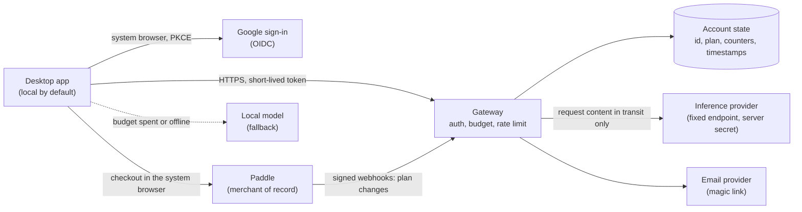

# StudentLLM Cloud plan

Status: planned, not implemented. This document is a decided product and engineering plan for an optional paid cloud tier. It is a draft for human review: every price, provider term and legal point marked "verify" must be rechecked against official sources before launch. No cloud code exists in this repository yet.

The related legal drafts are [terms-of-service.draft.md](./legal/terms-of-service.draft.md) and [privacy-policy.draft.md](./legal/privacy-policy.draft.md). Both need review by a qualified lawyer before any use.

## Principles

1. The local app is the product. Everything that works today keeps working offline, forever, for free.
2. Cloud is a separate, optional mode. It is off by default and never required.
3. Course content leaves the machine only after an explicit consent, only for the feature the user is using, and never otherwise.
4. The service keeps as little as possible: no content, no prompts, no answers. Only what is needed to run an account and a quota.
5. The service never makes the free app worse. No feature is removed from the free tier to sell it back.

This is consistent with [SECURITY.md](../SECURITY.md): local mode makes no implicit network request, and course data is private by default. The desktop app contacts the cloud service only after the user clicks **Sign in** or enables a cloud feature. There is no background ping, no telemetry, no "check my plan" request, and no update check tied to the account while cloud is off.

## Product tiers

| | Free | Plus |
| --- | --- | --- |
| Price | 0 | 6 EUR per month (VAT included), or a semester pass of about 25 EUR for 5 months |
| Local app (recording, import, notes, search, chat, study, export) | Full | Full |
| Local models, local ASR sidecar, local document sidecar | Yes | Yes |
| Bring your own provider key (a key the user owns) | Yes, free | Yes |
| Larger cloud models | No | Yes |
| Monthly token budget | Not applicable | Yes, with a visible meter |
| Cloud transcription and OCR | No | Yes |
| Encrypted backup and sync across devices | No | Yes |
| Ads | Never | Never |
| Overage charges | Not applicable | Never |

Decided points:

- The free tier is the full local app, with no ads and no feature removal. Bring-your-own-key stays free because the key and the cost belong to the user.
- There is no 2 EUR tier and there are no ads. The unit economics below explain why a tier that low does not work with a hard cost cap.
- A student discount is planned. Its price floor comes from the break-even computed in [Unit economics](#unit-economics); the verification method (for example a student-status provider or a school email domain) is an open item.
- The semester pass is a one-time payment for a fixed 5-month period that does not renew by itself (to confirm with the lawyer, see [open items](#open-items)).
- Budgets are monthly and do not roll over. When a budget is spent, the app falls back to the local model (see [Quota design](#quota-design)). Nothing is billed beyond the plan price.

## Architecture

A small separate service, the **gateway**, sits between the desktop app and one or more inference providers. It lives outside the app bundle. It will be documented first under a new top-level `cloud/` directory (design notes only, no code) and implemented from phase 2. Cloudflare Workers is the suggested host because it fits a small stateless service with per-user counters, but the design is provider-agnostic: the app speaks an OpenAI-compatible API to the gateway, and the gateway speaks OpenAI-compatible APIs upstream.

Components:

- **Desktop app.** Keeps its local-first behavior. A new "cloud" provider is one more OpenAI-compatible endpoint behind the existing provider adapter. The access token is held in memory; the refresh token is held in the operating system credential store, never in the workspace or in IndexedDB.
- **Gateway.** Verifies the session token, checks the plan and the monthly budget, applies a short rate limit, forwards the request to the routed model, streams the answer back, and records usage counters. It has no endpoint that returns stored content, because it stores none.
- **Account state.** A small store (for example Cloudflare D1 plus Durable Objects for atomic counters; the final choice is an open item). Rows hold only the fields listed in [Data flow](#data-flow-and-what-is-stored).
- **Auth module.** Part of the gateway. Verifies Google ID tokens, issues and verifies magic links, and mints session tokens.
- **Billing webhook.** A gateway route that verifies the Paddle signature and updates the plan in account state. The app never decides its own plan.
- **Backup store.** A separate, opt-in object store that holds only ciphertext produced on the device. See [Encrypted backup and sync](#encrypted-backup-and-sync).
- **Model routing table.** A configuration file mapping a logical model name to a provider, upstream model id, price weight and limits. Changing a model or provider is a config change and a deploy, not a code change.

The gateway must also be usable without the desktop app being updated: the app asks the gateway which logical models are available (`GET /v1/models`, authenticated) and shows those, so a model can be swapped server-side.

## Data flow and what is stored

Chat or note-formatting request with Plus enabled:

1. The app checks that cloud consent exists for this feature and that the user is signed in. If not, it does nothing and uses the local model.
2. The app sends the same minimal context it would send to a local model (retrieved passages and the question) to the gateway over HTTPS with the access token.
3. The gateway verifies the token, checks the rate limit, reserves a token estimate against the monthly budget, and forwards the request to the fixed upstream endpoint with the server-held provider key.
4. The answer streams back through the gateway to the app. The gateway settles the real usage reported by the provider into the counter.
5. The request and answer exist only in memory for the duration of the call.

| Data | Stored by the service | Notes |
| --- | --- | --- |
| Account id (random, opaque) | Yes | Primary key for everything else |
| Sign-in identifiers | Yes | Verified email address and the Google subject id when used; needed to sign the user in and to send the magic link |
| Plan and plan period | Yes | Set by Paddle webhooks; includes the Paddle customer and subscription ids |
| Usage counters | Yes | Credits used per month, request counts, per-feature counters; no content |
| Timestamps | Yes | Account creation, last sign-in, last request, consent version and time |
| Course content, transcripts, documents, audio, images | No | In transit only, never written |
| Prompts and model answers | No | In transit only, never written |
| Request and response bodies in logs | No | Forbidden by design, see [Security requirements](#security-requirements) |
| Backup ciphertext | Only if Plus backup is enabled | Encrypted on the device; the service cannot read it |

Operational logs keep a request id, account id, route, status code, credit count, latency and timestamp. They contain no content, no headers that carry tokens, and no query strings with user text. The network edge necessarily sees IP addresses and connection metadata; the privacy policy states this and its retention.

## Authentication

Sign-in methods: Sign in with Google (OpenID Connect) and an email magic link. No passwords are created or stored.

Desktop flow (system browser, PKCE, no embedded web view):

1. The user clicks **Sign in**. The app generates a PKCE `code_verifier` and `code_challenge`, a random `state`, and starts a loopback listener on `127.0.0.1` on an ephemeral port (or registers a deep link such as `studentllm://auth` where loopback is not possible).
2. The app opens the system browser on the gateway's `/auth/start` with the `code_challenge`, `state` and redirect URI. The user picks Google or enters an email.
3. Google path: the gateway runs the OIDC authorization code flow with Google, requesting only the `openid` and `email` scopes, and verifies the ID token (signature, issuer, audience, expiry, nonce).
4. Email path: the gateway emails a single-use link that expires after about 10 minutes and is bound to the same `code_challenge`, so the link only works to complete the sign-in that was started on that device. Requests are rate limited per address and per IP; the response is identical whether or not the address exists.
5. The gateway redirects to the loopback or deep-link URI with a short-lived authorization code and `state`. The app checks `state`, then exchanges the code plus the `code_verifier` for tokens at `/auth/token`.
6. Tokens: an access token valid for about 15 minutes (signed JWT, asymmetric key, `kid` in the header, verified from a published JWKS) and a rotating refresh token. Each refresh issues a new refresh token and invalidates the previous one; reuse of an old refresh token revokes the whole session family. Refresh tokens are bound to a device record and can be revoked from the account screen.
7. Sign-out deletes the refresh token from the credential store and revokes it server side.

Requirements: redirect URIs are matched exactly; loopback listeners accept one request and close; the authorization code is single use and valid for about 60 seconds; the app never logs tokens; no token or email address is placed in a URL that the app or the gateway logs.

## Quota design

- **Unit.** The meter is expressed in credits, not raw tokens, so that the user-visible budget stays stable when the model or provider changes. One credit equals a fixed amount of normalized cost, defined in the routing table from the input and output price of the routed model. Transcription minutes and OCR pages are converted to credits with their own weights.
- **Budget.** Each Plus account has a monthly credit budget, reset at the start of its billing period (UTC). The budget is a hard cap. The initial size is chosen from the conservative cost ceiling in [Unit economics](#unit-economics) and is a config value.
- **Reserve then settle.** Before forwarding, the gateway reserves an estimate (input tokens plus the capped maximum output tokens). After the response, it settles the provider-reported usage and releases the difference. Requests that would exceed the remaining budget are refused with a specific error code, not forwarded.
- **Limits per request.** Maximum input size, maximum output tokens, and a maximum request duration, all from the routing table.
- **Rate limit.** A short sliding window per account (for example 20 requests per minute, 2 concurrent requests) plus a per-IP limit on the unauthenticated auth endpoints. Values are config.
- **Atomicity.** Counters are updated atomically per account (one Durable Object or equivalent per account) so parallel requests cannot overspend.
- **Meter.** The gateway returns remaining credits in a response header and via `GET /v1/usage`. The app shows a usage meter at all times when cloud is on, and warns at 80% and 100%.
- **Fallback.** When the budget is spent, or the gateway is unreachable, the app switches automatically to the configured local model and tells the user plainly with a visible notice, once per episode. If no local model is available, the app says so and does not retry against the cloud. There is no overage charge and no way to buy extra credits in the first version.
- **Plan lapse.** If the plan ends, the account becomes a free account: the cloud features stop, and the local app is unchanged. Backup data follows the retention rule in the privacy policy, with a period during which the user can download or delete it.

## Provider strategy

Rule: production traffic must use an inference provider whose contract allows commercial use. Prices and model availability change often; they must be rechecked on each provider's official pricing, models and terms pages before launch and again at every routing change. Anything below about prices is unverified.

- **NVIDIA NIM.** The free API catalog at `integrate.api.nvidia.com` is a trial offer and is not for production use. Several keys must not be combined or rotated to multiply rate limits; doing so would circumvent the terms and is excluded explicitly. NIM stays limited to development (the opt-in dev provider described in [providers.md](./providers.md)) and to users who bring their own key. It is never put behind the paid gateway.
- **First production model: `gpt-oss-120b` on Groq**, listed there as a production model (verify at launch). Third-party trackers list gpt-oss-120b at around $0.15 per million input tokens and $0.60 per million output tokens on several providers; this is unverified and is used only for sizing.
- **Qwen.** Qwen is the preferred model family, but the only Qwen model listed on Groq is a preview model (reported as Qwen 3.8 27B, verify the exact name). Preview models can be discontinued at short notice, so it cannot be the production base. Plan: add a Qwen option on a provider that lists a Qwen model as a production model, after reading that provider's current commercial terms, data retention and training policy. Until then Qwen stays available through local models.
- **Provider checklist** before a provider enters the routing table: commercial use allowed; no training on customer data; documented retention (zero or minimal) for API requests; data processing agreement available; processing region and transfer mechanism known; OpenAI-compatible API; stable production model status; published rate limits compatible with the expected load; acceptable uptime history.
- **Routing is configuration.** A table maps logical model names (for example `studentllm-large`, `studentllm-fast`) to provider, upstream model id, credit weights, limits and an ordered fallback list. Moving traffic between providers needs no app release.
- **Failover.** If the primary provider fails or rate limits the gateway, the gateway may try the next provider in the table only if that provider also passed the checklist and appears in the processor list of the privacy policy. Otherwise it returns an error and the app falls back to the local model.
- **Cloud transcription and OCR.** Same rules. The provider and model are chosen in phase 2; audio and images are forwarded in transit only, with the same no-storage guarantee. Candidate models and prices are not decided here.

## Payments

**Paddle as merchant of record.** Paddle is the seller of record toward the customer: it collects payment, computes and remits EU VAT and other sales tax, and issues invoices. This is the main reason it was chosen for a solo founder. Paddle's fee is reported as about 5% plus $0.50 per transaction (verify the current schedule and what the percentage applies to).

Why not the alternatives: Lemon Squeezy is moving under Stripe, which makes its future terms and product shape uncertain, and Polar's pricing is unclear. The choice is revisited if the fees hurt (see [Risks](#risks)).

Flow:

1. The signed-in user chooses a plan in the app. The app opens the Paddle checkout in the system browser, passing only the opaque account id as custom data. No payment details ever pass through the app or the gateway.
2. Paddle sends signed webhooks (subscription created, updated, canceled, paused, past due; transaction completed or refunded). The gateway verifies the signature, deduplicates by event id, and updates the plan and period in account state. Webhook handling is idempotent.
3. The app learns the plan from the gateway at the next token refresh or on demand.
4. Cancellation and invoices are handled through Paddle's customer portal, linked from the account screen. A cancellation takes effect at the end of the paid period.
5. The service starts with a sandbox environment and live mode is switched on only after the end-to-end test in phase 3.

The service stores no card data and no billing address. Only the Paddle customer and subscription ids and the plan status are kept.

## Encrypted backup and sync

This is a distinct, separately consented Plus feature, because it is the only one that stores user-derived data on the service. It does not change the guarantee that the inference path stores nothing.

- Data is encrypted on the device before upload with a key derived from a secret that the service never sees. The service stores opaque ciphertext blobs and their sizes and timestamps.
- Sources, transcripts and notes are never uploaded unless the user turns backup on, and the user can choose which courses sync. A course marked "never cloud" is excluded from backup and from all cloud requests.
- Key handling (a recovery phrase shown once, loss means loss of the backup) is an open design item to settle before phase 2 exit; the first version must not offer server-side key escrow.
- Deleting the account deletes the ciphertext. The user can also delete the backup alone.
- Encrypted data can still be personal data under GDPR if the user can be identified; the privacy policy treats the ciphertext as personal data and states the retention.

## Security requirements

These are release criteria for the gateway, not suggestions.

**Secrets**
- Provider keys, the Paddle webhook secret, the email provider key, the Google client secret and the token signing key exist only as server secrets (for example Workers secrets). They are never in the repository, the app bundle, a log, or an environment file checked in.
- Separate secrets per environment (staging, production). Rotation procedure documented and rehearsed. The signing key supports rotation through `kid` and a JWKS with overlap.
- No secret is returned by any endpoint. Secret-bearing headers are stripped from logs.

**No content in logs**
- A logging policy test in CI fails if a log call can receive request bodies, response bodies, prompts or transcripts. Error reports must be scrubbed. Provider error messages are mapped to fixed error codes before they are logged or returned.
- Analytics and tracing that capture bodies are disabled. Cloud platform features that persist request payloads (full request logging, replay, tail sampling of bodies) stay off, and this is checked at each deploy.

**Upstream safety (SSRF)**
- The gateway forwards only to a fixed allowlist of upstream endpoints from the routing table. The client never supplies a URL, host, path prefix or header that reaches the upstream. Only an allowlisted set of routes (`/v1/chat/completions`, `/v1/models`, the audio and OCR routes) is exposed, with schema-validated bodies. Redirects from upstream are not followed.
- The app-side cloud provider ignores any user-set base URL for the paid gateway, mirroring the way the dev NVIDIA route is pinned in [providers.md](./providers.md).

**Abuse and fraud limits**
- Per-account monthly budget (hard), short-window rate limit, concurrency limit, per-request size and output caps.
- Per-IP and per-address limits on sign-in and magic-link endpoints; generic responses to avoid account enumeration; cooldown after repeated failures.
- Limits on the number of devices and active sessions per account, and anomaly detection on usage (many sessions, impossible geography, sustained budget exhaustion at the start of every period) with temporary suspension and a support path.
- Disposable email address handling and sign-up rate limits to reduce free-account farming (only matters once any free cloud allowance exists; the first version has none).
- Chargeback and refund events from Paddle revoke the plan automatically. Account sharing is addressed in the terms and by the device limit.
- A kill switch per provider and per feature in config, usable without a deploy.

**Token handling**
- Short-lived access tokens, rotating refresh tokens with reuse detection, revocation list checked on refresh, device-bound sessions.
- Tokens are stored in the OS credential store, not in the web storage of the app.
- All endpoints require TLS; HSTS on the gateway domain; strict CORS limited to the app origins; no cookies for the API.

**Other**
- Dependencies pinned and scanned. Minimal third-party code in the gateway.
- A vulnerability disclosure route consistent with [SECURITY.md](../SECURITY.md) applies to the cloud service; SECURITY.md will be updated in phase 4 to describe the optional cloud mode without weakening the local-mode statements.
- Data deletion on account closure is automatic and verified by a test.

## Privacy and consent UX

Cloud is off by default. The first time a user turns it on (or tries a cloud feature), a consent screen appears before any request leaves the machine. It is not a cookie-banner pattern and has no pre-ticked box.

The screen states in plain language:

- what is sent for each feature: chat (the question and the retrieved passages from the course), note formatting (the transcript or document text being formatted), study material (the same), cloud transcription (the audio), OCR (the page or image), backup (encrypted files);
- who receives it: the StudentLLM gateway, then the named inference provider, shown by name and region once known;
- what the service keeps (account id, plan, usage counters, timestamps) and what it does not keep (the content, the prompts and the answers);
- that the provider receives the content in transit to produce the answer, and under which retention terms;
- that cloud use is optional, can be turned off at any time, and that the app then goes back to purely local behavior;
- links to the terms and the privacy policy.

Controls and behavior:

- Consent is per feature (chat and notes, transcription and OCR, backup), and a course can be marked "never cloud" at any time.
- A **What will be sent** preview shows the exact payload (the passages and the question) before the first request, and an inspector is available later from the request details of each answer.
- While cloud is in use, the interface shows a persistent cloud indicator and the usage meter. Each answer states whether it came from a cloud or a local model.
- Consent is stored locally with its version and time, and the version and time are also recorded with the account. A new provider, a new category of data or a material change in the policy requires consent again.
- Turning cloud off, signing out, or deleting the account is available from the account screen. Withdrawal is as easy as consent.
- Fallback notices are explicit: "Your monthly cloud budget is used up. Using your local model until <date>." The app never silently switches a free user's content to a cloud model.
- A first-run user who never clicks Sign in never makes a network request to the service.

## Unit economics

All figures are rough, rounded, and based on unverified numbers (Paddle fee reported at about 5% + $0.50 per transaction; gpt-oss-120b at about $0.15 / $0.60 per million input / output tokens on third-party trackers; $1 taken as about 0.90 EUR). They size a conservative budget; they do not replace a real model with real prices at launch. Not included: fixed costs, the company's own taxes and social charges, support time, currency effects, refunds, and the Paddle fee on refunds.

**Monthly subscription, 6 EUR VAT included**

| Line | Amount |
| --- | --- |
| Price paid by the customer | 6.00 EUR |
| VAT at 20% (6.00 / 6) | 1.00 EUR |
| Price excluding VAT | 5.00 EUR |
| Paddle fee: 5% of 6.00 EUR (0.30) + $0.50 (about 0.45) | about 0.75 EUR |
| Net revenue after VAT and payment fee | about 4.25 EUR |

The fee takes about 12.5% of the gross price, a meaningful share because the fixed $0.50 weighs more on a small price. VAT may differ per customer country (Paddle applies the rate of the buyer's country), so the net varies a little.

**Worst-case variable cost per Plus user per month (budget fully used)**

| Line | Amount |
| --- | --- |
| Chat and notes: 3M input + 0.6M output tokens at $0.15 / $0.60 per million (about $0.81) | about 0.75 EUR |
| Cloud transcription and OCR reserve (to be priced in phase 2) | about 0.50 EUR |
| Gateway, state, email, backup storage (assumed) | about 0.25 EUR |
| Total ceiling | about 1.50 EUR |

The monthly credit budget is set so that a user who spends all of it costs at most about this ceiling. Because the budget is a hard cap and there is no overage, the worst case is bounded; a typical student will use much less.

**Contribution at the ceiling:** about 4.25 - 1.50 = 2.75 EUR per user per month, before fixed costs and the company's taxes.

**Semester pass, 25 EUR for 5 months:** fee about 1.25 + 0.45 = 1.70 EUR once; VAT about 4.17 EUR; net about 19.1 EUR, or about 3.8 EUR per month. At the 1.50 EUR ceiling the contribution is about 2.3 EUR per month. Only one payment fee applies, which is why the pass is cheaper per month for the customer yet healthy for the company.

**Price floor.** With a fixed $0.50 fee, net revenue for a gross monthly price P is about 0.783 x P - 0.45 EUR. Covering the 1.50 EUR ceiling needs P of about 2.5 EUR, with no margin and no fixed costs. That is why a 2 EUR tier is not offered, and why the student discount must stay above a floor (about 4 EUR gross keeps roughly 1.2 EUR of contribution at the ceiling). The discount level is an open item.

**Break-even by user count** depends on fixed costs not yet known (domain, email, legal, accounting, monitoring, support). It is computed in phase 3 once real costs exist.

## Risks

| Risk | Impact | Mitigation |
| --- | --- | --- |
| Provider terms change or forbid the intended use | Service interruption, rework | Provider checklist, contract review before launch, more than one provider in the routing table, local fallback |
| Preview model churn (a preview model is withdrawn at short notice) | Broken model option | Only production models in the default routing; previews are never the base; model swap by config |
| NIM trial misuse | Terms violation, account ban | NIM kept to development and bring-your-own-key only; no key pooling or rotation to multiply limits |
| Abuse and account farming | Cost spike | Hard per-user budget, rate and concurrency limits, device limits, anomaly alerts, kill switch |
| Cost spike from provider price increases | Margin loss | Budget in credits tied to the routing table; re-weight credits or change model by config; global spend alarm and cap |
| Payment fees too high for a 6 EUR price | Thin margin | Semester pass reduces per-transaction fees; revisit the provider choice (Paddle alternatives) if fees hurt |
| Lemon Squeezy and Polar uncertainty | Limited alternatives | Billing logic isolated behind one webhook module; plan data portable |
| GDPR: content in transit to a provider and a possible transfer outside the EU | Regulatory exposure | Consent screen, DPAs with all processors, transfer mechanism per processor, no storage, minimal retention, lawyer review, DPIA decision |
| Backup stores ciphertext of student data | Treated as personal data | Client-side encryption, separate consent, no escrow, deletion on request |
| Minors using the service | Consent and capacity rules | Minimum age in the terms (15 in France for data consent, verify), parental consent path to decide |
| Academic integrity concerns | Reputation | Terms place responsibility on the user; the app keeps source citations; no claim to bypass school rules |
| Outage of the gateway or provider | Degraded experience | Automatic local fallback, status communication, no hard dependency on cloud |
| Solo founder load (support, security, incidents) | Quality risk | Narrow scope, staging, runbook, private beta before launch |
| Consumer law mistakes (withdrawal right, renewal information, mediation) | Fines, refunds | Lawyer review; Paddle handles invoicing and VAT but the terms and consumer information remain the company's duty |

## Rollout phases

Each phase has an exit criterion. A phase does not start the next one until its criterion is met.

| Phase | Scope | Exit criterion |
| --- | --- | --- |
| 0. Local 0.1.0 | Ship the local, free app (in progress; see [status.md](./status.md)) | `v0.1.0` tagged with the draft release published and the local app verified; no cloud code in the app |
| 1. Design and legal review | This plan finalized; terms and privacy policy reviewed by a lawyer; provider contracts read; company details filled; DPIA decision made | Reviewed legal documents with all placeholders resolved; provider checklist passed for the first production model; written decision on the open items marked blocking |
| 2. Gateway and private beta | Build the gateway with auth, quotas, rate limits, routing table and a staging environment; no billing; a few invited users on a manual allowlist | Security requirements met and tested (logging test, SSRF test, token refresh and reuse tests); cost per user measured against the ceiling for four weeks; budget fallback verified; no content in any log confirmed by audit |
| 3. Billing | Paddle in sandbox, then live: checkout, webhooks, plan changes, cancellation, refunds | Sandbox end-to-end passes (purchase, renewal, cancel, refund, chargeback, failed payment); first live transaction processed and reconciled; unit economics recomputed with real fees and costs |
| 4. Desktop UI | Account screen, consent screen, usage meter, local fallback, "never cloud" per course, README, SECURITY.md and provider docs updated | A user can sign in, consent, use a cloud answer, see the meter, hit the budget, and fall back to the local model; a user who never signs in makes no request to the service (verified by test); accessibility checks pass |
| 5. Public launch | Open sign-up, public pricing page, support route, status page | Phase 4 criteria hold in production; terms and privacy policy published and linked in the app; monitoring and spend alarms active; a rollback and kill-switch drill completed |

## Open items

Blocking before phase 2:
- Choose the legal entity details, hosting region and email provider; fill every placeholder in the legal drafts.
- Lawyer review of the terms and the privacy policy, including the right of withdrawal, the semester pass renewal, the minimum age, the DPIA question and the legal basis for in-transit content.
- Confirm the first production provider's commercial terms, data retention and training policy, DPA, and processing region; confirm `gpt-oss-120b` is still listed as a production model.
- Decide the account state store and the exact fields stored (including whether the sign-in email is stored in clear or protected beyond platform encryption).
- Decide the key and recovery design for encrypted backup.

Before phase 3:
- Verify Paddle's fee schedule, what the percentage applies to, payout currency, refund and chargeback costs, and its seller-of-record terms for digital services to consumers.
- Decide the student discount level and verification method.
- Confirm whether the semester pass renews automatically (current plan: it does not).

Before phase 4:
- Choose cloud transcription and OCR providers and price them in credits.
- Choose a Qwen production option and its provider after reading current terms.
- Decide retention periods for logs and usage counters.
- Decide how bring-your-own-key keys are stored in the packaged app (the OS credential store) and which providers are offered in the packaged build.
- Update README, SECURITY.md and [providers.md](./providers.md) to describe the cloud mode.

Ongoing:
- Recheck prices and model availability on providers' official pages before launch and at each change.
- Decide the support channel and response commitments.
- Decide whether to publish the gateway design or source (the app stays MIT regardless).
